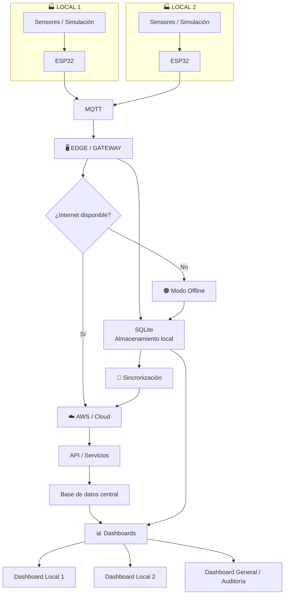
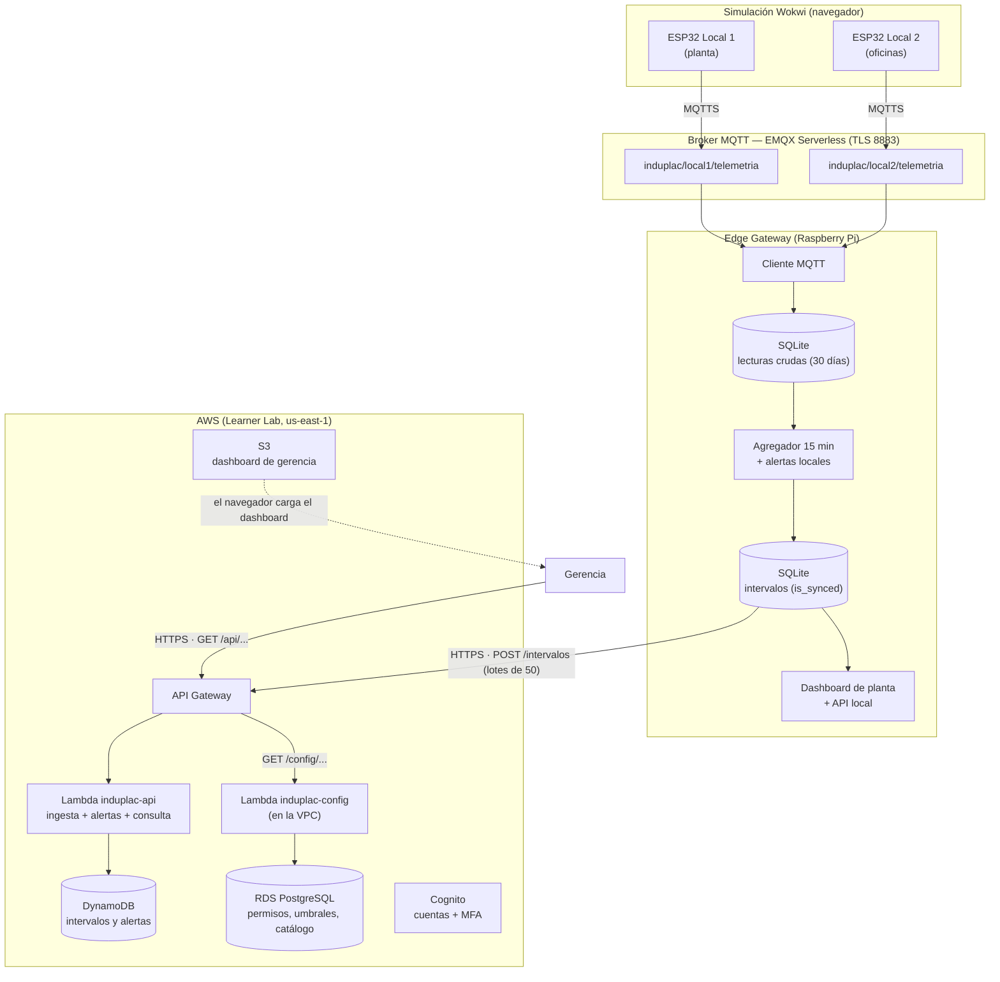
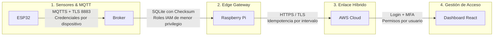

# 🏭 Induplac IoT

## Plataforma IoT para el monitoreo energético y operacional

### *Datos que permiten visualizar, comparar y anticipar.*

<br>


</div>

---

> 🧭 **¿Te perdiste cambios o no manejas algún tema?** Lee la **[Guía del Equipo](docs/GUIA-EQUIPO.md)**: explica todo el proyecto en simple y trae las preguntas típicas del profe con cómo responderlas.
>
> 📌 La versión vigente de las decisiones está en **[docs/CONTEXTO.md](docs/CONTEXTO.md)**. Si algo de este README no coincide, manda CONTEXTO.
>
> 🚧 **¿Vas a trabajar en algo?** Revisa y reserva la tarea en **[docs/EN-CURSO.md](docs/EN-CURSO.md)** antes de empezar, para no rehacer trabajo de otro. Las IA deben seguir **[AGENTS.md](AGENTS.md)**.

---

## 📋 Información del proyecto

| Información | Detalle |
|---|---|
| **Proyecto** | Induplac IoT |
| **Asignatura** | Problemáticas Globales y Prototipado |
| **Sección** | 002V |
| **Docente** | Marco Antonio Perelli |
| **Institución** | Duoc UC |
| **Fase** | Prototipo / MVP |
| **Contexto** | Empresa real |
| **Datos utilizados** | Ficticios |
| **Arquitectura** | IoT + Edge + Cloud |
| **Conectividad** | Online + Offline |
| **Simulación** | Wokwi (demo 100 % en Wokwi, decidido el 2026-10-14) |

### 👥 Equipo

- Abraham Castro Romero
- Sebastián Fuentes Cortés
- Lisandra González Hernández
- Felipe Murúa Lobos
- Bárbara Saavedra Fernández

---

# 📖 1. Sobre el proyecto

**Induplac IoT** es una propuesta de plataforma para centralizar información energética y operacional de dos locales de una empresa, permitiendo visualizar el estado actual, detectar situaciones anómalas y comparar el comportamiento histórico.

El proyecto utiliza a **Induplac como empresa real de referencia**, pero durante esta etapa se trabajará exclusivamente con **datos ficticios y simulados**.

El objetivo del prototipo es demostrar cómo una arquitectura IoT podría recopilar información desde distintos puntos, procesarla localmente, almacenarla y finalmente visualizarla mediante dashboards.

> ⚠️ Este proyecto no representa datos reales de Induplac ni implica acceso a sus sistemas internos. Los datos utilizados durante el desarrollo y demostración son ficticios.

---

# 🎯 2. Objetivo

Desarrollar un prototipo de plataforma IoT capaz de centralizar información energética y operacional de **dos locales**, permitiendo:

- Monitorear el consumo eléctrico.
- Monitorear el consumo de agua.
- Visualizar producción.
- Visualizar horas sin incidentes (HH).
- Visualizar índice UV.
- Detectar condiciones que requieran atención.
- Comparar períodos históricos.
- Visualizar información de cada local.
- Obtener una visión general mediante un dashboard de auditoría.
- Mantener funcionamiento básico ante una pérdida de conexión a Internet.
- Sincronizar los datos almacenados localmente cuando vuelva la conectividad.

---

# 🌐 3. Problema

La información energética y operacional puede encontrarse distribuida en diferentes fuentes, dificultando obtener una visión rápida del estado de una instalación.

La propuesta busca centralizar estas variables en una plataforma que permita responder preguntas como:

> **¿Cómo está funcionando actualmente cada local?**

> **¿El consumo está aumentando respecto al período anterior?**

> **¿Existe alguna condición que requiera atención?**

> **¿Cómo se está comportando un local respecto a otro?**

> **¿Qué ocurrió durante la última semana o mes?**

---

# 💡 4. Solución propuesta

La solución utiliza una arquitectura híbrida compuesta por:

```text
Sensores / Simulación
        ↓
      ESP32
        ↓
       MQTT
        ↓
   Edge / Gateway
        ↓
      SQLite
        ↓
 ┌──────┴──────┐
 │             │
Internet     Sin Internet
 │             │
 ▼             ▼
AWS           SQLite
 │             │
 └──────┬──────┘
        ↓
   Sincronización
        ↓
    Dashboards
```

La arquitectura está diseñada para que el sistema pueda continuar recopilando información aunque exista una interrupción temporal de Internet.

---

# 🏗️ 5. Arquitectura general



---

# 🔄 6. Flujo de datos

## 🟢 Modo Online

Cuando existe conexión a Internet:

```text
ESP32
  ↓
MQTT
  ↓
Edge
  ↓
SQLite local
  ↓
AWS
  ↓
Base de datos
  ↓
Dashboard
```

El Edge conserva una copia local del dato antes de enviarlo a la nube.

---

## 🟠 Modo Offline

Si se pierde Internet:

```text
ESP32
  ↓
MQTT
  ↓
Edge
  ↓
SQLite
  ↓
Dashboard local
```

Los datos se mantienen localmente hasta que pueda volver a establecerse la conexión.

---

## 🔵 Sincronización

Cuando vuelve Internet:

```text
Internet vuelve
      ↓
Edge detecta conexión
      ↓
SYNCING
      ↓
Obtiene registros pendientes
      ↓
Envía información a AWS
      ↓
AWS confirma recepción
      ↓
Registros marcados como sincronizados
      ↓
ONLINE
```

### Estados del sistema

| Estado | Significado |
|---|---|
| 🟢 **ONLINE** | Sistema conectado y sincronizado |
| 🟠 **OFFLINE** | Sin conexión a Internet |
| 🔵 **SYNCING** | Enviando información pendiente |
| 🔴 **ERROR** | Existe un problema que requiere revisión |

---

# 📊 7. Variables monitoreadas

| Variable | Descripción |
|---|---|
| ⚡ **Electricidad** | Consumo energético |
| 💧 **Agua** | Consumo de agua |
| 🏭 **Producción** | Indicadores de producción |
| 🦺 **HH** | Horas sin incidentes |
| ☀️ **UV** | Índice UV y condición de riesgo |

Los datos de electricidad y agua están planteados con una frecuencia de medición de 15 minutos, mientras que los indicadores operacionales se consideran de actualización diaria.

---

# 🚨 8. Sistema de alertas

## ⚡ Electricidad

Se considera una condición de alerta cuando el consumo horario supera en más de un **20 %** el promedio correspondiente de las cuatro semanas anteriores **en el mismo horario**.

Mientras no existan 4 semanas de historia se usa un umbral fijo de respaldo: normal < 45 kW, advertencia 45–55 kW, crítico > 55 kW.

```text
Consumo actual
      ↓
Comparar con histórico
      ↓
¿Supera +20%?
   ↙       ↘
 NO        SÍ
 ↓          ↓
Normal    ⚠ ALERTA
```

## 💧 Agua

Umbral diario por local (valores ficticios de referencia, definidos el 2026-10-14):

| Local | Normal (día hábil) | 🟡 Advertencia | 🔴 Alerta | Posible fuga (22:00–06:00 o fin de semana) |
| :--- | :---: | :---: | :---: | :--- |
| **Local 1 (Planta)** | ~10 m³/día | > 12 m³/día | > 14 m³/día | Caudal > 0,3 m³/h sostenido 1 hora |
| **Local 2 (Oficinas)** | ~1,5 m³/día | > 2 m³/día | > 2,5 m³/día | Caudal > 0,05 m³/h sostenido 1 hora |

## ☀️ UV

Un índice UV de **8 o superior** se considera una condición de riesgo para personal expuesto al exterior. Entre 6 y 7,9 se muestra en amarillo como recomendación de protector y sombra.

> Las alertas se evalúan en **dos niveles** (ADR-06): en el Edge, para que la planta reciba alertas también sin internet, y en AWS (Lambda). Cada alerta se identifica por `local + variable + inicio_intervalo`, así nunca se duplica.

---

# 🖥️ 9. Dashboards

La plataforma tendrá **tres dashboards funcionales**:

```text
                    INDUPLAC IoT
                         │
          ┌──────────────┴──────────────┐
          │                             │
      MONITOREO                      AUDITORÍA
          │                             │
    ┌─────┴─────┐                 Dashboard General
    │           │
 Local 1      Local 2
```

---

## 🏭 Dashboard — Local 1

Muestra el estado actual del primer local:

- Electricidad.
- Agua.
- Producción.
- HH.
- UV.
- Alertas.
- Estado de conexión.
- Estado de sensores.
- Última sincronización.
- Registros pendientes.

### Diseño visual base

```text
┌─────────────────────────────────────────────────────────────┐
│ INDUPLAC · LOCAL 1                    🟢 ONLINE              │
├─────────────────────────────────────────────────────────────┤
│                                                             │
│  ⚡ ELECTRICIDAD       💧 AGUA          🏭 PRODUCCIÓN        │
│                                                             │
│      50 kW             1.250 L            132 / 1.240       │
│      ⚠ +25%            ✓ NORMAL            MES / AÑO        │
│                                                             │
├─────────────────────────────────────────────────────────────┤
│                                                             │
│  🦺 HH SIN INCIDENTES                ☀ ÍNDICE UV             │
│                                                             │
│       45.320                           8 ⚠ ALTO              │
│                                                             │
├─────────────────────────────────────────────────────────────┤
│                                                             │
│              ⚡ CONSUMO ELÉCTRICO                           │
│                  [ GRÁFICO ]                               │
│                                                             │
├─────────────────────────────────────────────────────────────┤
│                                                             │
│ ⚠ ALERTAS ACTIVAS                                           │
│                                                             │
├─────────────────────────────────────────────────────────────┤
│ 🟢 SISTEMA   Internet ✓   AWS ✓   ESP32 ✓                  │
│ Última sincronización: 13:58     Pendientes: 0              │
└─────────────────────────────────────────────────────────────┘
```

---

## 🏭 Dashboard — Local 2

Utiliza la misma estructura visual y funcional del Local 1, mostrando exclusivamente la información correspondiente al segundo local.

Esto permite mantener una interfaz consistente entre ambos puntos.

---

# 🏢 10. Dashboard General / Auditoría

El Dashboard General tendrá una función diferente.

No solamente mostrará datos actuales, sino que permitirá obtener una **visión consolidada de ambos locales**.

### Información principal

```text
⚡ Energía total
💧 Agua total
🏭 Producción
🦺 HH
☀️ UV
🚨 Alertas
🟢 Estado de locales
```

También permitirá comparar períodos históricos.

---

# 📅 11. Comparación histórica

La plataforma contará con un selector de período:

```text
┌─────────────────────────────┐
│ PERÍODO                     │
│                             │
│ [ Día ▼ ]                   │
└─────────────────────────────┘
```

Opciones:

- Día.
- Semana.
- Mes.

El período de comparación se adaptará a la selección.

### Ejemplo: Día

```text
Hoy
vs.
Día anterior
```

### Ejemplo: Semana

```text
Esta semana
vs.
Semana anterior
```

### Ejemplo: Mes

```text
Este mes
vs.
Mes anterior
```

También se podrá utilizar un promedio histórico cuando corresponda.

---

# 📈 12. Tabla comparativa

Una de las funciones principales será una tabla que permita analizar ambos locales.

| Local | Período actual | Período anterior | Variación | Estado |
|---|---:|---:|---:|---|
| Local 1 | 50 kW | 42 kW | +19 % | ⚠️ |
| Local 2 | 48 kW | 47 kW | +2 % | 🟢 |

La misma estructura podrá utilizarse para:

- Electricidad.
- Agua.
- Producción.
- HH.
- Otros indicadores disponibles.

El usuario podrá cambiar entre día, semana y mes sin necesitar una pantalla independiente para cada análisis.

---

# 📡 13. Calidad y antigüedad de los datos

El dashboard también indicará qué tan reciente es cada dato.

### Dato actualizado

```text
⚡ 50 kW

🟢 Actualizado
Última lectura: hace 15 segundos
```

### Dato antiguo

```text
⚡ 50 kW

🟠 Último dato conocido
Última lectura: hace 37 minutos
```

### Sin información

```text
⚡ --

🔴 SIN DATOS
Última lectura: hace 3 horas
```

Esto evita interpretar un dato antiguo como si fuera una medición actual.

---

# 🧪 14. Simulación IoT con Wokwi y Flujo de Comunicación

La **demo es 100 % en Wokwi** (sin hardware físico). Cada ESP32 simulado emula los sensores de su local, se conecta a internet por la red virtual de Wokwi (`WiFi.begin("Wokwi-GUEST", "")`) y publica su telemetría en el broker MQTT de la simulación.

### Broker MQTT de la simulación

| Dato | Valor |
| :--- | :--- |
| Servicio | **EMQX Serverless** (plan gratuito, *spend limit* 0) |
| Puerto | **8883** (MQTT sobre TLS); 8084 (WebSocket TLS) para pruebas |
| Usuarios | Uno por dispositivo: `esp32-local1`, `esp32-local2`, `edge-local1`, `edge-local2` |
| Topics | `induplac/local1/telemetria` · `induplac/local2/telemetria` (QoS 1) |

> En el diseño real el broker vive **dentro de la planta** (Mosquitto en la Raspberry Pi). En la simulación va en la nube porque Wokwi corre en el navegador y no alcanza una red local. Detalle completo en [`docs/broker-mqtt.md`](docs/broker-mqtt.md).

### Mapeo de Sensores en Wokwi
- **Electricidad (kW):** potenciómetro analógico que simula un transformador de corriente (sensor CT SCT-013).
- **Consumo de agua (m³):** generador de pulsos que simula un caudalímetro de turbina tipo YF-S201.
- **Radiación solar (UV):** sensor analógico que simula un fotodiodo UV con escala UVI 0–12.

### Formato de Telemetría (Payload JSON MQTT)

Un mensaje por local cada 5 segundos. Ejemplo del Local 1:

```json
{
  "device_id": "esp32-local-01",
  "seq": 10452,
  "ts": 1759874400,
  "energia_kw": 42.7,
  "agua_m3_acum": 1532.418,
  "agua_m3h": 3.2,
  "uv_index": 5.4,
  "produccion_acum": 312,
  "personal_activo": 18
}
```

- `device_id + seq` identifica cada lectura: el Edge descarta reenvíos duplicados.
- `ts` en hora UTC, sincronizada por NTP.
- El Local 2 no envía UV ni producción, y separa la energía en climatización e iluminación.

---

# 📴 15. Arquitectura Híbrida y Sincronización Cloud (Edge ↔ AWS ↔ Dashboard)

> Regla general: **el Edge filtra, guarda, agrega y alerta; AWS consolida, compara y decide.** Registro formal en [`docs/decisiones-tecnicas.md`](docs/decisiones-tecnicas.md) (ADR-01 a ADR-10).



### Qué sube a la nube

Solo **intervalos de 15 minutos agregados y validados**, nunca la lectura cruda (ADR-05): promedio de electricidad y agua, máximo de UV, producción y HH. Cada intervalo se identifica por `local + inicio_intervalo` y se guarda con *upsert*: reenviarlo no lo duplica.

### Estados Operacionales del Sistema

1. **🟢 Online:** el Edge guarda, agrega y sube los intervalos casi de inmediato (pendientes ≈ 0). La planta lee el Edge; gerencia lee AWS.
2. **🔴 Offline (cae el enlace a AWS):** el ESP32, el broker local, el Edge y el **dashboard de planta siguen funcionando igual**, con datos en tiempo real y alertas locales. Solo cambia el indicador a `🔴 OFFLINE`. Los intervalos se acumulan en SQLite con `is_synced = 0`. Gerencia ve el local como desconectado, con su último dato.
3. **🟡 Sincronizando:** al volver la conexión, el Edge sube los pendientes en lotes de 50, en orden cronológico, y las alertas generadas offline se actualizan en la nube **sin duplicarse**. Con 0 pendientes vuelve a `🟢 ONLINE`.

> **Conectividad:** en el diseño, el Edge llega a AWS por una **VPN Site-to-Site IPsec** hacia una API Gateway privada. En el MVP la VPN queda documentada y no se demuestra (2026-10-14): la demo usa HTTPS contra una API Gateway pública. Detalle en [`docs/modo-offline.md`](docs/modo-offline.md) e [`infrastructure/README.md`](infrastructure/README.md).

### Contrato entre el dashboard y la API

El dashboard usa la misma API en planta (Edge) y en la nube (AWS), definida en [`docs/api-dashboard.md`](docs/api-dashboard.md). Por eso **el mismo build** funciona en los dos lugares.

---

# 🔐 16. Ciberseguridad (Estrategia de Defensa en 5 Capas)

La seguridad no se aborda como un complemento tardío, sino como una propiedad estructural del diseño híbrido:



### Las 5 Capas de Protección

1. **Capa 1 — Dispositivos y Protocolo MQTT:**
   - **MQTTS con TLS (Puerto 8883):** Canal cifrado en la red local.
   - **Autenticación por dispositivo:** Credenciales individuales para cada ESP32; se rechazan conexiones anónimas.
   - **Validación de límites físicos:** El Gateway descarta lecturas incoherentes (ej. $kW < 0$ o $kW > 500$) para neutralizar inyecciones de datos.

2. **Capa 2 — Gateway Edge (Raspberry Pi & SQLite):**
   - **Zero Hardcoding:** Credenciales de AWS y broker almacenadas exclusivamente en `.env` (excluido de Git mediante `.gitignore`).
   - **Mínimo privilegio:** en el diseño, credenciales IAM acotadas a la ingesta. En el MVP (el Learner Lab no permite crear usuarios IAM) la ingesta se protege con una clave compartida en la cabecera `x-induplac-key`.
   - **Integridad local:** Hashes de control para detectar adulteración manual de la base de datos SQLite mientras opera offline.

3. **Capa 3 — Sincronización y Enlace Cloud:**
   - **Idempotencia:** cada intervalo se identifica por `local + inicio_intervalo` y cada alerta por `local + variable + inicio_intervalo`; reenviar no duplica.
   - **Canal seguro:** Transporte exclusivo mediante HTTPS / TLS 1.3.

4. **Capa 4 — Control de Acceso en Dashboard:**
   - **Login obligatorio** para ver el dashboard, con o sin internet (ADR-09).
   - **Clave temporal** creada por el Administrador y **cambio obligatorio** en el primer ingreso; nadie puede ver la clave personal.
   - **Permisos por usuario:** el rol es una plantilla que el Administrador ajusta.
   - **MFA (Microsoft Authenticator)** obligatorio para quien tenga permisos de modificación.

| Rol (plantilla) | Ver su sede | Ver ambas sedes e histórico | Reconocer alertas | Umbrales y usuarios | MFA |
| :--- | :---: | :---: | :---: | :---: | :---: |
| **Operario** | ✅ | ❌ | ❌ | ❌ | No |
| **Jefe de Mantenimiento/Operaciones** | ✅ | ✅ | ✅ | ❌ | Sí |
| **Administrador** | ✅ | ✅ | ✅ | ✅ | Sí |

5. **Capa 5 — Privacidad y Cumplimiento Normativo (Ley 19.628 - Chile):**
   - Las métricas de Horas Hombre (HH) son estrictamente agregadas y anónimas (ej. `trabajadores_activos: 12`, `hh_turno: 96`).
   - No se almacenan nombres, RUTs ni datos personales de los colaboradores de Induplac.

> 📖 Consulta la documentación técnica completa en [**`docs/ciberseguridad.md`**](docs/ciberseguridad.md).

---

# 🗂️ 17. Estructura del repositorio

```text
Induplac/
│
├── README.md
├── AGENTS.md · CLAUDE.md · GEMINI.md   ← reglas para asistentes de IA
├── CONTRIBUTING.md
│
├── docs/
│   ├── CONTEXTO.md            ← fuente de verdad de las decisiones
│   ├── EN-CURSO.md            ← tablero: quién hace qué
│   ├── notas-de-avance.md     ← bitácora de sesiones
│   ├── GUIA-EQUIPO.md         ← el proyecto explicado en simple
│   ├── NOTA-2.md              ← pauta de la Nota 2
│   ├── roles-raci-gantt.md    ← roles, RACI y Carta Gantt (+ Excel en nota-2/)
│   ├── scrum-pmi.md · cloud-tecnologias.md · conclusiones.md
│   ├── api-dashboard.md       ← contrato entre el dashboard y la API
│   ├── broker-mqtt.md         ← broker de la simulación
│   ├── decisiones-tecnicas.md ← ADR-01 a ADR-10
│   ├── modo-offline.md
│   ├── ciberseguridad.md
│   └── arquitectura.md
│
├── dashboard/        ← React + TypeScript + Vite + Tailwind
├── backend/          ← Lambdas (API y configuración), simulador del Edge y script de RDS
├── edge/             ← agente Edge en Python (SQLite, 15 min, alertas, sync)
├── simulation/       ← ESP32 en Wokwi (wokwi-local1/)
├── sensors/
└── infrastructure/   ← redes, VPC, VPN y costos
```

---

# 🧩 18. Tecnologías

| Área | Tecnología | Estado |
|---|---|---|
| **Microcontrolador** | ESP32 (sensores analógicos y digitales) | ✅ Funcionando (Wokwi) |
| **Simulación** | Wokwi (Wi-Fi virtual `Wokwi-GUEST`) | ✅ Funcionando |
| **Broker MQTT** | EMQX Serverless (MQTTS 8883) · diseño real: Mosquitto en la Raspberry Pi | ✅ Funcionando |
| **Edge Gateway** | Raspberry Pi + Python + SQLite (`is_synced`) | ✅ Funcionando (en PC para la demo) |
| **API** | Amazon API Gateway (HTTP API) | ✅ Funcionando |
| **Cómputo cloud** | AWS Lambda (Python 3.12): `induplac-api` y `induplac-config` | ✅ Funcionando |
| **Base de datos cloud** | Amazon DynamoDB on-demand (intervalos y alertas) | ✅ Funcionando |
| **Base de datos relacional** | Amazon RDS PostgreSQL (permisos, umbrales, catálogo), solo accesible desde la Lambda | ✅ Funcionando (se enciende para configurar y para la demo) |
| **Autenticación** | Amazon Cognito con MFA TOTP | ✅ Probado en el Learner Lab · falta conectarlo al dashboard |
| **Dashboard** | React + TypeScript (Vite, Tailwind CSS, Chart.js) | ✅ Funcionando |
| **Hosting del dashboard** | Amazon S3 (HTTPS) | ✅ Funcionando |
| **Conectividad cloud** | VPN Site-to-Site IPsec + API Gateway privada | Diseño, no se demuestra |
| **Redes en planta** | VLANs segmentadas, *Zero Inbound Ports* | Diseño |
| **Hora sin internet** | RTC DS3231 + la Pi como servidor NTP (ADR-10) | Diseño |
| **Control de versiones** | Git + GitHub (ramas y Pull Requests) | En uso |
| **Documentación** | Markdown + Mermaid | En uso |

---

# 🏃 19. Plan de desarrollo

## Sprint 1 — Captura de datos

```text
ESP32
 ↓
MQTT
 ↓
Edge
 ↓
Datos ficticios
```

Objetivos:

- Preparar ESP32.
- Definir formato de datos.
- Implementar comunicación.
- Generar datos ficticios.
- Preparar almacenamiento local.

---

## Sprint 2 — Visualización

```text
Datos
 ↓
Backend
 ↓
Dashboard
```

Objetivos:

- Dashboard Local 1.
- Dashboard Local 2.
- Dashboard General.
- Tarjetas de indicadores.
- Alertas.
- Gráficos.
- Comparaciones históricas.

---

## Sprint 3 — Integración híbrida

```text
ONLINE
  ↓
AWS

OFFLINE
  ↓
SQLite

RECUPERACIÓN
  ↓
SYNC
```

Objetivos:

- Implementar modo Offline.
- Implementar sincronización.
- Validar recuperación de conexión.
- Integrar dashboards.
- Ejecutar pruebas.
- Preparar demostración final.

---

# 🧪 20. Pruebas de demostración

### Prueba 1 — Datos normales

```text
ESP32 → Edge → AWS → Dashboard

Resultado esperado:
🟢 Sistema funcionando normalmente
```

### Prueba 2 — Alerta eléctrica

```text
Aumentar consumo
      ↓
Superar umbral
      ↓
⚠ Alerta
```

### Prueba 3 — UV elevado

```text
UV ≥ 8
 ↓
⚠ Riesgo
```

### Prueba 4 — Pérdida de Internet

```text
Internet ❌
 ↓
Edge continúa funcionando
 ↓
SQLite almacena datos
 ↓
Dashboard continúa disponible
```

### Prueba 5 — Recuperación

```text
Internet ✓
 ↓
SYNCING
 ↓
Datos pendientes enviados
 ↓
ONLINE
```

---

# 📌 21. Alcance del MVP

## Incluido

- [x] Dos locales con datos ficticios.
- [x] Electricidad, agua, producción, HH y UV.
- [x] Reglas de alerta definidas (energía, agua, UV).
- [x] Dashboard con vistas por sede, resumen general, alertas e históricos.
- [x] Login obligatorio, clave temporal, permisos por usuario y MFA (login simulado).
- [x] Panel de demostración del corte de red (simulado en el dashboard).
- [x] Broker MQTT con TLS y un usuario por dispositivo.
- [x] Backend en AWS: API Gateway + Lambda + DynamoDB.
- [x] Dashboard de gerencia publicado en S3.
- [x] ESP32 en Wokwi publicando al broker.
- [x] Edge en Python (SQLite, intervalos de 15 min, alertas locales, sincronización).
- [x] RDS PostgreSQL con la configuración, leída por la Lambda `induplac-config`.
- [x] Cognito con MFA probado en el Learner Lab.
- [ ] Login del dashboard con Cognito (hoy usa su login propio con las mismas reglas).
- [x] Ciberseguridad diseñada en 5 capas (implementación parcial).

## Fuera del alcance actual

- Instalación eléctrica e hidráulica real.
- Acceso a sistemas o datos reales de Induplac.
- Información personal real.
- VPN, VLANs y RTC funcionando (quedan documentados como diseño).
- Implementación industrial definitiva.

---

# 🗺️ 22. Roadmap

```text
[✓] Definición del problema, solución y variables
[✓] Arquitectura híbrida y decisiones (ADR-01 a ADR-10)
[✓] Contrato de datos del dashboard
[✓] Dashboard (vistas, alertas, históricos, login, permisos, demo)
[✓] Broker MQTT (EMQX Serverless)
[✓] Backend AWS (API Gateway + Lambda + DynamoDB)
[✓] Dashboard de gerencia en S3

[✓] ESP32 en Wokwi                       (tarea 3)
[✓] Edge en Python                       (tarea 4)
[✓] RDS + Lambda de configuración
[✓] Cognito con MFA (probado)            (tarea 6)
[✓] Wokwi → Edge → AWS de punta a punta
[ ] Demostración final                   (21/10)
[ ] Cognito en el dashboard y umbrales desde RDS
```

---

# 🔮 23. Trabajo futuro

Una futura implementación podría incorporar:

- Sensores reales autorizados por la empresa.
- Automatización de indicadores de producción.
- Automatización de HH.
- Alertas mediante correo o mensajería.
- Umbrales configurables.
- Mayor cantidad de locales.
- Integración con sistemas existentes.
- Mejoras de seguridad.
- Analítica avanzada.
- Predicción de consumo.

---

# 🤝 24. Contribución

Para mantener el proyecto ordenado:

1. Crear una rama para cada funcionalidad.
2. Utilizar nombres descriptivos.
3. Realizar commits claros.
4. Documentar cambios importantes.
5. Evitar subir credenciales o claves.
6. Realizar Pull Request antes de integrar cambios importantes.
7. Mantener actualizada la documentación.

Ejemplo:

```text
feature/dashboard-local
feature/mqtt-esp32
feature/offline-mode
feature/aws-integration
feature/cybersecurity
```

---

# ⚠️ 25. Estado actual

> ✅ **MVP funcionando para la demo** · Última actualización: 2026-10-21

**Funcionando:**
- Cadena completa: `Wokwi (ESP32) → EMQX → Edge (SQLite, 15 min, alertas offline) → API Gateway → Lambda → DynamoDB → dashboard en S3`.
- Dashboard con login, clave temporal, MFA TOTP, permisos por usuario y panel de demostración del corte de red.
- RDS PostgreSQL con la configuración, leído por la Lambda `induplac-config` (`GET /config/umbrales`).
- Cognito con MFA probado en el Learner Lab.

**Siguiente:** conectar el dashboard a Cognito y que `induplac-api` lea los umbrales desde RDS.

El estado de cada tarea está en [`docs/EN-CURSO.md`](docs/EN-CURSO.md) y el detalle de cada sesión en [`docs/notas-de-avance.md`](docs/notas-de-avance.md). Los datos son ficticios.

---

<div align="center">

## 🏭 Induplac IoT

**Problemáticas Globales y Prototipado · Duoc UC**

*Del dato al análisis. Del análisis a la decisión.*

</div>
