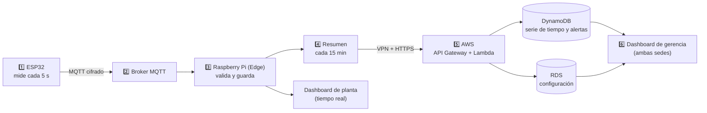

# 🧭 Guía del Equipo — Induplac IoT explicado simple

> **Para quién es:** para cualquier integrante que no estuvo en alguna reunión, que se perdió cambios o que no maneja bien algún tema (redes, nube, IoT, DevOps).
> **Objetivo:** que después de leer esto puedas **explicar el proyecto completo**, **entender para qué sirve cada cosa que hicimos** y **responder las preguntas del profe** con seguridad.
>
> **Cómo leerla:** las secciones 1 a 8 explican **qué hace** el sistema; la 9 a la 14, **cómo está construido y cómo trabajamos**; la 15 y la 17 te preparan para la **presentación**.
>
> Última actualización: **2026-11-17** (preparación de la Nota 3). Si algo de esta guía no coincide con otro documento, manda lo que diga [`docs/CONTEXTO.md`](CONTEXTO.md) y avisa al equipo.

---

## 📑 Índice

1. [El proyecto en 1 minuto](#1-el-proyecto-en-1-minuto)
2. [El problema que resolvemos](#2-el-problema-que-resolvemos)
3. [Diccionario rápido (las piezas)](#3-diccionario-rápido-las-piezas)
4. [El viaje de un dato](#4-el-viaje-de-un-dato)
5. [¿Qué pasa si se corta internet?](#5-qué-pasa-si-se-corta-internet)
6. [¿Qué sube a la nube y qué se queda en la planta?](#6-qué-sube-a-la-nube-y-qué-se-queda-en-la-planta)
7. [¿Por qué usamos tres bases de datos?](#7-por-qué-usamos-tres-bases-de-datos)
8. [Alertas](#8-alertas)
9. [Seguridad explicada simple](#9-seguridad-explicada-simple)
10. [La red](#10-la-red)
11. [El dashboard](#11-el-dashboard)
12. [API REST y backend, explicados simple](#12-api-rest-y-backend-explicados-simple)
13. [¿Cómo cambiamos el sistema sin romperlo? (DevOps)](#13-cómo-cambiamos-el-sistema-sin-romperlo-devops)
14. [Cómo nos organizamos (Ágil, Lean y gestión del equipo)](#14-cómo-nos-organizamos-ágil-lean-y-gestión-del-equipo)
15. [La demo para el profe](#15-la-demo-para-el-profe)
16. [Qué está hecho y qué falta](#16-qué-está-hecho-y-qué-falta)
17. [Preguntas que nos pueden hacer (y cómo responder)](#17-preguntas-que-nos-pueden-hacer-y-cómo-responder)
18. [Números para tener a mano](#18-números-para-tener-a-mano)
19. [Dónde está el detalle](#19-dónde-está-el-detalle)

---

## 1. El proyecto en 1 minuto

Si alguien te pregunta "¿de qué se trata su proyecto?", esta es la respuesta corta:

> **Induplac IoT es una plataforma que mide en tiempo real el consumo de electricidad y agua, la radiación UV, la producción y las horas sin accidentes de dos sedes de la empresa Induplac.**
> **Los sensores mandan los datos a un computador pequeño en cada sede (una Raspberry Pi; en el prototipo, una máquina virtual de AWS por sede), que los guarda, calcula alertas y muestra un dashboard. Cada 15 minutos manda un resumen a la nube de AWS, donde se juntan las dos sedes para comparar y ver el histórico.**
> **Lo más importante: si se corta internet, la planta sigue funcionando igual. Los datos se guardan localmente y se suben solos cuando vuelve la conexión, sin perder ni duplicar nada.**

Datos del proyecto:

| | |
|---|---|
| Asignatura | SIY6122 — Problemáticas Globales y Prototipado (Sección 002V) |
| Docente | Marco Antonio Perelli |
| Empresa de referencia | Induplac (real), pero usamos **datos ficticios** |
| Sedes | **Local 1:** planta/taller · **Local 2:** oficinas/administración |
| Equipo | Abraham Castro, Sebastián Fuentes, Lisandra González, Felipe Murúa, Bárbara Saavedra |
| Roles Scrum | **Product Owner:** Abraham · **Scrum Master:** Bárbara |

---

## 2. El problema que resolvemos

Hoy, en muchas empresas, el consumo se ve **tarde**: llega la boleta a fin de mes y recién ahí alguien nota que algo andaba mal. Nosotros atacamos tres problemas:

1. **Detección tardía:** una máquina que quedó encendida de noche o una fuga de agua se descubre 30 días después. Con el sistema se ve el mismo día.
2. **Seguridad de las personas:** los operarios que trabajan en el patio están expuestos al sol. El sistema avisa cuando la radiación UV es peligrosa.
3. **Quedar a ciegas sin internet:** si todo dependiera de la nube, un corte de fibra dejaría a la planta sin monitoreo. Nuestro sistema sigue funcionando sin internet.

> 💡 **La frase clave:** *"No es solo un dashboard de consumos; es un sistema de continuidad operacional."* Lo que nos diferencia es que la planta nunca queda a ciegas.

---

## 3. Diccionario rápido (las piezas)

| Pieza | Qué es, en simple | Qué hace en nuestro proyecto |
|---|---|---|
| **ESP32** | Un microcontrolador barato con WiFi (un "mini cerebro" para sensores). | Lee los sensores cada 5 segundos y envía los datos. |
| **Wokwi** | Un simulador web de ESP32. | Simulamos los sensores sin comprar hardware. Hay un prototipo por sede: Planta (`simulation/wokwi-local1/`) y Oficinas (`simulation/wokwi-local2/`, con energía separada en climatización e iluminación). |
| **MQTT** | Un protocolo de mensajes muy liviano, pensado para dispositivos pequeños. | Es el "idioma" con que el ESP32 envía datos. |
| **Broker MQTT** | El "cartero" de MQTT: recibe mensajes y los entrega a quien los pidió. | Recibe los datos de los ESP32 y se los pasa al Edge. En la simulación usamos **EMQX Serverless** (en la nube, gratis). |
| **Edge / Edge Gateway** | Un computador que está **en la sede**, cerca de los sensores ("en el borde" de la red). | En el diseño es una **Raspberry Pi** por sede. En el prototipo, cada sede tiene su Edge en una **EC2** del Learner Lab, que simula la Raspberry. Guarda, resume, alerta y muestra el dashboard de planta. |
| **SQLite** | Una base de datos liviana que vive en un solo archivo. | Base de datos local de la Raspberry Pi. |
| **AWS** | La nube de Amazon. Usamos el **Learner Lab** (cuenta educativa con USD 100). | Junta las dos sedes, guarda el histórico, administra usuarios. |
| **API Gateway** | La "puerta de entrada" a la nube: recibe pedidos por HTTPS. | Recibe los resúmenes del Edge y las consultas del dashboard. |
| **Lambda** | Código que corre en la nube solo cuando se necesita (sin servidor encendido). | Procesa lo que llega, revisa alertas y guarda en las bases. |
| **DynamoDB** | Base de datos de AWS sin tablas relacionadas (NoSQL), muy barata. | Guarda la serie de tiempo (los resúmenes cada 15 min) y las alertas. |
| **RDS PostgreSQL** | Base de datos relacional clásica (con tablas y relaciones). | Configuración: permisos de cada usuario, umbrales, sedes y dispositivos. |
| **Cognito** | Servicio de AWS para inicio de sesión. | Cuentas, claves temporales, **MFA** y el **rol y la sede** de cada persona. |
| **MFA** | Segundo factor: además de la contraseña, un código que cambia cada 30 s en el celular. | Obligatorio para jefes y admins, opcional para operarios. Se usa con Microsoft Authenticator. |
| **API REST** | Una forma estándar de pedir y mandar datos por internet con direcciones (URL) y verbos (`GET` = pedir, `POST` = mandar, `PUT` = cambiar). | Es como el Edge sube los datos y como el dashboard los consulta (sección 12). |
| **Git y GitHub** | Git guarda la historia de cada cambio del código; GitHub es donde vive el repositorio del equipo. | Todo el proyecto está ahí, y cada cambio entra por un *Pull Request* (sección 13). |
| **CI (GitHub Actions)** | Un "robot" que prueba solo cada cambio que alguien sube. | Corre las pruebas y los controles de seguridad antes de aceptar un cambio. |
| **Ansible** | Herramienta que configura muchos computadores a la vez, por SSH, siguiendo una "receta" (*playbook*). | Deja el Edge de cada sede instalado igual, sin hacerlo a mano (sección 13). |
| **VPN Site-to-Site** | Un "túnel" cifrado entre la red de la sede y la red en AWS. | Por ahí viajan los datos del Edge a la nube, sin pasar expuestos por internet. |
| **VLAN** | Dividir una red física en varias redes separadas. | Separa los sensores de los computadores de la oficina. |
| **Dashboard** | La página web con indicadores y gráficos. | Lo que ven los operarios, jefes y gerencia. |

---

## 4. El viaje de un dato

Sigamos una medición de electricidad desde el sensor hasta la pantalla:



Paso a paso:

1. **El ESP32 mide** (por ejemplo, 42,7 kW) y lo envía cada 5 segundos en un mensaje JSON por **MQTT cifrado (puerto 8883)**.
2. **El broker** recibe el mensaje y lo entrega a la Raspberry Pi.
3. **La Raspberry Pi valida** que el valor tenga sentido (por ejemplo, que no diga 9.999 kW). Si es válido, lo **guarda en SQLite** y lo muestra en el **dashboard de planta** al instante.
4. **Cada 15 minutos** la Pi calcula un **resumen** (promedio de electricidad y agua, máximo de UV, etc.) y revisa si hay que lanzar una **alerta**.
5. **Envía el resumen a AWS** (en el diseño, por la VPN; en la demo, por HTTPS). La Lambda lo guarda en DynamoDB, vuelve a revisar las alertas y también las guarda en DynamoDB.
6. **El dashboard de gerencia** (en la nube) muestra ambas sedes juntas, el histórico y las comparaciones.

---

## 5. ¿Qué pasa si se corta internet?

**Esta es la parte más importante del proyecto.** Hay que saberla de memoria.

La idea base: **los datos nunca dependen de internet para guardarse. Internet solo se necesita para subirlos a la nube.**

El sistema tiene tres estados:

```
🟢 ONLINE  ──se corta internet──▶  🔴 OFFLINE  ──vuelve internet──▶  🟡 SINCRONIZANDO  ──todo subido──▶  🟢 ONLINE
```

| Estado | Qué pasa en la planta | Qué pasa en la nube |
|---|---|---|
| 🟢 **ONLINE** | Todo normal. La Pi guarda y sube los resúmenes al tiro. | Recibe los resúmenes cada 15 min. |
| 🔴 **OFFLINE** | **Todo sigue igual**: sensores, dashboard en tiempo real y alertas. Solo cambia el indicador. Los resúmenes se acumulan en la Pi marcados como "pendientes". | Gerencia ve la sede como **desconectada**, con su último dato. |
| 🟡 **SINCRONIZANDO** | La Pi sube lo acumulado de a 50 resúmenes, en orden. | Recibe todo lo atrasado. Al terminar, el período del corte queda completo. |

**¿Cómo sabe la Pi que se cortó internet?** Cada 10 segundos le pregunta a AWS "¿estás ahí?" (*healthcheck*). Si falla 3 veces seguidas, pasa a OFFLINE.

**¿Por qué no se pierde nada?** Porque la Pi **nunca borra** un resumen hasta que AWS confirma que lo recibió.

**¿Por qué no se duplica nada?** Porque cada resumen tiene una "llave" única: **sede + hora de inicio del intervalo**. Si AWS recibe dos veces el resumen de "Local 1, 10:15", lo reemplaza en vez de contarlo dos veces.

**¿Y si lo que se cae es la Raspberry Pi?** El ESP32 guarda en su memoria unas **1.500 lecturas (~2 horas)** y las reenvía cuando la Pi vuelve.

**¿Cómo se ve el dashboard sin internet?** Los operarios abren el dashboard **directamente desde el Edge** dentro de la red de la planta (por ejemplo, `http://<ip-del-edge>:8080`), con un **login de planta** que funciona sin internet. No necesita salir a internet.

---

## 6. ¿Qué sube a la nube y qué se queda en la planta?

**Regla del equipo:** *el Edge filtra, guarda y resume; AWS consolida, compara y decide.*

| Se queda en la planta (Raspberry Pi) | Sube a la nube (AWS) |
|---|---|
| Cada lectura cruda, cada 5 s (se guarda 30 días) | **Solo resúmenes cada 15 minutos** |
| Validación de datos | Electricidad y agua: promedios |
| Resúmenes pendientes cuando no hay internet | UV: máximo del intervalo y del día |
| Alertas locales | Producción: tableros del mes y acumulado anual |
| Dashboard de planta | Horas-hombre sin incidentes |

**¿Por qué solo resúmenes?**
- Para reportes y comparaciones no necesitas el dato de cada 5 segundos; con cada 15 minutos alcanza para ver el comportamiento por hora y por día.
- Sube mucho menos información: menos costo y menos datos expuestos.
- Nunca sube nada que identifique a personas ni a la empresa real.

---

## 7. ¿Por qué usamos tres bases de datos?

| Base | Dónde | Qué guarda | Por qué esa |
|---|---|---|---|
| **SQLite** | Raspberry Pi | Lecturas crudas, resúmenes pendientes, alertas locales | Es liviana, vive en un archivo, no necesita servidor. Ideal para el Edge. |
| **DynamoDB** | AWS | La serie de tiempo (resúmenes de 15 min) y las alertas | Casi gratis, siempre encendida y Lambda escribe sin problemas de conexiones. |
| **RDS PostgreSQL** | AWS | Configuración: permisos de cada usuario, umbrales, sedes y dispositivos | Necesitamos relaciones entre tablas y SQL. Se enciende solo para configurar y para la demo. |

**La explicación corta para el profe:** *"Usamos cada base para lo que hace mejor. DynamoDB recibe los datos de los sensores y es casi gratis y siempre está disponible; así podemos apagar RDS para ahorrar crédito sin cortar la recepción de datos. RDS guarda la configuración, que necesita relaciones (qué puede hacer cada usuario, los umbrales de cada sede). Las cuentas y el MFA los maneja Cognito."*

> ⚠️ **No digas** que usamos DynamoDB "porque son demasiados datos". Con resúmenes cada 15 minutos el volumen es bajo. Las razones reales son **costo, disponibilidad y que Lambda no tiene que manejar conexiones**.

---

## 8. Alertas

### Las reglas

| Variable | Cuándo hay alerta 🔴 |
|---|---|
| ⚡ **Electricidad** | El consumo de una hora supera en **20 %** el promedio de esa misma hora en las **últimas 4 semanas**. Mientras no hay 4 semanas de historia, se usa un umbral fijo: sobre 55 kW es crítico (45–55 kW advertencia). |
| 💧 **Agua** | **Local 1 (planta):** alerta sobre 14 m³/día (amarillo sobre 12). **Local 2 (oficinas):** alerta sobre 2,5 m³/día (amarillo sobre 2). Además, **posible fuga** si hay consumo de noche (22:00–06:00) o el fin de semana: más de 0,3 m³/h en la planta o 0,05 m³/h en oficinas durante 1 hora. |
| ☀️ **UV** | Índice **8 o más** (riesgo para quienes trabajan afuera). Entre 6 y 7,9 se muestra amarillo como recomendación de protector y sombra. |

**Los umbrales se pueden cambiar** desde la pantalla *Umbrales* del dashboard, sin tocar código: se guardan en RDS, se copian a DynamoDB (lo que usan las alertas de la nube) y el cambio queda en la auditoría. Antes de guardar, la pantalla **simula** cuántas alertas habría dado el valor nuevo con los datos reales. El Edge todavía usa sus propios umbrales fijos (tarea 44).

**¿Por qué comparar contra el promedio y no un número fijo en electricidad?** Porque un lunes a las 10:00 es normal consumir mucho, pero un domingo a las 3:00 no. Comparar contra "lo normal para esa hora" detecta lo raro.

### Alertas en dos niveles

Las mismas reglas se revisan en **dos lugares**:

1. **En la Raspberry Pi:** para que la planta tenga alertas **aunque no haya internet**.
2. **En la Lambda (AWS):** para registrar oficialmente la alerta y que gerencia la vea.

**¿No se duplican?** No. Cada alerta se identifica por **sede + variable + intervalo**. Si la Pi creó la alerta sin internet y después la Lambda detecta la misma, se actualiza la misma alerta en vez de crear otra.

Las alertas aparecen **en rojo** en el dashboard. Enviarlas por correo o Telegram queda como mejora futura.

---

## 9. Seguridad explicada simple

Usamos **"defensa en profundidad"**: varias capas, para que si una falla, las otras sigan protegiendo.

| Capa | Qué protege | Cómo, en simple |
|---|---|---|
| **1. Sensores** | Que nadie se haga pasar por un sensor ni mande datos falsos | Cada ESP32 tiene su propio usuario y clave en MQTT, todo va cifrado (TLS), y se descartan valores imposibles (ej. 9.999 kW). |
| **2. Raspberry Pi** | Que no se puedan robar claves ni alterar datos guardados | Claves fuera del código (archivo `.env`), permisos mínimos en AWS, control de integridad en SQLite, acceso SSH solo con llaves. |
| **3. Envío a la nube** | Que nadie lea ni repita los datos en el camino | Túnel **VPN cifrado** + **HTTPS**, y la llave única por intervalo evita duplicados si se reenvía algo. |
| **4. Acceso al dashboard** | Que cada persona vea y haga solo lo que le corresponde | Roles (RBAC) y **MFA** para quienes pueden cambiar cosas. |
| **5. Privacidad y ley** | Los datos de los trabajadores | No guardamos nombres, RUT ni ubicación de personas. Las horas-hombre son solo contadores. Cumple la **Ley 19.628**. |

### Roles: quién ve qué

Cada cuenta tiene un **rol** (qué puede hacer) y una **sede** (dónde): `planta`, `oficinas` o `todas`. Nadie puede cambiarse de sede solo.

| Rol | Sedes | Ver datos actuales | Histórico | Reconocer alertas | Umbrales, usuarios y auditoría | MFA |
|---|---|:---:|:---:|:---:|:---:|:---:|
| **Admin general** | Todas | ✅ | ✅ | ✅ | ✅ de todas | Obligatorio |
| **Admin de sede** | La suya | ✅ | ✅ | ✅ | ✅ solo de su sede | Obligatorio |
| **Jefe** | La suya | ✅ | ✅ | ✅ | ❌ | Obligatorio |
| **Operario** | La suya | ✅ | ❌ | ❌ | ❌ | Opcional |

**En el equipo:** Abraham y Felipe son *admin general*; Bárbara, *admin de sede* de Planta; Seba, *admin de sede* de Oficinas; Lisandra, *operaria* de Planta.

**¿Por qué el MFA es opcional para el operario?** Porque el MFA protege las acciones que **cambian cosas**. El operario solo mira su sede; obligarlo agrega fricción sin mucho beneficio. Igual puede activarlo si quiere.

**¿Cómo funciona por dentro?** Cognito pone el rol y la sede dentro del **token** de la sesión. La API (API Gateway) **rechaza cualquier consulta sin token válido** (`401`), y el backend mira el rol y la sede del token antes de responder o permitir un cambio. Lo que se ve en pantalla es solo la cara visible: la seguridad real está en el servidor.

**¿Cómo se inicia sesión sin internet?** El Edge tiene un **login de planta** para ver el dashboard. Lo que cambia la configuración (umbrales, usuarios) requiere internet y MFA.

**Nada se borra:** los registros de **auditoría** (quién hizo qué) y de **alertas** no se pueden borrar, ni siquiera un admin.

---

## 10. La red

Si preguntan por la parte de redes, estos son los puntos:

- **VLANs separadas en cada sede:**
  - VLAN de sensores (IoT): `192.168.10.0/24` (Local 1) y `192.168.20.0/24` (Local 2).
  - VLAN de operarios: `192.168.11.0/24` y `192.168.21.0/24`.
  - Los operarios **solo pueden llegar a la Raspberry Pi por HTTPS (443)**. No ven los sensores. Si un sensor fuera hackeado, no puede llegar a los computadores de la oficina.
- **Cero puertos abiertos hacia la planta:** desde internet no se puede entrar. La conexión con AWS la **inicia la planta** hacia afuera.
- **VPN Site-to-Site (IPsec, IKEv2, AES-256)** entre cada sede y la red de AWS (VPC `10.0.0.0/16`).
- **Dos "puertas" en AWS:**
  - Una **privada**, solo alcanzable por la VPN, para que la Pi suba datos.
  - Una **pública**, protegida con login (Cognito), para el dashboard de gerencia.
- **Sin NAT Gateway** y **RDS en una sola zona**, para no gastar el crédito.

> ⚠️ **Sobre la VPN (decisión del equipo):** está diseñada y documentada, pero **no se demuestra**, porque no sabemos si el Learner Lab la permite y además cuesta unos USD 0,05 por hora por conexión. En la demo, la Raspberry Pi sube los datos por **HTTPS a una API pública** con permisos mínimos. Si preguntan, se explica como el diseño para producción.

---

## 11. El dashboard

Es **el mismo dashboard en dos lugares**: **en la nube** (para todos, con login de Cognito) y **en el Edge de la planta** (sigue funcionando sin internet). No es una sola pantalla: es un **panel tipo app** con menú lateral, y cada persona ve solo las pantallas y sedes de su rol.

```text
┌──────────────────────┬──────────────────────────────────────────────┐
│ INDUPLAC IoT         │ Resumen · Sede: Todas · 🕑 · 🔔 2              │
│ MONITOREO            │                                              │
│  • Resumen           │  ⚡ Energía   💧 Agua   ☀ UV   🏭 Producción  │
│  • Planta / Oficinas │  [al día]    [al día]  [dato antiguo]  ...   │
│  • Alertas           │                                              │
│  • Histórico         │  Gráfico de consumo · alertas activas        │
│ GESTIÓN              │                                              │
│  • Umbrales          │                                              │
│  • Usuarios          │                                              │
│  • Auditoría         │                                              │
│ SISTEMA              │                                              │
│  • Estado de sedes   │                                              │
└──────────────────────┴──────────────────────────────────────────────┘
```

| Pantalla | Para qué sirve |
|---|---|
| **Resumen, Planta y Oficinas** | Ver cómo está cada sede **ahora**. Cada tarjeta dice si el dato está *al día*, es *antiguo* o *no hay datos*, para saber si confiar en lo que se ve |
| **Alertas** | Ver las alertas y **reconocerlas** con un comentario (jefes y admins), para que el equipo sepa que alguien las atendió |
| **Histórico** | Comparar día con día y hora con hora, entre sedes y con el período anterior |
| **Umbrales** | Cambiar cuándo salta una alerta, **simulando antes** cuántas alertas habría dado el valor nuevo |
| **Usuarios** | Crear cuentas (con clave temporal), desactivarlas y reenviar la invitación |
| **Auditoría** | Ver quién cambió qué, cuándo y desde dónde (nube o Edge, con o sin internet) |
| **Estado de las sedes** | Saber si todo está llegando bien: último dato, sensores, pendientes por subir, hora del equipo y si RDS está encendido |

**Próximo paso decidido:** una **app para celular (PWA)** sobre AWS, para recibir las alertas en el teléfono.

---

## 12. API REST y backend, explicados simple

> Criterios 3 (cliente-servidor y API REST) y 4 (backend) de la Nota 3.

### Cliente-servidor: quién pide y quién responde

En una arquitectura **cliente-servidor**, el **cliente** pide algo y el **servidor** responde. Como en un restaurante: el cliente pide al mesero (la **API**), el mesero lleva el pedido a la cocina (el **backend**) y vuelve con el plato (los **datos**).

En Induplac hay **dos clientes** y **un servidor**:

```text
CLIENTES                                SERVIDOR (AWS)
Edge de la sede  ──POST /intervalos──►  API Gateway ──► Lambda ──► DynamoDB
  (sube datos)                            (la puerta)    (la cocina)  (la despensa)
Dashboard        ──GET /api/...──────►        │
  (consulta)     ◄──── JSON ───────────────────┘
```

### La API REST: direcciones y verbos

Una API **REST** usa direcciones (URL) y verbos para decir qué se quiere hacer. Las respuestas vienen en **JSON** (texto ordenado que entiende cualquier programa).

| Verbo | Significa | Ejemplo en Induplac |
|---|---|---|
| `POST` | **Mandar** algo nuevo | `POST /intervalos`: el Edge sube los resúmenes de 15 minutos |
| `GET` | **Pedir** datos | `GET /api/locales/local1/actual`: el dashboard pide cómo está la planta ahora |
| `GET` | | `GET /api/alertas`, `GET /api/historico`, `GET /api/auditoria` |
| `POST` | | `POST /api/alertas/{id}/reconocer`: un jefe reconoce una alerta |
| `PUT` | **Cambiar** algo que existe | `PUT /config/umbrales/local1/uv`: un admin cambia el umbral de UV |

Cada respuesta trae un **código** que dice cómo le fue: `200` (todo bien), `400` (el pedido viene mal), `401` (no iniciaste sesión o la clave no sirve), `403` (no tienes permiso para esa sede o acción), `404` (no existe), `503` (la fuente de datos no responde, por ejemplo RDS apagado). El contrato completo está en [`api-dashboard.md`](api-dashboard.md), y el diagrama cliente-servidor con los comandos para probar el envío y la consulta, en [`nota-3/api-rest.md`](nota-3/api-rest.md).

### El backend: qué pasa con un dato cuando llega

El backend son **dos funciones Lambda** (código que corre solo cuando llega un pedido): `induplac-api` (datos y alertas) e `induplac-config` (configuración en RDS). Con un dato que llega del Edge:

| Paso | Qué hace | Ejemplo |
|---|---|---|
| 1. **Recibe** | API Gateway recibe el `POST /intervalos` y la Lambda revisa la clave del Edge (cabecera `x-induplac-key`) | Sin la clave correcta responde `401` |
| 2. **Valida** | Revisa que el JSON esté bien formado y que la sede exista. Los valores absurdos ya los filtró el Edge antes de enviar (por ejemplo, 9.999 kW) | Un lote de una sede que no existe responde `400` |
| 3. **Procesa** | Revisa las **reglas de alerta** con los umbrales vigentes | ¿UV ≥ 8? → alerta |
| 4. **Almacena** | Guarda el intervalo y las alertas en **DynamoDB**, con una llave única (sede + hora) | Si llega dos veces, se reemplaza: **no se duplica** |
| 5. **Entrega** | Cuando el dashboard pregunta, responde solo con **lo que ese rol y esa sede pueden ver** | Un operario de Planta no recibe datos de Oficinas |

**¿Por qué Lambda y no un servidor con Flask o FastAPI?** La pauta permite cualquier tecnología justificada. Elegimos **Lambda (serverless)** porque:
- **Costo:** solo se paga cuando llega un pedido; un servidor Flask estaría encendido (y cobrando) las 24 horas, y el Learner Lab tiene USD 100.
- **Nada que mantener:** no hay sistema operativo que actualizar ni servidor que se caiga; AWS lo escala solo.
- **Encaja con AWS:** se integra directo con API Gateway, Cognito y DynamoDB.
- **Es Python igual:** el código se escribe como en Flask; solo cambia quién lo ejecuta.

---

## 13. ¿Cómo cambiamos el sistema sin romperlo? (DevOps)

> Criterio 2 de la Nota 3 (Pipeline DevOps). Detalle en [`devops.md`](devops.md) y [`ansible/README.md`](../ansible/README.md).

**La idea:** cuando un sistema ya funciona, el riesgo más grande es **cambiarlo**. DevOps es la forma de trabajar para que cada cambio, por chico que sea, pase siempre por el mismo camino: **se guarda, se prueba, se revisa, se instala y se vigila**.

Ejemplo real: **cambiar el umbral de una alerta o arreglar un error en el Edge**. ¿Quién lo hizo? ¿Se probó? ¿Qué versión quedó instalada? ¿Cómo sabemos si falló? El pipeline responde todo eso:

```text
requerimiento ─► desarrollo ─► Git + Pull Request ─► CI: pruebas + seguridad ─► revisión ─► despliegue ─► operación ─► monitoreo
     ▲                                                                                                                │
     └───────────────────────────────────────── retroalimentación ◄───────────────────────────────────────────────────┘
```

| Etapa | Qué hacemos | Para qué sirve |
|---|---|---|
| **1. Requerimiento** | La tarea se anota en [`EN-CURSO.md`](EN-CURSO.md) (nuestro Kanban) y alguien la reserva | Que dos personas no hagan lo mismo y se sepa quién tiene cada cosa |
| **2. Desarrollo** | Se trabaja en una **rama** (una copia aparte del código) | Si algo sale mal, `main` (la versión buena) no se toca |
| **3. Git + Pull Request** | El cambio se propone con un **PR**: qué cambió, por qué y cómo se prueba | Queda registrado **quién cambió qué, cuándo y por qué** |
| **4. CI (pruebas + seguridad)** | GitHub Actions corre solo **6 controles** en cada PR (abajo) | Encontrar errores **antes** de que lleguen a la planta |
| **5. Validación** | Otro integrante revisa el PR; `main` está **protegida** y no acepta cambios sin los 6 controles en verde | Nadie sube cambios sin probar, ni por apuro |
| **6. Despliegue** | GitHub Actions publica el dashboard (S3) y las Lambdas, y **Ansible** deja listo el Edge de cada sede | Instalar siempre igual, sin pasos a mano que se olviden |
| **7. Operación y monitoreo** | La API responde `/health`, la pantalla *Estado de las sedes* y las alertas de "sin datos" | Saber al tiro si algo dejó de funcionar |
| **8. Retroalimentación** | Lo que se encuentra vuelve como tarea nueva al tablero | El sistema mejora con cada vuelta |

### Los 6 controles automáticos del CI

| Control | Qué revisa, en simple |
|---|---|
| **Dashboard** | Que el dashboard compile y no tenga errores de código |
| **Edge y Lambdas** | Que pasen las pruebas: reglas de alerta, que no se dupliquen datos, la auditoría, los umbrales |
| **Secretos** (`gitleaks`) | Que nadie haya subido una contraseña o clave por error |
| **Dependencias** (`npm audit`, `pip-audit`) | Que ninguna librería que usamos tenga fallas de seguridad conocidas |
| **SAST** (Bandit, Semgrep) | Que el código no tenga malas prácticas peligrosas, como armar una consulta SQL a mano |
| **DAST** (OWASP ZAP) | Prueba el dashboard **funcionando**, desde afuera, como lo haría un atacante |

Si uno falla, el PR se marca ❌ y **no puede entrar a `main`** (eso se llama *quality gate*). A esto de meter la seguridad dentro del pipeline se le llama **DevSecOps**: es más barato encontrar un problema en el PR que cuando ya está en la planta.

> **Una alerta automática no siempre es un problema real.** Bandit avisó de "posible inyección SQL" en el Edge; al revisarlo, las consultas eran seguras (*falso positivo*). Por eso lo grave bloquea y lo medio se revisa a mano.

> **Caso real (17/11): ¿y si aparece una falla nueva que no nos afecta?** Se publicó una falla en `picomatch`, una librería que viene dentro de Vite (la herramienta que **arma** el dashboard). El control bloqueó todos los PR, como debía. **No fue un hackeo:** fue un aviso de que una pieza tiene una debilidad recién descubierta. Como esa pieza solo la usamos nosotros al armar el dashboard y todavía no hay versión corregida, se dejó una **excepción solo para esa falla**, escrita en [`devops.md`](devops.md) con el porqué y cuándo se quita. Todo lo demás sigue bloqueando. Es como saber que tu modelo de cerradura tiene una falla, pero que esa cerradura está en la bodega de la fábrica y no en la puerta de entrada.

### Versiones: saber qué está instalado y poder volver atrás

Cada hito del proyecto tiene un **nombre de versión** en Git (un *tag*): `v0.1` (diseño), `v0.2` (demo del 21/10), `v0.3` (planta autónoma), `v0.4` (roles, auditoría y umbrales), `v0.5` (dashboard de 7 pantallas), `v0.6` (DevSecOps) y `v0.7` (Ansible). Es como ponerle nombre a las fotos importantes del álbum: en vez de decir "el código de algún día de noviembre", se dice "está instalada la `v0.7`".

**Para qué sirve:** si una versión nueva falla en las sedes, con Ansible se vuelve a la anterior en un solo comando (`-e repo_version=v0.6`), en todas las sedes a la vez. El día de la presentación se crea la `v1.0`.

### Ansible: el Edge igual en todas las sedes

Configurar a mano una Raspberry en cada sede es lento y cada persona lo haría un poco distinto. Con **Ansible**, el estado correcto del Edge está escrito en una "receta" (`ansible/edge-baseline.yml`) y se aplica a todas las sedes a la vez, desde un solo computador:

- Hora de Chile sincronizada, paquetes, un usuario sin privilegios, el código de GitHub en una **versión conocida**, la configuración de su sede y el servicio que arranca solo.
- Es **idempotente**: si se corre de nuevo y todo está bien, **no cambia nada** (`changed=0`). Si alguien cambió algo a mano, lo devuelve al estado correcto.
- Lo probamos el 17/11 en 2 máquinas de AWS que simulan las Raspberry de Planta y Oficinas: 1ª pasada con 9 cambios, 2ª pasada con **0**.
- **Desde el 18/11, el Edge corre de verdad en esas 2 EC2**, una por sede, como servicio de Linux:
  - `edge-planta` atiende solo `local1` con el usuario `edge-local1`, y `edge-oficinas` atiende solo `local2` con `edge-local2`.
  - Arranca solo cuando se prende la EC2 y se reinicia si falla. **Ya no depende del PC de nadie.**
  - Las claves van en `ansible/secretos.yml`, que nunca se sube (ver [`ansible/README.md`](../ansible/README.md) §4b).

```
Wokwi Planta   ─► EMQX ─► EC2 edge-planta   (local1) ─┐
                                                      ├─► AWS ─► Dashboard
Wokwi Oficinas ─► EMQX ─► EC2 edge-oficinas (local2) ─┘
```

> ⚠️ Para que lleguen datos se necesitan dos cosas: el **lab encendido** (si termina la sesión, las EC2 se apagan, y al prenderlas el Edge arranca solo) y **los dos Wokwi en Play** en el navegador.

---

## 14. Cómo nos organizamos (Ágil, Lean y gestión del equipo)

> Criterios 5 y 7 de la Nota 3. Detalle en [`nota-3/backlog.md`](nota-3/backlog.md) y [`nota-3/gestion-equipo.md`](nota-3/gestion-equipo.md).

- **Scrum con sprints de una semana** desde el 05/10. Abraham es *Product Owner* (prioriza qué se hace) y Bárbara, *Scrum Master* (mantiene el orden y el tablero).
- **Product Backlog:** 21 **historias de usuario** escritas desde quien usa el sistema (*"Como jefe de planta, quiero… para…"*), priorizadas con **MoSCoW** (Debe, Debería, Podría, No ahora).
- **Kanban:** [`EN-CURSO.md`](EN-CURSO.md) es el tablero: 🟢 Libre → 🟡 En curso → 🔵 En revisión → ✅ Listo. Una tarea sin avance por más de 7 días se conversa en el grupo.
- **Lean:** reservar antes de empezar (no repetir trabajo), cada uno toma tarjetas libres (sistema *pull*), cambios chicos por PR (lotes pequeños) y el CI prueba todo (calidad desde el origen).
- **Gestión del equipo:** la **lluvia de ideas** del 07/10 (documento *Decisiones Cloud*) y su orden en un **diagrama de afinidad** mostraron decisiones clave, como poner las alertas también en el Edge para no quedar a ciegas sin internet.

### PRINCE2: cómo controlamos el proyecto completo

> El profe pidió **enfocarse en PRINCE2** (clase 3.4.1, 18/11). Va en el criterio 8 (calidad). Detalle en [`nota-3/prince2.md`](nota-3/prince2.md).

**Para qué sirve:** Scrum dice cómo **construimos** semana a semana. **PRINCE2** dice cómo se **controla** el proyecto entero: por etapas, con roles claros y revisando la calidad de cada entrega. Usarlos juntos se llama **PRINCE2 Agile**.

Piénsalo como construir una casa para un cliente: se avanza **por etapas** y el cliente revisa al final de cada una; cada uno sabe **qué le toca**; el cliente no mira cada ladrillo, solo pone límites y lo llaman **si algo se sale** (gestión por excepción); y cada parte se **revisa contra lo pedido** antes de darla por terminada.

En Induplac:
- **Etapas:** inicio → MVP (demo 21/10, Nota 2) → mejoras (Nota 3, 25/11) → cierre (examen 16/12). Cada una la cierra la evaluación del profe.
- **Roles:** el profe es la junta (decide), Abraham es el director del proyecto (PO), Bárbara es el apoyo (SM, tablero y Gantt) y todos somos el equipo.
- **Paquetes de trabajo:** cada tarea de [`EN-CURSO.md`](EN-CURSO.md). Se reserva, se hace en una rama, entra por PR y se acepta con el merge.
- **Excepciones:** lo que cambiaba el plan se decidió en equipo: EMQX en vez de HiveMQ, RDS de vuelta al MVP y el Edge en las EC2.
- **Calidad:** primero se define qué es "bien hecho" (criterios de aceptación) y después se controla en cada cambio (CI + revisión) y queda registrado (plan de pruebas y checks de los PR). El **Ishikawa**, el **plan de pruebas** y el **gráfico de control** son piezas de ese mismo sistema.

---

## 15. La demo para el profe

La evaluación no se gana con gráficos bonitos, sino mostrando que **el sistema funciona de punta a punta y aguanta sin internet**. El recorrido que pide la pauta:

```text
Wokwi (ESP32) ─► broker MQTT ─► Edge ─► API REST ─► backend (Lambda) ─► DynamoDB ─► reglas/alertas ─► consulta ─► dashboard
```

Resumen del guion. El guion completo, con tiempos, quién hace qué, plan B y el ensayo del 24/11, está en [`nota-3/guion-demo.md`](nota-3/guion-demo.md) (tarea 18):

1. Wokwi envía datos y el dashboard muestra todo 🟢 **ONLINE**.
2. Se corta **solo la conexión del Edge con AWS** (no todo internet). El indicador pasa a 🔴 **OFFLINE**, pero el dashboard de planta **sigue mostrando datos**.
3. Se sube el **UV** en Wokwi → **la alerta aparece igual**, generada por el Edge.
4. Se **reconecta** → 🟡 **SINCRONIZANDO** → todo sube a AWS **sin perder ni duplicar** datos → 🟢 **ONLINE**.

Otras cosas que se pueden mostrar:
- **Roles:** entrar como operario (no ve Histórico ni Umbrales) y como admin (pide MFA).
- **Umbrales:** simular un valor nuevo y guardarlo; aparece en la **Auditoría**.
- **Pipeline:** un PR con los 6 controles en verde y el reporte de ZAP.
- **Ansible:** `ansible edge -m ping` y el playbook con `changed=0`.

> ⚠️ **Antes de presentar:** abrir el Learner Lab, encender RDS y las 2 EC2 (el Edge de cada sede arranca solo), poner los **2 Wokwi en Play** y revisar que lleguen datos (la pantalla *Estado de las sedes* lo muestra). Las IP en `ansible/inventario.ini` solo hay que actualizarlas si se va a mostrar Ansible.

---

## 16. Qué está hecho y qué falta

> Estado al **17/11/2026**. El detalle de cada tarea está en [`EN-CURSO.md`](EN-CURSO.md) y el de la Nota 3 en [`nota-3.md`](nota-3.md).

**✅ Funcionando:**
- Cadena completa: Wokwi → EMQX → Edge (SQLite, resúmenes de 15 min, alertas sin internet) → API Gateway → Lambda → DynamoDB → dashboard.
- Modo offline y sincronización sin perder ni duplicar datos.
- Dashboard con 7 pantallas, en la nube (S3) y en el Edge.
- Cognito con 4 roles y sede, claves temporales y MFA por rol; la API exige iniciar sesión.
- Umbrales editables (RDS → DynamoDB) con simulación, y auditoría que no se puede borrar.
- Pipeline DevOps: ramas + PR, CI con 6 controles (incluida seguridad), `main` protegida, versiones `v0.1` a `v0.7`, despliegue con `/health` y **Ansible** para el Edge.
- Backlog con historias de usuario, Kanban y gestión del equipo (criterios 5 y 7).

**⏳ Falta para la Nota 3 (25/11):** Wokwi listo para la demo, gráfico de control, explicación del backend, ensayo de la demo, PowerPoint y grabación (tareas 18, 23, 35, 42 y 43). Ya están el guion de la demo (tarea 18), la API REST (tarea 34), el [plan de pruebas](nota-3/plan-de-pruebas.md) (tarea 41) y, de Lisandra (18/11): los [5 Porqués](nota-3/5-porques.md) (36), la [transferencia tecnológica](nota-3/transferencia-tecnologica.md) (38) y el [Ishikawa](nota-3/ishikawa.md) (40), y **PRINCE2** ([`prince2.md`](nota-3/prince2.md), tarea 49, 19/11), que une las herramientas de calidad en un solo sistema. Sirven para explicar **por qué** existe el problema, **qué podría fallar** en nuestra solución y **cómo se llevaría** a Induplac de verdad.

**📁 Evidencias:** todas las pruebas de que el prototipo funciona están ordenadas por criterio en [`nota-3/evidencias.md`](nota-3/evidencias.md): capturas, reporte de ZAP y links al CI. Ahí se ve qué falta y quién lo saca. La grabación del ensayo del 24/11 se deja como link en ese mismo archivo.

**📐 Queda como diseño (no se demuestra):** VPN entre las sedes y AWS, sensores reales y Raspberry Pi física.

---

## 17. Preguntas que nos pueden hacer (y cómo responder)

### Sobre la idea general

**¿Por qué no mandan los datos de los sensores directo a la nube?**
> Porque si se corta internet, los sensores no tendrían dónde mandar los datos y la planta quedaría sin monitoreo. Con la Raspberry Pi en medio, la planta sigue funcionando igual y los datos se suben cuando vuelve la conexión.

**¿Por qué usan datos ficticios si la empresa es real?**
> Por ética y confidencialidad: no tenemos acceso a los sistemas internos de Induplac. Simulamos datos con órdenes de magnitud coherentes con la industria.

**Si el broker está en la nube, ¿cómo sigue funcionando la planta sin internet?**
> En el diseño real, el broker vive dentro de la planta (en la Raspberry Pi), así que un corte de internet no lo afecta. En la simulación lo pusimos en la nube solo porque Wokwi corre en el navegador y no puede llegar a la red local. Por eso, en la demo el "corte" que simulamos es el del enlace entre la Raspberry Pi y AWS, que es el que de verdad se cae en una planta.

**¿Por qué Wokwi y no sensores reales?**
> Para el prototipo, Wokwi permite simular el ESP32 y los sensores sin costo de hardware. El diseño está pensado para pasar después a sensores reales (por ejemplo, SCT-013 para corriente y caudalímetros).

### Sobre el modo offline

**¿Qué pasa si se corta internet?**
> La planta sigue igual: los sensores siguen midiendo, la Raspberry Pi sigue guardando, mostrando el dashboard y generando alertas. Solo cambia el indicador a OFFLINE. Cuando vuelve internet, la Pi sube todo lo pendiente.

**¿Se pierden datos? ¿Se duplican?**
> No se pierden, porque la Pi no borra nada hasta que AWS confirma que lo recibió. No se duplican, porque cada resumen tiene una llave única (sede + hora del intervalo) y si llega dos veces se reemplaza en vez de sumarse.

**¿Cuánto tiempo aguanta sin internet?**
> En la práctica, meses o años. Un año completo de resúmenes ocupa unos 21 MB, y la tarjeta de la Pi tiene unos 22 GB libres. El espacio no es el límite.

**¿Y si se cae la Raspberry Pi?**
> El ESP32 guarda unas 1.500 lecturas en memoria (cerca de 2 horas) y las reenvía cuando la Pi vuelve.

**¿Esto depende de un computador de ustedes?**
> No. Cada sede tiene su propio Edge en una máquina virtual de AWS (EC2) que simula la Raspberry Pi. Se instala con Ansible igual en las dos y corre como servicio: arranca solo y se reinicia si falla. Si una sede se cae, la otra sigue funcionando. Lo único que corre en el navegador es Wokwi, que simula los sensores.

**¿Por qué no ponen una tarjeta SD en cada ESP32 en vez de la Raspberry?**
> Porque mantener tarjetas en cada sensor es poco práctico, las tarjetas en microcontroladores se dañan con cortes de luz, y el ESP32 no tiene capacidad para levantar una VPN ni servir un dashboard.

**¿Cómo ven el dashboard los operarios sin internet?**
> La Raspberry Pi sirve el dashboard dentro de la red de la planta. Los operarios lo abren desde su VLAN, que solo tiene permiso para llegar a la Pi por HTTPS.

### Sobre los datos y las bases

**¿Por qué solo suben promedios cada 15 minutos? ¿No pierden información?**
> Para reportes, comparaciones y alertas por hora o por día, cada 15 minutos es suficiente. El detalle de cada 5 segundos se queda 30 días en la Pi. Así subimos menos datos, gastamos menos y exponemos menos información.

**¿Por qué dos bases de datos en la nube? ¿No basta con una?**
> Podría ser una sola, pero perderíamos dos ventajas. DynamoDB es casi gratis y siempre está disponible, así que podemos apagar RDS para ahorrar crédito sin cortar la recepción de datos. Además, Lambda escribe en DynamoDB sin manejar conexiones. RDS lo usamos para lo que necesita relaciones: la configuración (permisos de cada usuario, umbrales, sedes y dispositivos). Las cuentas y el MFA van en Cognito.

**¿Por qué MQTT en los sensores y HTTPS hacia la nube?**
> MQTT es muy liviano y está hecho para dispositivos pequeños como el ESP32. Hacia la nube usamos HTTPS porque es el estándar de las APIs y AWS lo maneja directamente.

### Sobre las alertas

**¿Cómo funciona la alerta de electricidad?**
> Comparamos el consumo de cada hora con el promedio de esa misma hora en las últimas 4 semanas. Si lo supera en 20 %, hay alerta. Así detectamos lo anormal para ese momento y no solo valores altos.

**¿Y las primeras 4 semanas, cuando no hay historia?**
> Se usa un umbral fijo de respaldo: sobre 55 kW es crítico.

**¿Por qué UV 8?**
> Desde 8 la radiación se considera de riesgo muy alto para quienes trabajan al aire libre. Entre 6 y 7,9 mostramos una recomendación en amarillo.

**¿Las alertas funcionan sin internet?**
> Sí. Las mismas reglas corren en la Raspberry Pi y en la nube. Sin internet, la Pi genera la alerta; al reconectar se sube y no se duplica con la de la nube.

### Sobre seguridad y red

**¿Para qué la VPN si ya usan HTTPS?**
> Es defensa en profundidad. HTTPS cifra los datos de la aplicación; la VPN cifra a nivel de red y además permite que la puerta de entrada de los datos sea privada, que no exista en internet. Si una capa falla, la otra sigue protegiendo.

**¿Por qué no muestran la VPN funcionando?**
> Porque no tenemos certeza de que la cuenta educativa de AWS permita crearla y además cobra por hora. La dejamos diseñada y documentada para una implementación real; en la demo los datos viajan por HTTPS a una API con permisos mínimos.

**¿Qué pasa si hackean un ESP32?**
> Está en una VLAN aislada: solo puede hablar con la Raspberry Pi por MQTT. No llega a los computadores de la oficina. Además, el broker no le deja publicar datos de la otra sede, y los valores imposibles se descartan.

**¿Qué pasa si un sensor manda un valor absurdo?**
> Se valida contra límites físicos (por ejemplo, 0 a 250 kW). Si está fuera de rango, se registra como falla del sensor y no entra a los cálculos ni a la nube.

**¿Por qué no hay puertos abiertos en la planta?**
> Porque abrir puertos hacia la red de una fábrica es una puerta de entrada para ataques. Todas las conexiones las inicia la planta hacia afuera.

**¿Quién puede ver y cambiar qué?**
> Hay 4 roles y cada uno tiene una sede. El operario solo mira su sede; el jefe además ve el histórico y reconoce alertas; el admin de sede administra umbrales y usuarios de su sede, y el admin general, de todas. Jefes y admins entran con MFA. La API revisa el rol y la sede en cada consulta, no solo la pantalla.

**¿Cumplen con la ley de protección de datos?**
> Sí, con la Ley 19.628. No guardamos nombres, RUT ni ubicación de trabajadores. Las horas-hombre son solo contadores agregados por turno, y a la nube solo suben resúmenes.

### Sobre costos y alcance

**¿Cuánto cuesta? ¿Les alcanza con los USD 100 del Learner Lab?**
> La mayoría de los servicios cuesta casi nada a esta escala (DynamoDB, Lambda, API Gateway). RDS es una instancia pequeña que apagamos cuando no se usa, y no usamos NAT Gateway. Lo único caro sería la VPN (unos USD 0,05 por hora por conexión); por eso en el MVP queda como diseño y no se levanta.

**¿Qué tienen listo y qué falta?**
> El sistema funciona de punta a punta: Wokwi, Edge con modo offline, backend en AWS, dashboard con roles y MFA, y el pipeline con pruebas, seguridad y Ansible. Lo que queda como diseño es la VPN y el hardware real.

### Sobre la Nota 3 (cómo administramos los cambios y cómo nos organizamos)

**¿Cómo administran un cambio, por ejemplo un umbral nuevo?**
> Si es un valor, lo cambia un admin en la pantalla *Umbrales*: primero simula cuántas alertas habría dado, lo guarda en RDS, se copia a DynamoDB y queda en la auditoría con el valor de antes y el nuevo. Si es un cambio de código, entra por rama y Pull Request, pasa los 6 controles del CI, lo revisa otro integrante y recién ahí llega a `main` y se despliega.

**¿Qué pasa si alguien sube algo con un error?**
> El CI lo detecta antes: si falla una prueba o un control de seguridad, el PR queda en rojo y `main` no lo acepta. Si aun así llegara a producción, el monitoreo (`/health`, *Estado de las sedes*) lo muestra, y como todo está versionado en Git, se puede volver a la versión anterior.

**¿Qué versión está instalada? ¿Pueden volver atrás si algo falla?**
> Cada hito tiene una versión con nombre en Git (de `v0.1` a `v0.7`), y el playbook de Ansible muestra qué versión quedó en cada sede. Si una versión nueva falla, se reinstala la anterior en todas las sedes con un solo comando, y cuando esté corregida se vuelve a la nueva.

**¿Para qué sirve Ansible si el Edge es un solo programa?**
> Porque en la realidad hay un Edge en cada sede. Con Ansible, todos quedan instalados igual, con la misma versión y configuración, sin pasos a mano. Y es idempotente: se puede correr cuando se quiera para revisar que una sede siga bien.

**¿Qué es DevSecOps?**
> Meter la seguridad dentro del pipeline: en cada cambio se revisan claves filtradas, librerías vulnerables, el código (SAST) y la app funcionando (DAST con ZAP). Encontrar un problema en el PR es mucho más barato que en la planta.

**¿Cómo se envían y consultan los datos? (cliente-servidor)**
> El Edge es un cliente que **manda** (`POST /intervalos`) y el dashboard es un cliente que **pide** (`GET /api/...`). Los dos hablan con la misma API REST en API Gateway, que llama a la Lambda, y la Lambda guarda y lee en DynamoDB. Las respuestas van en JSON.

**¿Qué hace el backend con un dato?**
> Lo recibe (revisa la clave del Edge), lo valida (formato y rangos), lo procesa (reglas de alerta), lo almacena (DynamoDB, sin duplicar) y lo entrega al dashboard según el rol y la sede de quien pregunta.

**¿Por qué Lambda y no Flask?**
> Porque solo cobra cuando se usa, no hay servidor que mantener ni que se caiga, y se integra directo con API Gateway, Cognito y DynamoDB. El código igual es Python.

**¿Cómo se organizaron como equipo?**
> Con Scrum en sprints de una semana, un backlog de historias de usuario priorizadas con MoSCoW y un tablero Kanban en el repositorio. Cada tarea se reserva antes de empezar y entra por Pull Request, así siempre se sabe quién hace qué.

**¿Por qué PRINCE2 si ya usan Scrum?**
> Scrum organiza el trabajo de cada semana, pero no dice cómo se controla el proyecto completo ni quién autoriza cada etapa. PRINCE2 agrega eso: etapas que cierran con una revisión, roles de decisión y un sistema de calidad. Usarlos juntos se llama PRINCE2 Agile.

**¿Qué es gestionar por excepción en su proyecto?**
> Cada uno resuelve su tarea sin pedir permiso, pero si algo cambia el plan (como pasar el Edge a las EC2 o cambiar de broker) se lleva al equipo, se decide y queda registrado en la bitácora.

**¿Cuál es su registro de calidad?**
> La matriz del plan de pruebas (requisito → pruebas → resultado) y el historial de checks de cada Pull Request en GitHub: ahí queda qué se revisó, cuándo y con qué resultado.

**¿Cómo podría pasar esto a una empresa real?** *(transferencia tecnológica)*
> Por etapas: validar con la empresa, hacer un **piloto** en una sede, probar, documentar, capacitar a los usuarios, ponerlo en marcha, darle soporte y mejorarlo con lo que se aprenda. El roadmap detallado es la tarea 38.

### Si no sabes la respuesta

> **No inventes.** Di: *"Ese punto lo definimos en el documento de decisiones técnicas; déjeme confirmarlo con el equipo"* o *"Eso está en evaluación por el equipo"*. Es mejor que dar un dato equivocado.

---

## 18. Números para tener a mano

| Dato | Valor |
|---|---|
| Frecuencia de lectura de sensores | Cada **5 segundos** |
| Resumen que sube a la nube | Cada **15 minutos** |
| Healthcheck a AWS | Cada **10 s**; 3 fallas = OFFLINE |
| Tamaño del lote al sincronizar | **50** resúmenes |
| Memoria del ESP32 si cae la Pi | ~**1.500 lecturas** (~2 horas) |
| Lecturas crudas guardadas en la Pi | **30 días** (~210 MB) |
| Resúmenes de un año completo | ~**21 MB** |
| Resúmenes guardados en la Pi | **13 meses** (los pendientes, para siempre hasta subirlos) |
| Alerta electricidad | **+20 %** vs. promedio de 4 semanas a la misma hora (respaldo: > 55 kW) |
| Alerta UV | **≥ 8** |
| Rango válido de electricidad | 0 – 250 kW |
| Rango válido de agua | 0 – 50 m³/h |
| Alerta agua Local 1 / Local 2 | > **14** / > **2,5** m³/día (amarillo > 12 / > 2) |
| Posible fuga Local 1 / Local 2 | > **0,3** / > **0,05** m³/h por 1 h, de noche o fin de semana |
| Rango válido de UV | 0 – 15 |
| MQTT cifrado | Puerto **8883** |
| Red de AWS (VPC) | `10.0.0.0/16` |
| VLAN IoT Local 1 / Local 2 | `192.168.10.0/24` / `192.168.20.0/24` |
| VLAN operarios Local 1 / Local 2 | `192.168.11.0/24` / `192.168.21.0/24` |
| Raspberry Pi Local 1 / Local 2 | `192.168.10.10` / `192.168.20.10` |
| Crédito del Learner Lab | **USD 100** |
| Roles en Cognito | **4** (admin general, admin de sede, jefe, operario) |
| Pantallas del dashboard | **7** |
| Controles del CI en cada PR | **6** (3 de ellos de seguridad: dependencias, SAST y DAST) |
| Pruebas automáticas | **112** (61 Edge, 46 API, 5 configuración), atadas a **17 requisitos**; 112/112 OK al 17/11 |
| Tiempo del CI | Mediana **21 s**; **87 s** con todos los controles de seguridad |
| Tasa de éxito del CI | **97,3 %** (107 de 110 ejecuciones, al 05/11) |
| Historias de usuario del backlog | **21** (en 6 épicas) |
| Ansible: 1ª / 2ª pasada | **9** cambios / **0** cambios (idempotente) |
| Versiones del proyecto | **v0.1** (08/10) a **v0.7** (17/11); **v1.0** el 25/11 |

---

## 19. Dónde está el detalle

| Si quieres saber más de... | Lee |
|---|---|
| **La Nota 3: pauta, criterios, qué falta y quién hace qué** | [`docs/nota-3.md`](nota-3.md) |
| Todo el proyecto, decisiones y roadmap | [`docs/CONTEXTO.md`](CONTEXTO.md) |
| Pipeline DevOps y DevSecOps | [`docs/devops.md`](devops.md) |
| Ansible (configuración del Edge) | [`ansible/README.md`](../ansible/README.md) |
| La API: todos los endpoints | [`docs/api-dashboard.md`](api-dashboard.md) |
| El backend en AWS | [`backend/README.md`](../backend/README.md) |
| Backlog, sprints y Kanban | [`docs/nota-3/backlog.md`](nota-3/backlog.md) |
| Lluvia de ideas y diagrama de afinidad | [`docs/nota-3/gestion-equipo.md`](nota-3/gestion-equipo.md) |
| Por qué existe el problema (5 Porqués) y cómo creció el MVP | [`docs/nota-3/5-porques.md`](nota-3/5-porques.md) |
| Qué puede hacer que una alerta no llegue (Ishikawa) | [`docs/nota-3/ishikawa.md`](nota-3/ishikawa.md) |
| Cómo pasaría el MVP a Induplac de verdad (transferencia) | [`docs/nota-3/transferencia-tecnologica.md`](nota-3/transferencia-tecnologica.md) |
| Qué está haciendo cada uno ahora | [`docs/EN-CURSO.md`](EN-CURSO.md) |
| Por qué elegimos cada tecnología (ADR-01 a ADR-08) | [`docs/decisiones-tecnicas.md`](decisiones-tecnicas.md) |
| Modo offline, cálculos y sincronización | [`docs/modo-offline.md`](modo-offline.md) |
| Seguridad, roles y MFA | [`docs/ciberseguridad.md`](ciberseguridad.md) |
| Red, VLANs, VPN y AWS | [`infrastructure/README.md`](../infrastructure/README.md) |
| Historial de cambios, ideas y pendientes | [`docs/notas-de-avance.md`](notas-de-avance.md) |
