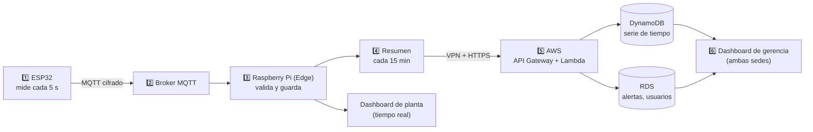

# 🧭 Guía del Equipo — Induplac IoT explicado simple

> **Para quién es:** para cualquier integrante que no estuvo en alguna reunión, que se perdió cambios o que no maneja bien algún tema (redes, nube, IoT).
> **Objetivo:** que después de leer esto puedas **explicar el proyecto completo** y **responder las preguntas del profe** con seguridad.
>
> Última actualización: 2026-10-14. Si algo de esta guía no coincide con otro documento, manda lo que diga [`docs/CONTEXTO.md`](CONTEXTO.md) y avisa al equipo.

---

## 📑 Índice

1. [El proyecto en 1 minuto](#1-el-proyecto-en-1-minuto)
2. [El problema que resolvemos](#2-el-problema-que-resolvemos)
3. [Diccionario rápido (las piezas)](#3-diccionario-rápido-las-piezas)
4. [El viaje de un dato](#4-el-viaje-de-un-dato)
5. [¿Qué pasa si se corta internet?](#5-qué-pasa-si-se-corta-internet)
6. [¿Qué sube a la nube y qué se queda en la planta?](#6-qué-sube-a-la-nube-y-qué-se-queda-en-la-planta)
7. [¿Por qué usamos tres bases de datos?](#7-por-qué-usamos-tres-bases-de-datos)
8. [Alertas](#8-alertas)
9. [Seguridad explicada simple](#9-seguridad-explicada-simple)
10. [La red](#10-la-red)
11. [El dashboard](#11-el-dashboard)
12. [La demo para el profe](#12-la-demo-para-el-profe)
13. [Qué está hecho y qué falta](#13-qué-está-hecho-y-qué-falta)
14. [Preguntas que nos pueden hacer (y cómo responder)](#14-preguntas-que-nos-pueden-hacer-y-cómo-responder)
15. [Números para tener a mano](#15-números-para-tener-a-mano)
16. [Dónde está el detalle](#16-dónde-está-el-detalle)

---

## 1. El proyecto en 1 minuto

Si alguien te pregunta "¿de qué se trata su proyecto?", esta es la respuesta corta:

> **Induplac IoT es una plataforma que mide en tiempo real el consumo de electricidad y agua, la radiación UV, la producción y las horas sin accidentes de dos sedes de la empresa Induplac.**
> **Los sensores mandan los datos a un computador pequeño en cada sede (una Raspberry Pi), que los guarda, calcula alertas y muestra un dashboard. Cada 15 minutos manda un resumen a la nube de AWS, donde se juntan las dos sedes para comparar y ver el histórico.**
> **Lo más importante: si se corta internet, la planta sigue funcionando igual. Los datos se guardan localmente y se suben solos cuando vuelve la conexión, sin perder ni duplicar nada.**

Datos del proyecto:

| | |
|---|---|
| Asignatura | SIY6122 — Problemáticas Globales y Prototipado (Sección 002V) |
| Docente | Marco Antonio Perelli |
| Empresa de referencia | Induplac (real), pero usamos **datos ficticios** |
| Sedes | **Local 1:** planta/taller · **Local 2:** oficinas/administración |
| Equipo | Abraham Castro, Sebastián Fuentes, Lisandra González, Felipe Murúa, Bárbara Saavedra |

---

## 2. El problema que resolvemos

Hoy, en muchas empresas, el consumo se ve **tarde**: llega la boleta a fin de mes y recién ahí alguien nota que algo andaba mal. Nosotros atacamos tres problemas:

1. **Detección tardía:** una máquina que quedó encendida de noche o una fuga de agua se descubre 30 días después. Con el sistema se ve el mismo día.
2. **Seguridad de las personas:** los operarios que trabajan en el patio están expuestos al sol. El sistema avisa cuando la radiación UV es peligrosa.
3. **Quedar a ciegas sin internet:** si todo dependiera de la nube, un corte de fibra dejaría a la planta sin monitoreo. Nuestro sistema sigue funcionando sin internet.

> 💡 **La frase clave:** *"No es solo un dashboard de consumos; es un sistema de continuidad operacional."* Lo que nos diferencia es que la planta nunca queda a ciegas.

---

## 3. Diccionario rápido (las piezas)

| Pieza | Qué es, en simple | Qué hace en nuestro proyecto |
|---|---|---|
| **ESP32** | Un microcontrolador barato con WiFi (un "mini cerebro" para sensores). | Lee los sensores cada 5 segundos y envía los datos. |
| **Wokwi** | Un simulador web de ESP32. | Simulamos los sensores sin comprar hardware. |
| **MQTT** | Un protocolo de mensajes muy liviano, pensado para dispositivos pequeños. | Es el "idioma" con que el ESP32 envía datos. |
| **Broker MQTT** | El "cartero" de MQTT: recibe mensajes y los entrega a quien los pidió. | Recibe los datos de los ESP32 y se los pasa al Edge. |
| **Edge / Edge Gateway** | Un computador que está **en la sede**, cerca de los sensores ("en el borde" de la red). | En nuestro caso es una **Raspberry Pi**: guarda, resume, alerta y muestra el dashboard de planta. |
| **SQLite** | Una base de datos liviana que vive en un solo archivo. | Base de datos local de la Raspberry Pi. |
| **AWS** | La nube de Amazon. Usamos el **Learner Lab** (cuenta educativa con USD 100). | Junta las dos sedes, guarda el histórico, administra usuarios. |
| **API Gateway** | La "puerta de entrada" a la nube: recibe pedidos por HTTPS. | Recibe los resúmenes del Edge y las consultas del dashboard. |
| **Lambda** | Código que corre en la nube solo cuando se necesita (sin servidor encendido). | Procesa lo que llega, revisa alertas y guarda en las bases. |
| **DynamoDB** | Base de datos de AWS sin tablas relacionadas (NoSQL), muy barata. | Guarda la serie de tiempo: los resúmenes cada 15 min. |
| **RDS PostgreSQL** | Base de datos relacional clásica (con tablas y relaciones). | Usuarios, roles, sedes, dispositivos, umbrales, alertas, reportes. |
| **Cognito** | Servicio de AWS para inicio de sesión. | Login del dashboard y **MFA**. |
| **MFA** | Segundo factor: además de la contraseña, un código que cambia cada 30 s en el celular. | Obligatorio para quienes pueden cambiar cosas (Admin y Jefe). Se usa con Microsoft Authenticator. |
| **VPN Site-to-Site** | Un "túnel" cifrado entre la red de la sede y la red en AWS. | Por ahí viajan los datos del Edge a la nube, sin pasar expuestos por internet. |
| **VLAN** | Dividir una red física en varias redes separadas. | Separa los sensores de los computadores de la oficina. |
| **Dashboard** | La página web con indicadores y gráficos. | Lo que ven los operarios, jefes y gerencia. |

---

## 4. El viaje de un dato

Sigamos una medición de electricidad desde el sensor hasta la pantalla:



Paso a paso:

1. **El ESP32 mide** (por ejemplo, 42,7 kW) y lo envía cada 5 segundos en un mensaje JSON por **MQTT cifrado (puerto 8883)**.
2. **El broker** recibe el mensaje y lo entrega a la Raspberry Pi.
3. **La Raspberry Pi valida** que el valor tenga sentido (por ejemplo, que no diga 9.999 kW). Si es válido, lo **guarda en SQLite** y lo muestra en el **dashboard de planta** al instante.
4. **Cada 15 minutos** la Pi calcula un **resumen** (promedio de electricidad y agua, máximo de UV, etc.) y revisa si hay que lanzar una **alerta**.
5. **Envía el resumen a AWS** por la VPN. La Lambda lo guarda en DynamoDB, vuelve a revisar las alertas y las registra en RDS.
6. **El dashboard de gerencia** (en la nube) muestra ambas sedes juntas, el histórico y las comparaciones.

---

## 5. ¿Qué pasa si se corta internet?

**Esta es la parte más importante del proyecto.** Hay que saberla de memoria.

La idea base: **los datos nunca dependen de internet para guardarse. Internet solo se necesita para subirlos a la nube.**

El sistema tiene tres estados:

```
🟢 ONLINE  ──se corta internet──▶  🔴 OFFLINE  ──vuelve internet──▶  🟡 SINCRONIZANDO  ──todo subido──▶  🟢 ONLINE
```

| Estado | Qué pasa en la planta | Qué pasa en la nube |
|---|---|---|
| 🟢 **ONLINE** | Todo normal. La Pi guarda y sube los resúmenes al tiro. | Recibe los resúmenes cada 15 min. |
| 🔴 **OFFLINE** | **Todo sigue igual**: sensores, dashboard en tiempo real y alertas. Solo cambia el indicador. Los resúmenes se acumulan en la Pi marcados como "pendientes". | Gerencia ve la sede como **desconectada**, con su último dato. |
| 🟡 **SINCRONIZANDO** | La Pi sube lo acumulado de a 50 resúmenes, en orden. | Recibe todo lo atrasado. Al terminar, el período del corte queda completo. |

**¿Cómo sabe la Pi que se cortó internet?** Cada 10 segundos le pregunta a AWS "¿estás ahí?" (*healthcheck*). Si falla 3 veces seguidas, pasa a OFFLINE.

**¿Por qué no se pierde nada?** Porque la Pi **nunca borra** un resumen hasta que AWS confirma que lo recibió.

**¿Por qué no se duplica nada?** Porque cada resumen tiene una "llave" única: **sede + hora de inicio del intervalo**. Si AWS recibe dos veces el resumen de "Local 1, 10:15", lo reemplaza en vez de contarlo dos veces.

**¿Y si lo que se cae es la Raspberry Pi?** El ESP32 guarda en su memoria unas **1.500 lecturas (~2 horas)** y las reenvía cuando la Pi vuelve.

**¿Cómo se ve el dashboard sin internet?** Los operarios abren el dashboard **directamente desde la Raspberry Pi** dentro de la red de la planta (por ejemplo, `https://edge.induplac.local`). No necesita salir a internet.

---

## 6. ¿Qué sube a la nube y qué se queda en la planta?

**Regla del equipo:** *el Edge filtra, guarda y resume; AWS consolida, compara y decide.*

| Se queda en la planta (Raspberry Pi) | Sube a la nube (AWS) |
|---|---|
| Cada lectura cruda, cada 5 s (se guarda 30 días) | **Solo resúmenes cada 15 minutos** |
| Validación de datos | Electricidad y agua: promedios |
| Resúmenes pendientes cuando no hay internet | UV: máximo del intervalo y del día |
| Alertas locales | Producción: tableros del mes y acumulado anual |
| Dashboard de planta | Horas-hombre sin incidentes |

**¿Por qué solo resúmenes?**
- Para reportes y comparaciones no necesitas el dato de cada 5 segundos; con cada 15 minutos alcanza para ver el comportamiento por hora y por día.
- Sube mucho menos información: menos costo y menos datos expuestos.
- Nunca sube nada que identifique a personas ni a la empresa real.

---

## 7. ¿Por qué usamos tres bases de datos?

| Base | Dónde | Qué guarda | Por qué esa |
|---|---|---|---|
| **SQLite** | Raspberry Pi | Lecturas crudas, resúmenes pendientes, alertas locales | Es liviana, vive en un archivo, no necesita servidor. Ideal para el Edge. |
| **DynamoDB** | AWS | La serie de tiempo (resúmenes de 15 min) | Casi gratis, siempre encendida y Lambda escribe sin problemas de conexiones. |
| **RDS PostgreSQL** | AWS | Usuarios, roles, sedes, umbrales, alertas, reportes | Necesitamos relaciones entre tablas (quién tiene qué rol) y consultas SQL para comparar períodos. |

**La explicación corta para el profe:** *"Usamos cada base para lo que hace mejor. DynamoDB recibe los datos de los sensores y es casi gratis y siempre está disponible; así podemos apagar RDS para ahorrar crédito sin cortar la recepción de datos. RDS guarda lo que necesita relaciones, como usuarios y roles, y permite hacer reportes con SQL."*

> ⚠️ **No digas** que usamos DynamoDB "porque son demasiados datos". Con resúmenes cada 15 minutos el volumen es bajo. Las razones reales son **costo, disponibilidad y que Lambda no tiene que manejar conexiones**.

---

## 8. Alertas

### Las reglas

| Variable | Cuándo hay alerta 🔴 |
|---|---|
| ⚡ **Electricidad** | El consumo de una hora supera en **20 %** el promedio de esa misma hora en las **últimas 4 semanas**. Mientras no hay 4 semanas de historia, se usa un umbral fijo: sobre 55 kW es crítico (45–55 kW advertencia). |
| 💧 **Agua** | **Local 1 (planta):** alerta sobre 14 m³/día (amarillo sobre 12). **Local 2 (oficinas):** alerta sobre 2,5 m³/día (amarillo sobre 2). Además, **posible fuga** si hay consumo de noche (22:00–06:00) o el fin de semana: más de 0,3 m³/h en la planta o 0,05 m³/h en oficinas durante 1 hora. |
| ☀️ **UV** | Índice **8 o más** (riesgo para quienes trabajan afuera). Entre 6 y 7,9 se muestra amarillo como recomendación de protector y sombra. |

**¿Por qué comparar contra el promedio y no un número fijo en electricidad?** Porque un lunes a las 10:00 es normal consumir mucho, pero un domingo a las 3:00 no. Comparar contra "lo normal para esa hora" detecta lo raro.

### Alertas en dos niveles

Las mismas reglas se revisan en **dos lugares**:

1. **En la Raspberry Pi:** para que la planta tenga alertas **aunque no haya internet**.
2. **En la Lambda (AWS):** para registrar oficialmente la alerta y que gerencia la vea.

**¿No se duplican?** No. Cada alerta se identifica por **sede + variable + intervalo**. Si la Pi creó la alerta sin internet y después la Lambda detecta la misma, se actualiza la misma alerta en vez de crear otra.

Las alertas aparecen **en rojo** en el dashboard. Enviarlas por correo o Telegram queda como mejora futura.

---

## 9. Seguridad explicada simple

Usamos **"defensa en profundidad"**: varias capas, para que si una falla, las otras sigan protegiendo.

| Capa | Qué protege | Cómo, en simple |
|---|---|---|
| **1. Sensores** | Que nadie se haga pasar por un sensor ni mande datos falsos | Cada ESP32 tiene su propio usuario y clave en MQTT, todo va cifrado (TLS), y se descartan valores imposibles (ej. 9.999 kW). |
| **2. Raspberry Pi** | Que no se puedan robar claves ni alterar datos guardados | Claves fuera del código (archivo `.env`), permisos mínimos en AWS, control de integridad en SQLite, acceso SSH solo con llaves. |
| **3. Envío a la nube** | Que nadie lea ni repita los datos en el camino | Túnel **VPN cifrado** + **HTTPS**, y la llave única por intervalo evita duplicados si se reenvía algo. |
| **4. Acceso al dashboard** | Que cada persona vea y haga solo lo que le corresponde | Roles (RBAC) y **MFA** para quienes pueden cambiar cosas. |
| **5. Privacidad y ley** | Los datos de los trabajadores | No guardamos nombres, RUT ni ubicación de personas. Las horas-hombre son solo contadores. Cumple la **Ley 19.628**. |

### Roles: quién ve qué

| Rol | Puede | MFA |
|---|---|---|
| **Operario** | Ver los indicadores de **su sede** (solo mirar) | No |
| **Jefe de Mantenimiento/Operaciones** | Ver **ambas sedes** y **gestionar alertas** | **Sí** |
| **Administrador** | **Todo**: usuarios, configuración y umbrales | **Sí** |

**¿Por qué MFA solo para algunos?** Porque el MFA protege las acciones que **cambian cosas**. El operario solo mira; pedirle MFA agrega fricción sin mucho beneficio.

**¿Cómo se inicia sesión sin internet?** La Raspberry Pi tiene un login local para ver el dashboard. Lo que cambia la configuración (umbrales, usuarios) requiere internet y MFA. Sin internet también se pueden **reconocer alertas** (queda registrado y se sube después). *(Aprobado por el equipo.)*

---

## 10. La red

Si preguntan por la parte de redes, estos son los puntos:

- **VLANs separadas en cada sede:**
  - VLAN de sensores (IoT): `192.168.10.0/24` (Local 1) y `192.168.20.0/24` (Local 2).
  - VLAN de operarios: `192.168.11.0/24` y `192.168.21.0/24`.
  - Los operarios **solo pueden llegar a la Raspberry Pi por HTTPS (443)**. No ven los sensores. Si un sensor fuera hackeado, no puede llegar a los computadores de la oficina.
- **Cero puertos abiertos hacia la planta:** desde internet no se puede entrar. La conexión con AWS la **inicia la planta** hacia afuera.
- **VPN Site-to-Site (IPsec, IKEv2, AES-256)** entre cada sede y la red de AWS (VPC `10.0.0.0/16`).
- **Dos "puertas" en AWS:**
  - Una **privada**, solo alcanzable por la VPN, para que la Pi suba datos.
  - Una **pública**, protegida con login (Cognito), para el dashboard de gerencia.
- **Sin NAT Gateway** y **RDS en una sola zona**, para no gastar el crédito.

> ⚠️ **Sobre la VPN (decisión del equipo):** está diseñada y documentada, pero **no se demuestra**, porque no sabemos si el Learner Lab la permite y además cuesta unos USD 0,05 por hora por conexión. En la demo, la Raspberry Pi sube los datos por **HTTPS a una API pública** con permisos mínimos. Si preguntan, se explica como el diseño para producción.

---

## 11. El dashboard

Es **el mismo dashboard en dos lugares**:

- **En la planta**, servido por la Raspberry Pi: funciona con o sin internet.
- **En la nube**, para gerencia: ve las dos sedes juntas.

Qué muestra:

- Monitor por sede: electricidad y agua actuales **comparados con el promedio histórico**.
- Producción: tableros del mes y acumulado del año.
- Horas-hombre sin incidentes.
- Índice UV del día.
- Alertas activas en rojo.
- Histórico: comparación entre sedes y entre períodos (día, semana, mes).
- Indicador de estado: 🟢 ONLINE / 🔴 OFFLINE / 🟡 SINCRONIZANDO.
- **Panel de demostración:** botones para simular un corte de red e inyectar alertas en vivo.

---

## 12. La demo para el profe

La evaluación no se gana con gráficos bonitos, sino mostrando que **el sistema aguanta sin internet**. El guion:

1. Todo funciona en 🟢 **ONLINE**.
2. Se presiona **"Simular corte de red"** → se corta el enlace entre la Raspberry Pi y AWS. El indicador pasa a 🔴 **OFFLINE**, pero el dashboard **sigue mostrando datos en tiempo real**.
3. Se inyecta un **UV alto** → **la alerta aparece igual**, generada por la Raspberry Pi.
4. Mientras tanto, los resúmenes se acumulan en la Pi como pendientes.
5. Se **reconecta** → 🟡 **SINCRONIZANDO (XX pendientes)**.
6. Todo sube a AWS, la alerta aparece en la vista de gerencia **una sola vez**, y vuelve a 🟢 **ONLINE**. **No se perdió ni se duplicó ningún dato.**

Pruebas de seguridad que también se pueden mostrar:
- Inyectar **9.999 kW** → el sistema lo rechaza.
- Reenviar un lote ya enviado → no se duplica.
- Entrar como **Operario** → no puede ver la vista consolidada ni cambiar umbrales.
- Entrar como **Admin sin código MFA** → no puede entrar.

---

## 13. Qué está hecho y qué falta

**✅ Hecho (diseño y documentación):**
- Arquitectura completa (Edge + nube) y comportamiento online/offline.
- Decisiones de nube del equipo (resúmenes cada 15 min, alertas, roles, MFA).
- Seguridad en 5 capas.
- Red: VLANs, VPN, VPC, permisos entre servicios.
- Bases de datos y cálculo de capacidad.

**⏳ Falta (código), en este orden:**
1. Dashboard (React).
2. Código del ESP32 en Wokwi.
3. Programa de la Raspberry Pi (Python): recibir, guardar, resumir, alertar y sincronizar.
4. Backend en AWS: Lambdas, bases de datos y Cognito con MFA.
5. ~~VPN y API privada~~ → queda solo como diseño (no se demuestra).

**✅ Decidido el 2026-10-14:**
- La demo es **100 % en Wokwi**.
- Sin internet se puede **ver todo y reconocer alertas**; umbrales y usuarios solo con internet y MFA.
- Umbrales de agua definidos (ver sección 8).
- La **VPN queda como diseño** y no se demuestra; Cognito con MFA **sí se implementa**.

**❓ Pendiente:**
- **Broker MQTT:** elegimos HiveMQ Cloud, pero ya no tiene plan gratis permanente (solo prueba de 15 días). Propuesta: **EMQX Serverless**, que sí es gratis. Falta confirmar.
- Probar que el Learner Lab permita **Cognito con MFA**.

---

## 14. Preguntas que nos pueden hacer (y cómo responder)

### Sobre la idea general

**¿Por qué no mandan los datos de los sensores directo a la nube?**
> Porque si se corta internet, los sensores no tendrían dónde mandar los datos y la planta quedaría sin monitoreo. Con la Raspberry Pi en medio, la planta sigue funcionando igual y los datos se suben cuando vuelve la conexión.

**¿Por qué usan datos ficticios si la empresa es real?**
> Por ética y confidencialidad: no tenemos acceso a los sistemas internos de Induplac. Simulamos datos con órdenes de magnitud coherentes con la industria.

**Si el broker está en la nube, ¿cómo sigue funcionando la planta sin internet?**
> En el diseño real, el broker vive dentro de la planta (en la Raspberry Pi), así que un corte de internet no lo afecta. En la simulación lo pusimos en la nube solo porque Wokwi corre en el navegador y no puede llegar a la red local. Por eso, en la demo el "corte" que simulamos es el del enlace entre la Raspberry Pi y AWS, que es el que de verdad se cae en una planta.

**¿Por qué Wokwi y no sensores reales?**
> Para el prototipo, Wokwi permite simular el ESP32 y los sensores sin costo de hardware. El diseño está pensado para pasar después a sensores reales (por ejemplo, SCT-013 para corriente y caudalímetros).

### Sobre el modo offline

**¿Qué pasa si se corta internet?**
> La planta sigue igual: los sensores siguen midiendo, la Raspberry Pi sigue guardando, mostrando el dashboard y generando alertas. Solo cambia el indicador a OFFLINE. Cuando vuelve internet, la Pi sube todo lo pendiente.

**¿Se pierden datos? ¿Se duplican?**
> No se pierden, porque la Pi no borra nada hasta que AWS confirma que lo recibió. No se duplican, porque cada resumen tiene una llave única (sede + hora del intervalo) y si llega dos veces se reemplaza en vez de sumarse.

**¿Cuánto tiempo aguanta sin internet?**
> En la práctica, meses o años. Un año completo de resúmenes ocupa unos 21 MB, y la tarjeta de la Pi tiene unos 22 GB libres. El espacio no es el límite.

**¿Y si se cae la Raspberry Pi?**
> El ESP32 guarda unas 1.500 lecturas en memoria (cerca de 2 horas) y las reenvía cuando la Pi vuelve.

**¿Por qué no ponen una tarjeta SD en cada ESP32 en vez de la Raspberry?**
> Porque mantener tarjetas en cada sensor es poco práctico, las tarjetas en microcontroladores se dañan con cortes de luz, y el ESP32 no tiene capacidad para levantar una VPN ni servir un dashboard.

**¿Cómo ven el dashboard los operarios sin internet?**
> La Raspberry Pi sirve el dashboard dentro de la red de la planta. Los operarios lo abren desde su VLAN, que solo tiene permiso para llegar a la Pi por HTTPS.

### Sobre los datos y las bases

**¿Por qué solo suben promedios cada 15 minutos? ¿No pierden información?**
> Para reportes, comparaciones y alertas por hora o por día, cada 15 minutos es suficiente. El detalle de cada 5 segundos se queda 30 días en la Pi. Así subimos menos datos, gastamos menos y exponemos menos información.

**¿Por qué dos bases de datos en la nube? ¿No basta con una?**
> Podría ser una sola, pero perderíamos dos ventajas. DynamoDB es casi gratis y siempre está disponible, así que podemos apagar RDS para ahorrar crédito sin cortar la recepción de datos. Además, Lambda escribe en DynamoDB sin manejar conexiones. RDS lo usamos para lo que necesita relaciones: usuarios, roles y reportes con SQL.

**¿Por qué MQTT en los sensores y HTTPS hacia la nube?**
> MQTT es muy liviano y está hecho para dispositivos pequeños como el ESP32. Hacia la nube usamos HTTPS porque es el estándar de las APIs y AWS lo maneja directamente.

### Sobre las alertas

**¿Cómo funciona la alerta de electricidad?**
> Comparamos el consumo de cada hora con el promedio de esa misma hora en las últimas 4 semanas. Si lo supera en 20 %, hay alerta. Así detectamos lo anormal para ese momento y no solo valores altos.

**¿Y las primeras 4 semanas, cuando no hay historia?**
> Se usa un umbral fijo de respaldo: sobre 55 kW es crítico.

**¿Por qué UV 8?**
> Desde 8 la radiación se considera de riesgo muy alto para quienes trabajan al aire libre. Entre 6 y 7,9 mostramos una recomendación en amarillo.

**¿Las alertas funcionan sin internet?**
> Sí. Las mismas reglas corren en la Raspberry Pi y en la nube. Sin internet, la Pi genera la alerta; al reconectar se sube y no se duplica con la de la nube.

### Sobre seguridad y red

**¿Para qué la VPN si ya usan HTTPS?**
> Es defensa en profundidad. HTTPS cifra los datos de la aplicación; la VPN cifra a nivel de red y además permite que la puerta de entrada de los datos sea privada, que no exista en internet. Si una capa falla, la otra sigue protegiendo.

**¿Por qué no muestran la VPN funcionando?**
> Porque no tenemos certeza de que la cuenta educativa de AWS permita crearla y además cobra por hora. La dejamos diseñada y documentada para una implementación real; en la demo los datos viajan por HTTPS a una API con permisos mínimos.

**¿Qué pasa si hackean un ESP32?**
> Está en una VLAN aislada: solo puede hablar con la Raspberry Pi por MQTT. No llega a los computadores de la oficina. Además, el broker no le deja publicar datos de la otra sede, y los valores imposibles se descartan.

**¿Qué pasa si un sensor manda un valor absurdo?**
> Se valida contra límites físicos (por ejemplo, 0 a 250 kW). Si está fuera de rango, se registra como falla del sensor y no entra a los cálculos ni a la nube.

**¿Por qué no hay puertos abiertos en la planta?**
> Porque abrir puertos hacia la red de una fábrica es una puerta de entrada para ataques. Todas las conexiones las inicia la planta hacia afuera.

**¿Quién puede ver y cambiar qué?**
> El operario solo ve su sede. El jefe ve ambas sedes y gestiona alertas. El administrador puede todo. Los que pueden cambiar cosas (jefe y admin) entran con MFA.

**¿Cumplen con la ley de protección de datos?**
> Sí, con la Ley 19.628. No guardamos nombres, RUT ni ubicación de trabajadores. Las horas-hombre son solo contadores agregados por turno, y a la nube solo suben resúmenes.

### Sobre costos y alcance

**¿Cuánto cuesta? ¿Les alcanza con los USD 100 del Learner Lab?**
> La mayoría de los servicios cuesta casi nada a esta escala (DynamoDB, Lambda, API Gateway). RDS es una instancia pequeña que apagamos cuando no se usa, y no usamos NAT Gateway. Lo único caro sería la VPN (unos USD 0,05 por hora por conexión); por eso en el MVP queda como diseño y no se levanta.

**¿Qué tienen listo y qué falta?**
> El diseño completo y la documentación están listos. Falta el código: primero el dashboard, después el ESP32 en Wokwi, el programa de la Raspberry Pi y el backend en AWS.

### Si no sabes la respuesta

> **No inventes.** Di: *"Ese punto lo definimos en el documento de decisiones técnicas; déjeme confirmarlo con el equipo"* o *"Eso está en evaluación por el equipo"*. Es mejor que dar un dato equivocado.

---

## 15. Números para tener a mano

| Dato | Valor |
|---|---|
| Frecuencia de lectura de sensores | Cada **5 segundos** |
| Resumen que sube a la nube | Cada **15 minutos** |
| Healthcheck a AWS | Cada **10 s**; 3 fallas = OFFLINE |
| Tamaño del lote al sincronizar | **50** resúmenes |
| Memoria del ESP32 si cae la Pi | ~**1.500 lecturas** (~2 horas) |
| Lecturas crudas guardadas en la Pi | **30 días** (~210 MB) |
| Resúmenes de un año completo | ~**21 MB** |
| Resúmenes guardados en la Pi | **13 meses** (los pendientes, para siempre hasta subirlos) |
| Alerta electricidad | **+20 %** vs. promedio de 4 semanas a la misma hora (respaldo: > 55 kW) |
| Alerta UV | **≥ 8** |
| Rango válido de electricidad | 0 – 250 kW |
| Rango válido de agua | 0 – 50 m³/h |
| Alerta agua Local 1 / Local 2 | > **14** / > **2,5** m³/día (amarillo > 12 / > 2) |
| Posible fuga Local 1 / Local 2 | > **0,3** / > **0,05** m³/h por 1 h, de noche o fin de semana |
| Rango válido de UV | 0 – 15 |
| MQTT cifrado | Puerto **8883** |
| Red de AWS (VPC) | `10.0.0.0/16` |
| VLAN IoT Local 1 / Local 2 | `192.168.10.0/24` / `192.168.20.0/24` |
| VLAN operarios Local 1 / Local 2 | `192.168.11.0/24` / `192.168.21.0/24` |
| Raspberry Pi Local 1 / Local 2 | `192.168.10.10` / `192.168.20.10` |
| Crédito del Learner Lab | **USD 100** |

---

## 16. Dónde está el detalle

| Si quieres saber más de... | Lee |
|---|---|
| Todo el proyecto, decisiones y roadmap | [`docs/CONTEXTO.md`](CONTEXTO.md) |
| Por qué elegimos cada tecnología (ADR-01 a ADR-08) | [`docs/decisiones-tecnicas.md`](decisiones-tecnicas.md) |
| Modo offline, cálculos y sincronización | [`docs/modo-offline.md`](modo-offline.md) |
| Seguridad, roles y MFA | [`docs/ciberseguridad.md`](ciberseguridad.md) |
| Red, VLANs, VPN y AWS | [`infrastructure/README.md`](../infrastructure/README.md) |
| Historial de cambios, ideas y pendientes | [`docs/notas-de-avance.md`](notas-de-avance.md) |
