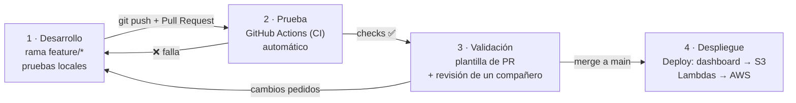

# 🔁 Pipeline DevOps — Induplac IoT

> Entregable 8 de la pauta (tarea 12 de `EN-CURSO.md`): cómo pasa un cambio desde que alguien lo escribe hasta que está funcionando.
> Archivos: [`.github/workflows/ci.yml`](../.github/workflows/ci.yml) (prueba y validación) y [`.github/workflows/deploy.yml`](../.github/workflows/deploy.yml) (despliegue).

---

## 1. Desarrollo

- Cada cambio se hace en **su propia rama** (`feature/...`, `fix/...`, `docs/...`). Nadie hace commit directo en `main` (`CONTRIBUTING.md`).
- Antes de reservar una tarea se anota en [`EN-CURSO.md`](EN-CURSO.md) para no repetir trabajo.
- Pruebas locales según la parte:

| Parte | Cómo se prueba en el PC |
| :--- | :--- |
| Dashboard | `npm run dev` con datos simulados o leyendo la API de AWS |
| Edge | `py edge_gateway.py` + `py simular_esp32.py` (o Wokwi) contra el broker EMQX |
| ESP32 | Wokwi: el Serial Monitor muestra cada publicación MQTT |
| Lambdas | `curl` a `/health` y `/config/umbrales`; *Test* en la consola de Lambda |
| Pruebas del Edge | `py -m unittest discover -s tests -v` (desde `edge/`) |

## 2. Prueba automática (CI)

Al abrir un Pull Request, **GitHub Actions** corre solo `ci.yml`, con tres trabajos en paralelo:

| Trabajo | Qué revisa | Por qué |
| :--- | :--- | :--- |
| **Dashboard** | `npm ci`, `oxlint` (calidad del código), `tsc` (tipos) y `vite build` | Si no compila, no se puede publicar en S3 |
| **Edge y Lambdas** | Sintaxis de todo el Python y **15 pruebas** del Edge | Protege lo que se demuestra: validación de rangos, descarte de duplicados (también si el ESP32 se reinicia) y las reglas de alerta: UV ≥ 8, energía sobre 55 kW, fuga de agua solo fuera de horario, id único por alerta |
| **Secretos** | `gitleaks` busca claves, tokens y contraseñas en el código | Ley 19.628 y capa de seguridad: ninguna credencial al repositorio |

Si un trabajo falla, el PR muestra **❌** y vuelve al paso 1.

## 3. Validación

- **Plantilla de PR** obligatoria (`.github/pull_request_template.md`): qué se cambió, por qué, cómo probarlo y checklist (tarea reservada, notas de avance, sin credenciales).
- **Revisión de un compañero**, que aprueba o pide cambios.
- **Regla de `main`** (*Settings → Branches → Branch protection*): no se puede mergear sin los checks de CI en verde ni sin una aprobación.

## 4. Despliegue (CD)

`deploy.yml` publica en AWS lo que está en `main`:

| Qué | Cómo |
| :--- | :--- |
| **Dashboard → S3** | Build con la URL de la API y el Client ID de Cognito, y `aws s3 sync` al bucket |
| **Lambda `induplac-api`** | Zip del código y `aws lambda update-function-code` |
| **Lambda `induplac-config`** | Zip con `pg8000` y el certificado de RDS, y `update-function-code` |
| **Verificación** | `curl /health` al final |
| **Edge (Raspberry Pi)** | *Diseño:* `git pull` + reinicio del servicio `systemd`. En la demo corre en un PC |
| **ESP32** | *Simulación:* se copia `simulation/wokwi-local1/` al proyecto de Wokwi. Con hardware real: OTA |

### Limitación honesta: AWS Academy Learner Lab

Las credenciales del Learner Lab **vencen cada ~4 horas** y **no se pueden crear usuarios ni roles IAM**. Por eso GitHub no puede guardar una llave permanente:

- El despliegue se lanza **a mano** (*Actions → Deploy → Run workflow*) después de pegar las credenciales del lab del momento como secretos (`AWS_ACCESS_KEY_ID`, `AWS_SECRET_ACCESS_KEY`, `AWS_SESSION_TOKEN`).
- **En producción** se usaría un **rol IAM con OIDC** para GitHub: sin llaves guardadas y despliegue **automático al mergear a `main`**.

---

## Configuración (una sola vez)

1. **Variables** (*Settings → Secrets and variables → Actions → Variables*): `S3_BUCKET`, `VITE_API_URL` (`https://<api-id>.execute-api.us-east-1.amazonaws.com/api`) y `VITE_COGNITO_CLIENT_ID`.
2. **Secretos** (misma pantalla → *Secrets*): las 3 credenciales del Learner Lab. Se actualizan cada vez que se despliega.
3. **Regla de `main`**: exigir los checks *Dashboard*, *Edge y Lambdas* y *Sin claves en el repositorio*, y 1 aprobación.

> El login con Cognito (`login: cognito` en *Run workflow*) requiere el PR #20 mergeado. Con `login: simulada` se publica el login de demo.

## Evidencia para la presentación

- Pestaña **Actions** del repositorio: historial de ejecuciones de CI.
- Cualquier PR: sección *Checks* con los tres trabajos en ✅.
- Ejecución de **Deploy**: el log muestra el `aws s3 sync`, la actualización de las Lambdas y el `/health` final.
