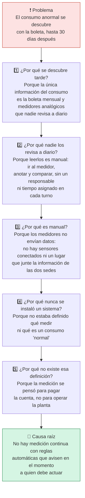
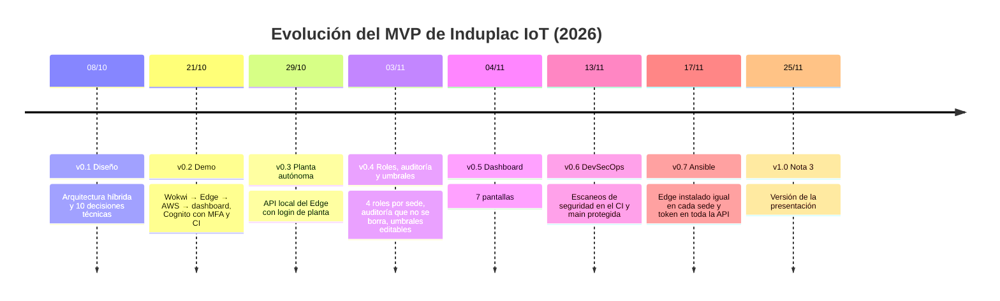

# 🔎 5 Porqués y evolución del MVP — Nota 3

> **Autora:** Lisandra González (`lisagonzalez-jpg`). Tarea 36 de [`EN-CURSO.md`](../EN-CURSO.md) · criterio 1 de la pauta ([`nota-3.md`](../nota-3.md), IL 1.6, 10 %).
> Basado en [`CONTEXTO.md`](../CONTEXTO.md), [`conclusiones.md`](../conclusiones.md), [`devops.md`](../devops.md) y [`backlog.md`](backlog.md). Estado al **18/11/2026**.

**En resumen:** preguntamos "¿por qué?" cinco veces sobre el problema principal de Induplac y llegamos a una causa raíz: **la medición del consumo existe para pagar, no para operar**. No hay medición continua ni reglas que digan qué es "normal", así que nadie puede reaccionar a tiempo. Nuestra solución ataca esa causa con sensores, un Edge en cada sede, reglas de alerta automáticas y un dashboard por rol. Al final está la **línea de tiempo del MVP**, de `v0.1` a `v0.7`.

> ⚠️ No tenemos datos internos de Induplac (ver [`CONTEXTO.md`](../CONTEXTO.md) §3). Las respuestas se basan en cómo funciona hoy una planta típica con boleta mensual y medidores analógicos, que es el escenario que definimos en el diseño.

---

## 1. Qué es la técnica y por qué la elegimos

Los **5 Porqués** consisten en partir de un problema visible y preguntar "¿por qué pasa esto?" una y otra vez, hasta llegar a la causa que, si se corrige, evita que el problema se repita. Normalmente bastan cinco preguntas.

La elegimos porque el problema de Induplac parece técnico ("faltan sensores"), pero tiene un fondo de **gestión**: aunque se pusieran medidores, si nadie define qué es un consumo normal ni quién reacciona, el problema seguiría. Los 5 Porqués ayudan a no quedarse en el primer síntoma.

## 2. El problema

> **En Induplac, el consumo anormal de energía y agua (una máquina encendida fuera de turno, una fuga) se descubre tarde: con la boleta mensual, hasta 30 días después.**

## 3. Los 5 Porqués

| # | Pregunta | Respuesta |
|---|---|---|
| 1 | ¿Por qué el consumo anormal se descubre tarde? | Porque la única información es la **boleta mensual** y los medidores analógicos, que nadie revisa a diario. |
| 2 | ¿Por qué nadie los revisa a diario? | Porque leerlos es **manual** (ir al medidor, anotar, comparar) y no hay un responsable ni tiempo asignado en cada turno. |
| 3 | ¿Por qué es manual? | Porque los medidores **no envían datos**: no hay sensores conectados ni un sistema que junte la información de las dos sedes. |
| 4 | ¿Por qué nunca se instaló un sistema? | Porque **no estaba definido qué medir ni qué es un consumo "normal"** (sin línea base por hora ni umbrales). |
| 5 | ¿Por qué no existe esa definición? | Porque la medición del consumo **se pensó para pagar la cuenta, no para operar la planta**. |

**🎯 Causa raíz:** Induplac no tiene **medición continua con reglas automáticas** que conviertan los datos en un **aviso en el momento** para la persona que debe actuar.

### Comprobación de la causa raíz

Para validar que llegamos a la raíz y no a un síntoma, hicimos la pregunta inversa: *"si corregimos esta causa, ¿el problema desaparece?"*

- Si solo ponemos sensores (porqué 3), los datos se acumulan pero nadie sabe cuándo preocuparse → **el problema sigue**.
- Si medimos, definimos qué es normal, avisamos solo y dejamos registro de quién atendió (causa raíz) → la anomalía se ve **el mismo día** → **el problema desaparece**.

## 4. Cómo nuestra solución ataca cada porqué

| Porqué | Qué lo resuelve en Induplac IoT | Evidencia |
|---|---|---|
| 1. Solo hay boleta mensual | Datos cada **5 s** desde los sensores (Wokwi/ESP32) y **promedios cada 15 min** en el dashboard | HU-01 · tareas 1, 3, 4 y 5 |
| 2. Revisar es manual y sin responsable | El sistema revisa solo. Las alertas llegan al dashboard según **rol y sede**, y el jefe las **reconoce con un comentario** (queda quién y cuándo) | HU-10, HU-12 · tareas 26 y 28 |
| 3. Los medidores no envían datos | Sensores → **MQTT** → **Edge** en cada sede → **AWS**, que consolida las dos sedes | Arquitectura en [`arquitectura.md`](../arquitectura.md) |
| 4. No estaba definido qué medir ni qué es "normal" | **Reglas de alerta**: energía **+20 %** sobre el promedio de 4 semanas a la misma hora (con umbral fijo de respaldo), **posible fuga** si hay caudal entre 22:00 y 06:00, **UV ≥ 8**. Umbrales **editables** sin tocar código | HU-02 a HU-04, HU-11 · `edge/reglas.py` |
| 5. La medición es para pagar, no para operar | **Alertas con responsable** (llegan según rol y sede y el jefe las reconoce con comentario) + un **dashboard de operación** de 7 pantallas que funciona aunque se corte internet. Es lo que cambia de "pagar" a "operar" | HU-02 a HU-05, HU-12 · tareas 28 y 30 |

> Los otros dos problemas de Induplac salen de la misma raíz: el **riesgo UV** (nadie mide la radiación en los patios ni avisa) y la **ceguera sin internet** (una solución 100 % nube también dejaría de avisar). Por eso las alertas corren **también en el Edge**, sin depender de la nube.

---

## 5. Evolución del MVP (línea de tiempo)

El MVP creció en **7 versiones (`v0.1` a `v0.7`) y la `v1.0` el día de la presentación**, cada una con nombre (*tags* de Git, ver [`devops.md`](../devops.md)). Cada una respondió a algo que aprendimos en la anterior.

| Versión | Fecha | Qué trajo | Por qué (qué aprendimos antes) | Sprint |
|---|---|---|---|---|
| `v0.1` | 08/10 | Diseño: arquitectura híbrida y decisiones cloud | El problema exige que la planta siga avisando sin internet → Edge + nube, no solo nube | 1 |
| `v0.2` | 21/10 | MVP de punta a punta para la demo, Cognito con MFA y CI | Había que probar la idea completa. Se movieron las alertas de RDS a DynamoDB porque RDS cobra por hora. Después de la demo quedó anotado que la API no validaba el token (HU-08) | 2 y 3 |
| `v0.3` | 29/10 | Planta autónoma: API local del Edge con login | En la demo el dashboard de planta dependía de la nube; sin internet, la planta no quedaba realmente autónoma | 4 |
| `v0.4` | 03/11 | Roles por sede, auditoría y umbrales editables | Las alertas necesitan un **responsable** y reglas ajustables sin programar (porqués 2 y 4). Los umbrales se copian a DynamoDB para que las alertas sigan con RDS apagado | 5 |
| `v0.5` | 04/11 | Dashboard de 7 pantallas | Los bocetos aprobados el 01/11 ordenaron qué ve cada rol | 5 |
| `v0.6` | 13/11 | DevSecOps en el CI y `main` protegida | Con más gente cambiando código, había que asegurar que nada entrara sin pruebas ni revisión de seguridad | 6 |
| `v0.7` | 17/11 | Ansible para el Edge y token en toda la API | Para llevarlo a varias sedes, cada Edge debe quedar igual; y se cerró el hueco de HU-08 | 7 |
| `v1.0` | 25/11 | Versión de la Nota 3 | Se crea el día de la presentación | 7 |

**Cómo leerla:** el MVP partió resolviendo el **qué** (medir y alertar, `v0.1`–`v0.2`), luego el **quién** (autonomía, roles y responsables, `v0.3`–`v0.5`) y al final el **cómo mantenerlo** (calidad, seguridad e instalación repetible, `v0.6`–`v0.7`). Ese último paso es la base de la [transferencia tecnológica](transferencia-tecnologica.md).

---

## 6. Para la presentación (1 a 2 diapositivas)

1. **Diapositiva de los 5 Porqués:** el diagrama de la sección 3 y, abajo, la causa raíz en una frase.
2. **Diapositiva de la evolución:** la línea de tiempo de la sección 5.
3. **Frase para decir:** *"Si solo hubiéramos puesto sensores, el problema seguiría: el fondo era que nadie sabía qué es un consumo normal ni quién debe reaccionar. Por eso el MVP no solo mide: tiene reglas, alertas por rol y registro de quién atendió."*

### Preguntas probables

| Pregunta | Respuesta corta |
|---|---|
| ¿Por qué 5 Porqués y no Ishikawa para el problema? | Los 5 Porqués siguen **una** cadena hasta la raíz del problema del negocio. Ishikawa lo usamos para otra cosa: las causas de que una **alerta no llegue a tiempo** ([`ishikawa.md`](ishikawa.md)). |
| ¿Cómo saben que es la causa raíz? | Con la pregunta inversa: si solo corregimos un porqué intermedio, el problema sigue; si corregimos la raíz, desaparece (sección 3). |
| ¿Usaron datos reales de Induplac? | No. Por ética y confidencialidad todo es ficticio; el análisis parte del escenario que definimos en el diseño. |
