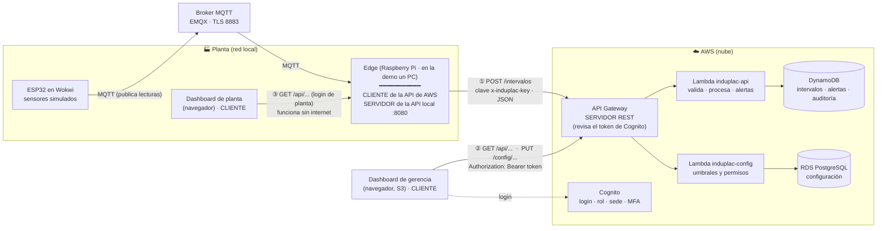
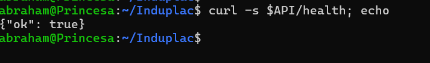
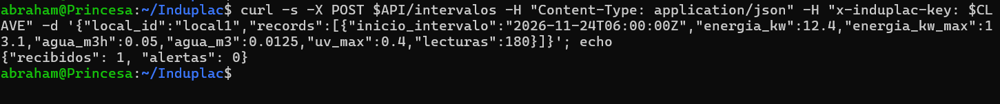
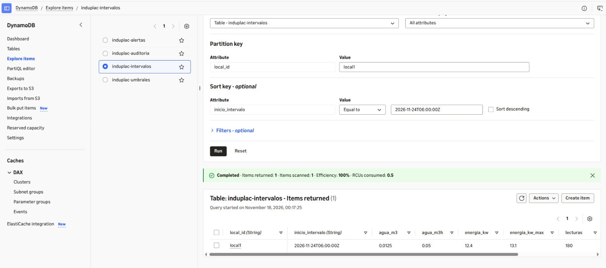
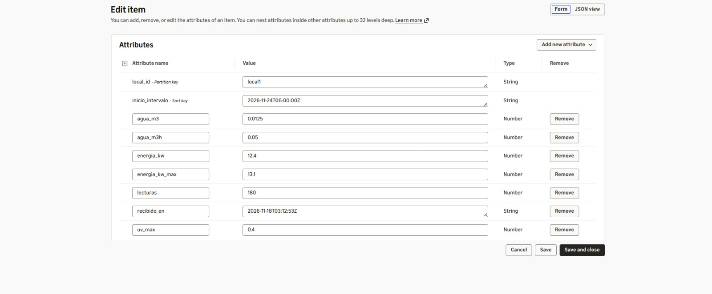
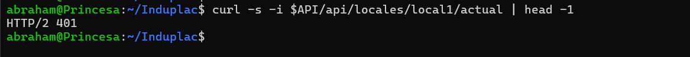
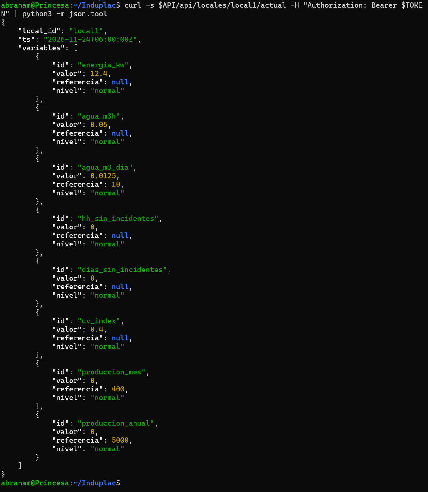

# 🔌 Arquitectura cliente-servidor y API REST — Induplac IoT

> **Tarea 34 · Criterio 3 de la Nota 3 (10 %).** Responsables: Abraham Castro y Felipe Murúa.
> La pauta pide explicar cómo los datos IoT simulados **se envían y se consultan** con una arquitectura cliente-servidor, y mostrar **funcionando** las operaciones de envío y consulta por API REST.
> Contrato completo de la API: [`api-dashboard.md`](../api-dashboard.md). Explicación simple: [guía del equipo §12](../GUIA-EQUIPO.md).

---

## 1. Cliente-servidor en una frase

Un **cliente** pide o manda algo; un **servidor** lo recibe, lo procesa y responde. En Induplac hay **dos servidores REST** (uno en la nube y otro en la planta) y **tres clientes**.

## 2. Diagrama



| # | Cliente | Servidor | Operación | Para qué |
|---|---|---|---|---|
| ① | **Edge** | API Gateway + Lambda (AWS) | **Envío:** `POST /intervalos` | Subir los resúmenes de 15 minutos de cada sede |
| ② | **Dashboard de gerencia** | API Gateway + Lambda (AWS) | **Consulta:** `GET /api/...` (y `PUT /config/...` para cambiar umbrales) | Ver el estado, las alertas y el histórico de las sedes |
| ③ | **Dashboard de planta** | API local del Edge | **Consulta:** `GET /api/...` | Ver la planta **aunque no haya internet** |

> El ESP32 **no** usa REST: publica por **MQTT**, que es más liviano para sensores. El **Edge** es el puente: recibe por MQTT y habla REST con la nube. Por eso el Edge es **cliente** (de AWS) y **servidor** (del dashboard de planta) al mismo tiempo.

## 3. Las operaciones principales

| Método y ruta | Quién la usa | Cómo se autentica | Qué hace | Respuesta |
|---|---|---|---|---|
| `POST /intervalos` | Edge | Cabecera `x-induplac-key` (clave del Edge) | **Envía** un lote de resúmenes de 15 min (el Edge manda hasta 50 por lote) | `200 {"recibidos": n, "alertas": n}` |
| `GET /health` | Edge, monitoreo | Ninguna | ¿Está viva la API? | `200 {"ok": true}` |
| `GET /api/locales/{local_id}/actual` | Dashboard | `Authorization: Bearer <token de Cognito>` | **Consulta** los valores actuales de una sede | JSON con cada variable, su valor y su nivel |
| `GET /api/alertas?local_id=local1` | Dashboard | Token | **Consulta** las alertas, filtradas por la sede del usuario | Lista de alertas |
| `GET /api/historico?...` | Dashboard | Token | **Consulta** series por 15 min, hora, día o mes | Serie de puntos |
| `PUT /config/umbrales/{local_id}/{variable}` | Dashboard (admins) | Token + rol admin | **Cambia** un umbral (RDS → DynamoDB + auditoría) | Umbral guardado |

**Códigos de respuesta:** `200` bien · `400` pedido mal armado · `401` sin sesión o clave inválida · `403` sin permiso para esa sede o acción · `404` no existe · `503` la fuente de datos no responde (por ejemplo, RDS apagado).

### Ejemplo de envío (lo que manda el Edge)

```json
POST /intervalos
x-induplac-key: <clave del Edge, nunca en el repo>

{
  "local_id": "local1",
  "records": [
    {
      "inicio_intervalo": "2026-11-24T06:00:00Z",
      "energia_kw": 12.4, "energia_kw_max": 13.1,
      "agua_m3h": 0.05, "agua_m3": 0.0125,
      "uv_max": 0.4, "lecturas": 180
    }
  ]
}
```

La Lambda responde `{"recibidos": 1, "alertas": 0}`. Si se manda **dos veces**, el registro se **reemplaza** y no se duplica, porque la llave en DynamoDB es *sede + hora del intervalo*.

---

## 4. Demo de la API (envío y consulta funcionando)

> Se corre desde **WSL (Ubuntu)** en el PC de Abraham, con el **lab de Felipe encendido**. Toma unos 10 minutos y deja 5 capturas en `docs/nota-3/img/`.
> ⚠️ **Nunca** se escribe la clave ni el token en pantalla ni en un archivo del repo: se piden con `read -s`, que no los muestra.

### 4.0 Preparar (una vez por sesión)

```bash
API=https://3j82c54obf.execute-api.us-east-1.amazonaws.com
read -s -p "Clave del Edge (CLAVE_INGESTA de edge/.env): " CLAVE; echo
```

### 4.1 ¿Está viva la API?

```bash
curl -s $API/health; echo
```
✅ `{"ok": true}` · 📸 `api-1-health.png`

### 4.2 Envío: `POST /intervalos`

```bash
curl -s -X POST $API/intervalos \
  -H "Content-Type: application/json" -H "x-induplac-key: $CLAVE" \
  -d '{"local_id":"local1","records":[{"inicio_intervalo":"2026-11-24T06:00:00Z","energia_kw":12.4,"energia_kw_max":13.1,"agua_m3h":0.05,"agua_m3":0.0125,"uv_max":0.4,"lecturas":180}]}'; echo
```
✅ `{"recibidos": 1, "alertas": 0}` (valores normales: no hay alerta) · 📸 `api-2-envio.png`

**Se manda de nuevo el mismo comando** → vuelve a responder `recibidos: 1`, y en **DynamoDB → tabla `induplac-intervalos`** sigue habiendo **un solo** registro para `local1` + `2026-11-24T06:00:00Z` (no se duplica) · 📸 `api-3-dynamodb.png`

> El intervalo de ejemplo es a las **03:00 de Chile** del 24/11 y con valores normales, para no generar alertas falsas.
> ⚠️ Como su fecha es **futura**, `GET /actual` lo toma como el último dato de la planta y el dashboard muestra 12.4 kW hasta esa fecha. Por eso **se borra al terminar** (§4.5).

### 4.3 Consulta sin sesión → `401`

```bash
curl -s -i $API/api/locales/local1/actual | head -1
```
✅ `HTTP/2 401`: sin token no se entrega nada · 📸 `api-4-sin-token.png`

### 4.4 Consulta con sesión → `200`

1. Entrar al dashboard de gerencia con la cuenta de Abraham (con MFA).
2. **F12 → Red (Network)** → recargar → clic en un pedido a `/api/...` → *Encabezados* → copiar el valor de `Authorization` **sin** la palabra `Bearer` (sin mostrarlo en el proyector).
3. En WSL:

```bash
read -s -p "Token (pegar y Enter): " TOKEN; echo
curl -s $API/api/locales/local1/actual -H "Authorization: Bearer $TOKEN" | python3 -m json.tool
curl -s "$API/api/alertas?local_id=local1" -H "Authorization: Bearer $TOKEN" | python3 -m json.tool | head -30
```
✅ JSON con las variables de la planta y su nivel, y la lista de alertas de **su** sede · 📸 `api-5-consulta.png`

> El token dura alrededor de 1 hora. Si responde `401`, hay que volver a copiarlo.

### 4.5 Al terminar

```bash
unset CLAVE TOKEN
```

Y en **DynamoDB → `induplac-intervalos`**: seleccionar el registro `local1` + `2026-11-24T06:00:00Z` → **Acciones → Eliminar elementos**. Así el dashboard vuelve a mostrar el dato real.

### 4.6 Evidencias (18/11/2026)

| # | Qué muestra | Captura |
| --- | --- | --- |
| 1 | `GET /health` → `{"ok": true}` |  |
| 2 | `POST /intervalos` → `{"recibidos": 1, "alertas": 0}` |  |
| 3 | DynamoDB: `Items returned: 1` aunque se envió dos veces (no se duplica) |  |
| 3b | El registro guardado: los mismos valores que se enviaron, y `recibido_en` con la hora del **segundo** envío (00:12 de Chile): el reenvío **reemplazó** al primero en vez de duplicarlo |  |
| 4 | Consulta sin token → `HTTP/2 401` |  |
| 5 | Consulta con token → JSON con las 8 variables de `local1` y su nivel |  |

---

## 5. Para la presentación (criterio 3)

- **Qué es:** el ESP32 publica por **MQTT** al broker; el **Edge** lo recibe, valida y resume, y lo **envía** a la nube con `POST /intervalos`. El **dashboard consulta** con `GET /api/...` usando el token de Cognito. Todo en **JSON** y con **códigos HTTP** estándar.
- **Dos servidores:** el de AWS para todos y el **local del Edge** para que la planta siga viendo sus datos **sin internet**.
- **Seguridad en cada pedido:** el Edge entra con su clave; las personas, con token (rol y sede); sin token, `401`.
- **Funcionando:** los comandos de la sección 4 (o su captura), y en la demo en vivo, la pestaña *Red* del navegador mostrando los `GET /api/...`.
- **Detalle del backend** (qué hace la Lambda con cada pedido): criterio 4, tarea 35 de Felipe.
