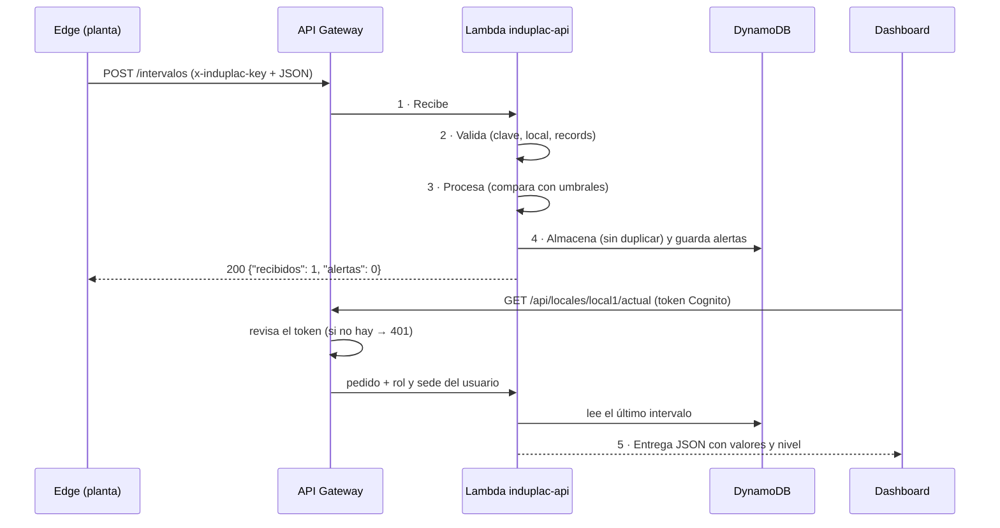

# ⚙️ Backend: qué hace la nube con cada dato (Nota 3 · criterio 4)

> **Tarea 35.** Lo presenta Felipe Murúa (borrador: Abraham con Claude, 18/11/2026).
> Criterio 4 de la pauta (IL 3.4 · 10 %): *cómo el backend recibe, valida, procesa, almacena y entrega la información, con la tecnología justificada.*
> No se configuró nada nuevo: se explica el backend que ya funciona. Las capturas son las de la demo de la API del 18/11 ([`api-rest.md`](api-rest.md) §4.6).

---

## 1. En una frase

El backend es **código Python en AWS Lambda** que corre **solo cuando llega un pedido**. Recibe los datos que manda el Edge, revisa que vengan bien y de quien corresponde, decide si hay alerta, los guarda en DynamoDB y se los entrega al dashboard solo a quien tiene permiso.

## 2. Las piezas

| Pieza | Qué es | Qué hace |
| --- | --- | --- |
| **API Gateway** | La "puerta" de la API en AWS | Recibe los pedidos HTTPS y se los pasa a la Lambda que corresponde. En `/api/*` revisa el token de Cognito **antes** de llamar a la Lambda |
| **Lambda `induplac-api`** | El backend principal ([`backend/lambda_api/`](../../backend/lambda_api/)) | Ingesta (`POST /intervalos`), alertas y todas las consultas del dashboard (`GET /api/...`) |
| **Lambda `induplac-config`** | El backend de configuración ([`backend/lambda_config/`](../../backend/lambda_config/)) | Lee y cambia los umbrales en RDS (`/config/...`). Va aparte porque es la única que entra a la red privada donde está RDS |
| **DynamoDB** | Base NoSQL, siempre encendida | Guarda las mediciones (`induplac-intervalos`), las alertas, la auditoría y una copia de los umbrales |
| **RDS PostgreSQL** | Base relacional | Guarda la configuración: umbrales, sedes, dispositivos y permisos. Se enciende solo para configurar |
| **Cognito** | Cuentas y login | Entrega el token con el rol (grupo) y la sede de cada persona, y exige MFA |

## 3. El recorrido de un dato en 5 pasos

### ① Recibe

El Edge resume las lecturas de los sensores cada **15 minutos** y manda ese resumen con `POST /intervalos`. API Gateway recibe el pedido por HTTPS y se lo pasa a la Lambda `induplac-api`. La Lambda mira **qué ruta y qué método** llegaron y llama a la función que corresponde (`lambda_handler`).

📸 Evidencia: [`api-2-envio.png`](img/api-2-envio.png). El servidor responde `{"recibidos": 1, "alertas": 0}`.

### ② Valida

Antes de guardar nada, la Lambda revisa:

- **¿Quién lo manda?** El Edge debe traer la cabecera `x-induplac-key` con la clave correcta. Si no la trae → `401 NO_AUTORIZADO`. La clave está en una variable de entorno de la Lambda, **nunca en el repo**.
- **¿Viene bien?** `local_id` tiene que ser una sede que existe y `records` no puede venir vacío. Si no → `400 LOTE_INVALIDO`.
- **Para las consultas del dashboard** (`/api/*`), API Gateway revisa el **token de Cognito**. Sin token → `401`, y la Lambda ni se entera. Con token, la Lambda revisa además el **rol** y la **sede**: si un usuario pide una sede que no es la suya → `403 SIN_PERMISO`.

📸 Evidencia: [`api-4-sin-token.png`](img/api-4-sin-token.png). Sin sesión, la respuesta es `HTTP/2 401`.

### ③ Procesa

Con cada intervalo recibido, la Lambda decide si hay **alerta** (`evaluar_alertas`):

| Variable | Regla |
| --- | --- |
| ⚡ Energía | Crítico si supera en **20 %** el promedio de esa misma hora en las últimas 4 semanas. Sin 4 semanas de historia, usa un umbral fijo |
| ☀️ UV (solo Planta) | Crítico si el índice UV es ≥ 8 |
| 💧 Agua, caudal | Posible fuga: caudal alto **fuera de horario** |
| 💧 Agua, día | Consumo del día sobre el tope de la sede |

Los umbrales **no están fijos en el código**: se cambian desde la pantalla *Umbrales* del dashboard. Se guardan en RDS y se copian a DynamoDB, que es de donde los lee esta Lambda.

### ④ Almacena

- La medición se guarda en DynamoDB (`induplac-intervalos`) con la llave **`local_id` + `inicio_intervalo`**. Si el mismo intervalo llega dos veces (por ejemplo, porque el Edge reintentó después de un corte de internet), **se reemplaza en vez de duplicarse** (ADR-05).
- También se guarda `recibido_en`, la hora en que llegó a la nube.
- Si hubo alerta, se guarda en `induplac-alertas` con un id fijo (`local + variable + intervalo`), así que tampoco se duplica (ADR-06).

📸 Evidencia: [`api-3-dynamodb.png`](img/api-3-dynamodb.png) y [`api-3b-dynamodb-registro.png`](img/api-3b-dynamodb-registro.png). El dato se envió **dos veces** y quedó **un solo** registro, con `recibido_en` del segundo envío.

### ⑤ Entrega

El dashboard pide los datos con `GET /api/...` y su token. La Lambda:

1. Filtra por la **sede** del usuario (un admin de Oficinas no ve la Planta).
2. Lee el último intervalo de DynamoDB.
3. Arma un **JSON** con cada variable, su valor, su referencia y su **nivel** (`normal`, `advertencia`, `critico`), que el dashboard pinta de verde, amarillo o rojo.

📸 Evidencia: [`api-5-consulta.png`](img/api-5-consulta.png). Es el JSON con las 8 variables de `local1`.

**Si algo falla adentro**, la Lambda responde `500 ERROR_INTERNO` sin mostrar el detalle del error al cliente, y el detalle queda en los logs de CloudWatch.

## 4. ¿Por qué Lambda y no un servidor con Flask o FastAPI?

| | **AWS Lambda** (lo que usamos) | **Flask/FastAPI en una EC2** |
| --- | --- | --- |
| **Costo** | Se cobra solo cuando llega un pedido. Con un intervalo cada 15 min por sede, queda dentro de la capa gratuita | La máquina cobra las 24 horas, aunque no llegue nada. Con el crédito limitado del Learner Lab, eso pesa |
| **Mantención** | AWS se encarga del servidor, del sistema operativo y de los parches | Hay que instalar, actualizar y asegurar el servidor nosotros |
| **Escala** | Si llegan más pedidos, AWS abre más copias sola | Hay que agrandar la máquina o poner un balanceador |
| **Integración** | Se conecta directo con API Gateway, Cognito (login), DynamoDB y CloudWatch (logs) | Hay que programar a mano el login, el HTTPS y los logs |
| **Disponibilidad** | Si RDS está apagado, la ingesta igual funciona (usa DynamoDB) | Si la máquina se cae o se apaga, no se recibe nada |

**Lo que cuesta (y cómo lo resolvimos):**

- **Arranque en frío:** la primera llamada después de un rato tarda un poco más. Para datos cada 15 minutos no importa.
- **Conexiones a RDS:** cada Lambda abriría su propia conexión y podría saturar una base chica. Por eso los datos van a DynamoDB, que no usa conexiones, y RDS se usa solo para configuración, desde una Lambda aparte (`induplac-config`, ADR-01).
- **Límite de tiempo** (hasta 15 min por ejecución): nuestros pedidos duran milisegundos.

**Una sola Lambda para toda la API** (y no una por ruta): es más simple de desplegar y probar para un MVP. Las rutas se separan dentro del código.

## 5. Y sin internet: el "backend local" del Edge

El Edge (una Raspberry Pi en la planta real; en el prototipo, una EC2 por sede que la simula, instalada con Ansible) también hace de backend **local**. Cada uno recibe por MQTT solo los datos de su sede, valida, resume cada 15 min, evalúa las **mismas alertas** y guarda en SQLite. Además, entrega su propia API en el puerto `8080` para que la planta siga viendo sus datos **aunque se corte internet**. Cuando vuelve la conexión, envía lo pendiente, y gracias al paso ④ no se duplica nada.

## 6. Cómo sabemos que funciona

- **Pruebas automáticas:** 46 pruebas de la Lambda `induplac-api` y 5 de `induplac-config` corren en cada PR con GitHub Actions, junto con el análisis de seguridad. Detalle en [`plan-de-pruebas.md`](plan-de-pruebas.md).
- **Prueba real:** la demo del 18/11 con las 5 capturas ([`api-rest.md`](api-rest.md) §4.6).

## 7. Preguntas que puede hacer el profe

| Pregunta | Respuesta corta |
| --- | --- |
| *¿Qué pasa si llega el mismo dato dos veces?* | Se reemplaza, no se duplica: la llave es local + hora del intervalo. Lo probamos (captura 3) |
| *¿Y si alguien manda datos falsos?* | Sin la clave del Edge, la API responde `401` y no guarda nada |
| *¿Por qué no un servidor?* | Costo (se paga por uso), cero mantención, escala sola y se integra con Cognito y DynamoDB |
| *¿Dónde se procesan las alertas?* | En dos lugares con las mismas reglas: el Edge (funciona sin internet) y la Lambda |
| *¿Por qué dos bases de datos?* | DynamoDB para mediciones (rápida, sin conexiones, siempre encendida) y RDS para configuración (necesita relaciones y SQL) |
| *¿Dónde quedan los errores?* | En CloudWatch Logs. Al cliente solo le llega `500` sin detalles |

## 8. Para la presentación (1-2 minutos)

1. Mostrar el diagrama de la §3 y recorrer los 5 pasos con una captura cada uno.
2. Remarcar la **validación** (clave del Edge y token con rol y sede) y que **no se duplica**.
3. Cerrar con la tabla de **por qué Lambda** (§4).
