# 📁 Carpeta de evidencias — Nota 3

> **Tarea 43.** Índice de las pruebas de que el prototipo funciona y de cómo se tomaron las decisiones, ordenadas por criterio de la pauta.
> Se va completando a medida que el equipo termina cada parte. **Última actualización: 18/11/2026, 23:40.**
> ✅ = evidencia lista · ⏳ = falta (dice quién)

## Resumen

| # | Criterio | Peso | Evidencias |
| --- | --- | --- | --- |
| 1 | Problema y evolución del MVP | 10 % | ✅ |
| 2 | Pipeline DevOps | 10 % | ✅ (falta 1 captura de CI) |
| 3 | Cliente-servidor y API REST | 10 % | ✅ |
| 4 | Backend | 10 % | ✅ |
| 5 | Ágil y Lean | 15 % | ✅ |
| 6 | Transferencia tecnológica | 15 % | ✅ |
| 7 | Gestión del equipo | 15 % | ✅ |
| 8 | Herramientas de calidad | 15 % | ✅ |
| — | Demo en vivo y dashboard | — | ⏳ capturas del dashboard, Wokwi y modo offline |
| — | Grabación | — | ⏳ 24/11 |

---

## 1. Problema y evolución del MVP

| Evidencia | Dónde | Estado |
| --- | --- | --- |
| 5 Porqués: del síntoma a la causa raíz | [`5-porques.md`](5-porques.md) | ✅ |
| Línea de tiempo del MVP, `v0.1` → `v0.7` (y `v1.0` el 25/11) | [`5-porques.md`](5-porques.md) · [versiones en GitHub](https://github.com/Aburahamu20/Induplac/tags) | ✅ |
| Contexto del problema | [`../CONTEXTO.md`](../CONTEXTO.md) | ✅ |

## 2. Pipeline DevOps

| Evidencia | Dónde | Estado |
| --- | --- | --- |
| Pipeline de 8 etapas: requerimiento → … → retroalimentación | [`../devops.md`](../devops.md) | ✅ |
| CI con 6 checks en cada PR (build, pruebas, gitleaks, dependencias, SAST y DAST con ZAP) | Última ejecución en `main`, **6 de 6 en verde** (18/11): [CI #44416528202](https://github.com/Aburahamu20/Induplac/actions/runs/44416528202) | ✅ enlace · ⏳ captura `ci-1-checks.png` (Abraham) |
| `main` protegida: solo entra código por PR y con los 6 checks | Ruleset `proteger-main` ([`../devops.md`](../devops.md), sección *Configuración*) · 75 PRs aceptados al 18/11 | ✅ |
| Despliegue a AWS (S3 + Lambdas) con prueba de `/health` | Workflow `deploy.yml`: [última ejecución OK](https://github.com/Aburahamu20/Induplac/actions/runs/41936677907) | ✅ |
| Ansible: inventario, ping, primera pasada, idempotencia y el Edge corriendo como servicio en cada EC2 | [`../../ansible/README.md`](../../ansible/README.md) · capturas abajo | ✅ |
| Versiones etiquetadas y rollback | Tags `v0.1`–`v0.7` · rollback con `-e repo_version=v0.6` | ✅ tags · ⏳ prueba del rollback (opcional) |

| | |
| --- | --- |
| 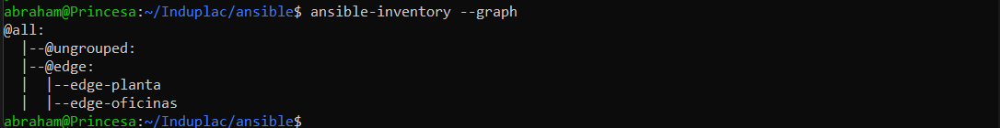 | 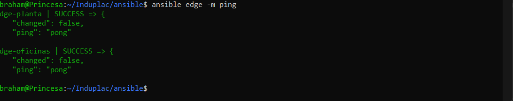 |
| 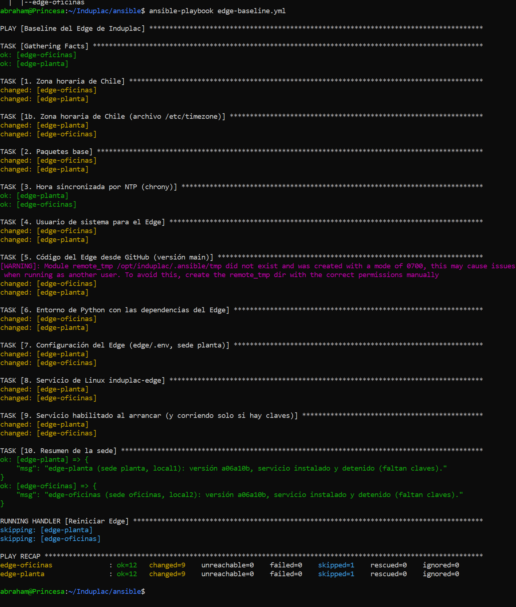 | 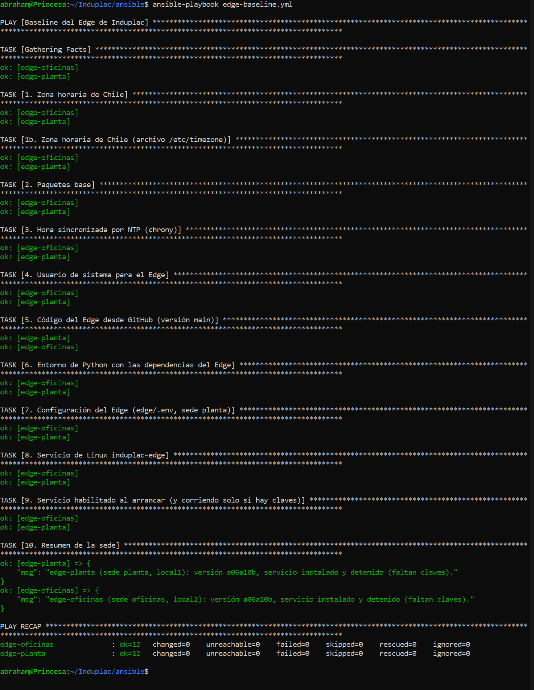 |
| 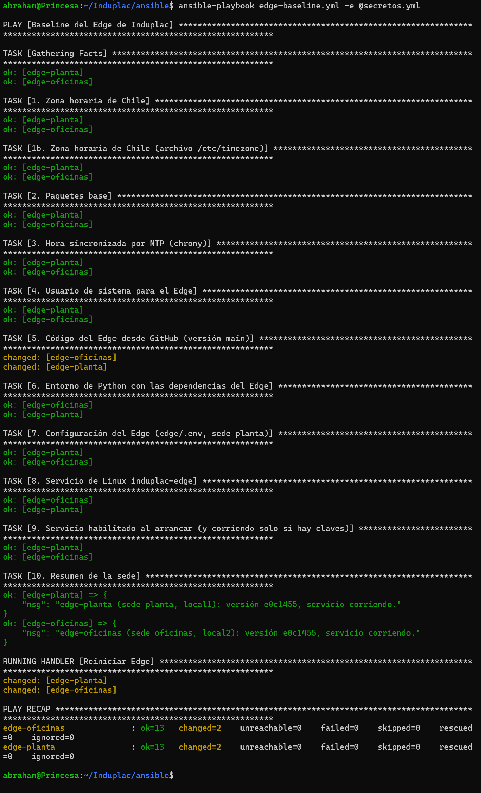 | 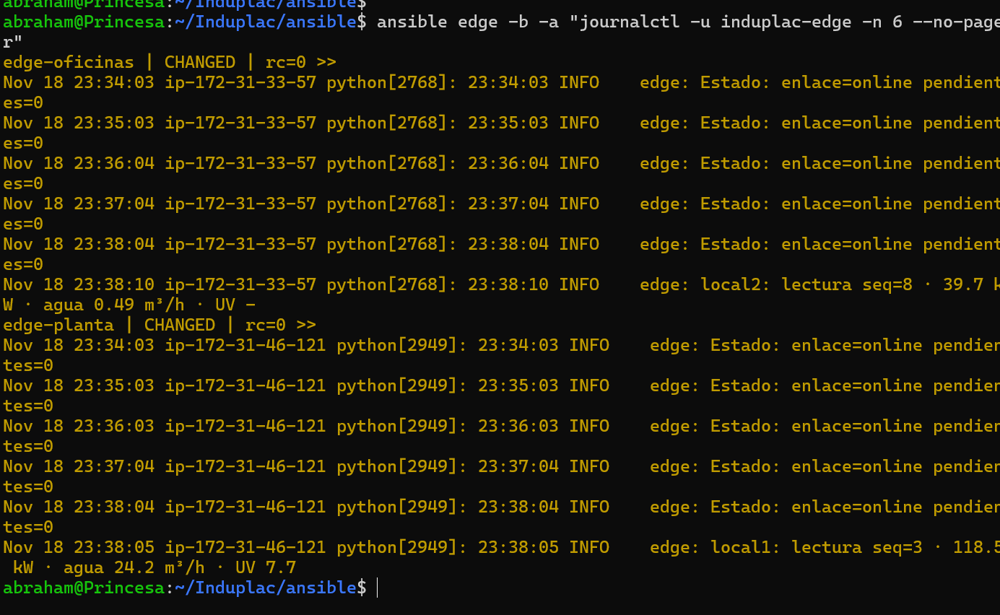 |

**18/11: el Edge corre en el lab, sin depender de un PC.** Con las claves (`-e @secretos.yml`), cada EC2 queda como el Edge de su sede: el servicio `induplac-edge` está corriendo y recibe de su Wokwi (`local1` en Planta, `local2` en Oficinas). Ver [`../../ansible/README.md`](../../ansible/README.md) §4b.

## 3. Cliente-servidor y API REST

| Evidencia | Dónde | Estado |
| --- | --- | --- |
| Diagrama cliente-servidor (2 servidores, 3 clientes) | [`api-rest.md`](api-rest.md) | ✅ |
| Contrato de la API (rutas, códigos HTTP, formatos JSON) | [`../api-dashboard.md`](../api-dashboard.md) | ✅ |
| Demo con `curl` (18/11): health, envío, no se duplica, `401` y consulta con token | [`api-rest.md`](api-rest.md) §4.6 | ✅ 6 capturas |

| | |
| --- | --- |
| 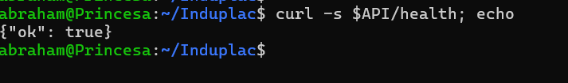 | 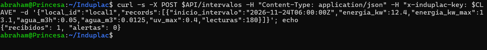 |
| 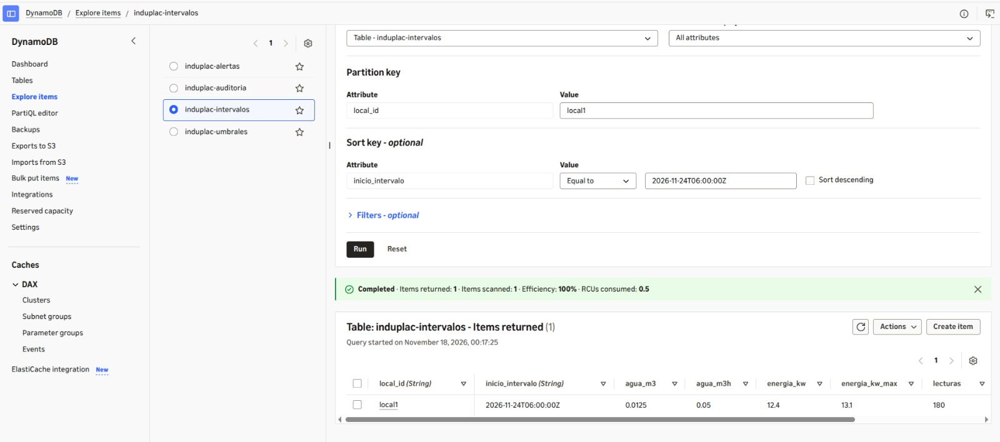 | 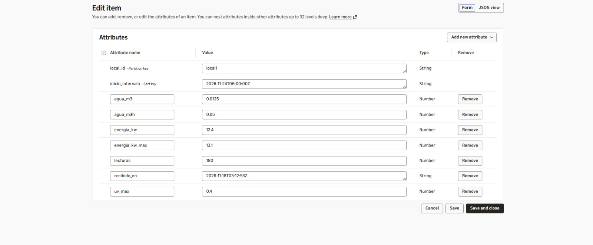 |
| 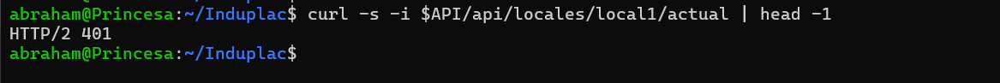 | 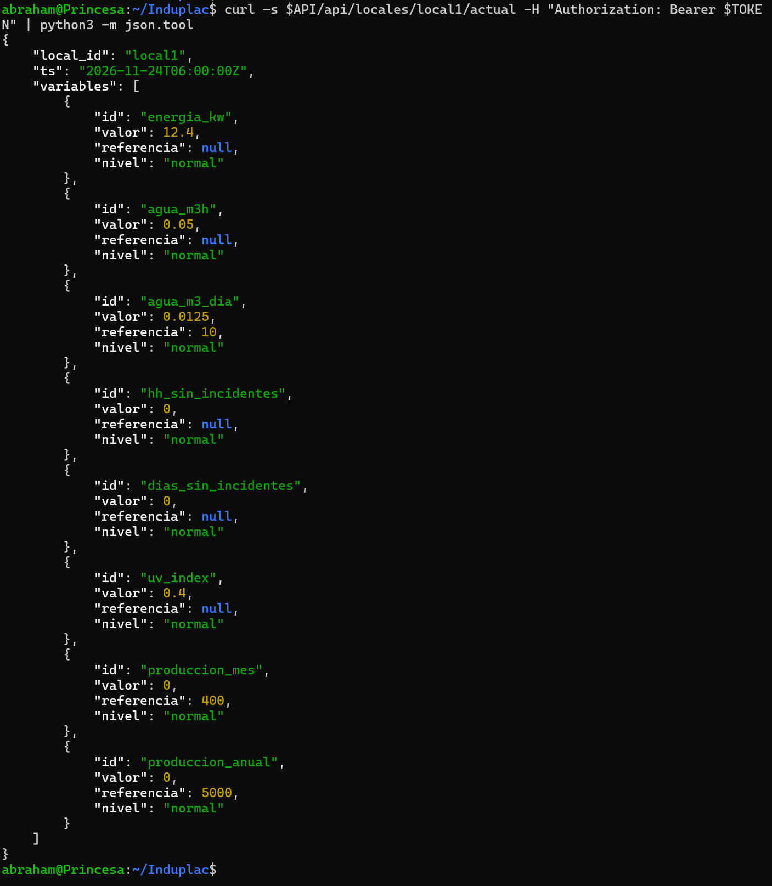 |

## 4. Backend

| Evidencia | Dónde | Estado |
| --- | --- | --- |
| Recibe → valida → procesa → almacena → entrega, con una captura por paso | [`backend.md`](backend.md) ([PR #74](https://github.com/Aburahamu20/Induplac/pull/74)) | ✅ |
| Por qué Lambda y no Flask/FastAPI | [`backend.md`](backend.md) §4 | ✅ |
| Código de las Lambdas | [`../../backend/lambda_api/`](../../backend/lambda_api/) · [`../../backend/lambda_config/`](../../backend/lambda_config/) | ✅ |
| Decisiones técnicas (bases de datos, alertas en 2 niveles, MFA) | [`../decisiones-tecnicas.md`](../decisiones-tecnicas.md) (ADR-01 a ADR-09) | ✅ |

## 5. Ágil y Lean

| Evidencia | Dónde | Estado |
| --- | --- | --- |
| Product Backlog con épicas e historias de usuario priorizadas | [`backlog.md`](backlog.md) | ✅ |
| Sprints | [`backlog.md`](backlog.md) §2 · [`../scrum-pmi.md`](../scrum-pmi.md) | ✅ |
| Tablero Kanban real (tareas reservadas, en curso, hechas) | [`../EN-CURSO.md`](../EN-CURSO.md) | ✅ |
| Historial de trabajo: cada tarea con su PR | [PRs aceptados](https://github.com/Aburahamu20/Induplac/pulls?q=is%3Apr+is%3Amerged) · [`../notas-de-avance.md`](../notas-de-avance.md) | ✅ |

## 6. Transferencia tecnológica

| Evidencia | Dónde | Estado |
| --- | --- | --- |
| Roadmap de 8 etapas, cronograma, metas del piloto y riesgos | [`transferencia-tecnologica.md`](transferencia-tecnologica.md) | ✅ |

## 7. Gestión del equipo

| Evidencia | Dónde | Estado |
| --- | --- | --- |
| Lluvia de ideas y diagrama de afinidad, y qué decisiones cambiaron | [`gestion-equipo.md`](gestion-equipo.md) | ✅ |
| Roles, RACI y Gantt | [`../roles-raci-gantt.md`](../roles-raci-gantt.md) | ✅ |

## 8. Herramientas de calidad

| Evidencia | Dónde | Estado |
| --- | --- | --- |
| Plan de pruebas: 17 requisitos → 112 pruebas, todas OK (17/11), y checklists de inspección | [`plan-de-pruebas.md`](plan-de-pruebas.md) | ✅ |
| Diagrama de Ishikawa: 18 causas en 6M, cada una con su control | [`ishikawa.md`](ishikawa.md) | ✅ |
| Gráfico de control con los datos simulados de consumo (25 lecturas · x̄ = 37.56 kW · UCL = 42.99 kW · 2 puntos fuera de control) | [`grafico-control.md`](grafico-control.md) · [`img/grafico-control.png`](img/grafico-control.png) | ✅ |
| Reporte de seguridad de OWASP ZAP | [`evidencias/reporte-zap.html`](evidencias/reporte-zap.html) (descargar y abrir en el navegador) · [JSON](evidencias/reporte-zap.json) | ✅ |
| Diagrama de flujo (pipeline y recorrido de un dato) | [`../devops.md`](../devops.md) · [`backend.md`](backend.md) §3 | ✅ |

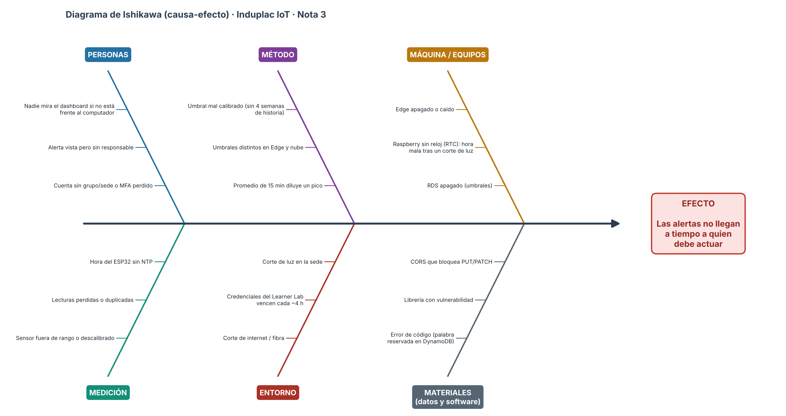

**Reporte de ZAP (18/11, CI en `main`):** 0 altos, 2 medios, 5 bajos y 2 informativos. Ninguno bloquea, porque todos son **cabeceras de seguridad** que el servidor de prueba no envía (CSP, anti-clickjacking, `X-Content-Type-Options`, `Cross-Origin-*`, `Permissions-Policy`). Ya estaba anotado como pendiente de diseño en [`../devops.md`](../devops.md): en producción se agregan con una *response headers policy* de CloudFront. Lo que sí bloquearía (librerías JS vulnerables, cookies sin `HttpOnly`/`Secure`, CORS mal configurado) salió **limpio**.

---

## Demo en vivo y dashboard

> Capturas de lo que se muestra el 25/11, por si algo falla en vivo. Las saca Abraham con su cuenta y van en `img/demo-*.png`.

| Evidencia | Archivo | Estado |
| --- | --- | --- |
| Dashboard de planta con los datos actuales y su nivel (verde, amarillo, rojo), servido por el Edge de la EC2 `edge-planta` por túnel SSH (18/11, 23:59). Muestra una alerta real de *posible fuga fuera de horario* | [`demo-1-planta.png`](img/demo-1-planta.png) | ✅ |
| Dashboard de gerencia (las dos sedes) | `demo-2-gerencia.png` | ⏳ Abraham |
| Una alerta activa y cómo se reconoce | `demo-3-alerta.png` | ⏳ Abraham |
| Login con MFA (código de 6 dígitos) | `demo-4-mfa.png` | ⏳ Abraham |
| Pantalla Umbrales con la simulación ("habría dado N alertas") | `demo-5-umbrales.png` | ⏳ Abraham |
| Auditoría (quién cambió qué y cuándo) | `demo-6-auditoria.png` | ⏳ Abraham |
| Wokwi: el ESP32 simulado enviando lecturas, Planta y Oficinas | `demo-7-wokwi.png` (Planta) · `demo-7b-wokwi-oficinas.png` (Oficinas) | ⏳ Seba (tarea 23) |
| Modo offline: el Edge sigue mostrando datos sin internet y después sincroniza | `demo-8-offline.png` | ⏳ Abraham |
| Guion de la demo | [`guion-demo.md`](guion-demo.md) | ✅ |

## Grabación

| Qué | Dónde | Estado |
| --- | --- | --- |
| Ensayo completo (≥ 15 min, con la demo) grabado el 24/11; sirve también de respaldo si la demo falla en vivo | Link al video (Drive o YouTube no listado) | ⏳ todos |
| Presentación del 25/11, si el profe permite grabarla | Link al video | ⏳ todos |

> El video **no se sube al repo** (pesa demasiado): se deja el link aquí.

## Reglas para las evidencias

- **Nunca** deben verse claves, tokens, IPs públicas, el Account ID de AWS ni la llave `.pem`. Si aparecen, se recorta la captura antes de subirla (como la de ping de Ansible y la `api-3b`).
- Todos los datos son **simulados**: nada real de Induplac.
- Cada captura nueva va en `img/` con un nombre que diga qué muestra, y se agrega a la tabla del criterio que corresponde.
