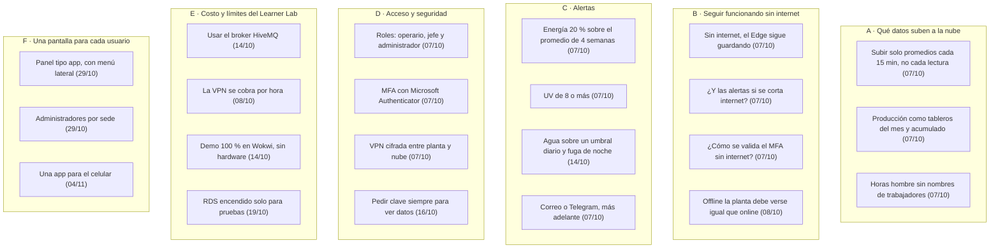

# 🧠 Gestión del equipo: lluvia de ideas y diagrama de afinidad — Nota 3

> **Autora:** Bárbara Saavedra (`barbaraantoniaa`), Scrum Master. Tarea 39 de [`EN-CURSO.md`](../EN-CURSO.md) · criterio 7 de la pauta ([`nota-3.md`](../nota-3.md), IL 4.5, 15 %).
> **Fuentes:** documento del equipo *Induplac_Decisiones_Cloud* (Castro, Fuentes, González, Murúa y Saavedra, clase del 07/10) y las decisiones registradas en [`notas-de-avance.md`](../notas-de-avance.md).

**En resumen:** usamos una **lluvia de ideas** en clase (07/10) y ordenamos sus ideas, y las que aparecieron después, en un **diagrama de afinidad** de 6 temas. Al compararlas con el diseño que había en el repositorio aparecieron **9 diferencias**, y resolverlas cambió el diseño: alertas también sin internet, solo promedios cada 15 minutos a la nube, la VPN como diseño por costo y un dashboard distinto para cada rol.

---

## 1. Las herramientas

| Herramienta | Qué es | Cómo la usamos |
|---|---|---|
| **Lluvia de ideas** | Todos proponen ideas libremente, sin descartar ninguna al principio. | En la clase del 07/10 los 5 integrantes propusieron qué datos medir, qué subir a la nube, qué alertas dar y cómo proteger el acceso. Quedó en el documento *Decisiones Cloud*. |
| **Diagrama de afinidad** | Las ideas se escriben como notas y se agrupan por parecido; cada grupo recibe un nombre. | Agrupamos las ideas del 07/10 y las que surgieron después (dudas del equipo, respuestas del 14/10 e ideas nuevas de octubre y noviembre) en 6 temas, para ver qué había que decidir en cada uno. |

---

## 2. El diagrama de afinidad

Cada nota es una idea o duda real del equipo, con su fecha.

---

## 3. Qué información nos dio y qué decisiones cambió

| Tema | Qué nos mostró | Decisión que cambió | Cuándo y evidencia |
|---|---|---|---|
| **A · Qué datos suben** | Con promedios cada 15 min llegan unos 96 registros al día por variable y sede: el volumen es bajo. | A la nube sube solo lo agregado; DynamoDB se justifica por costo y disponibilidad, no por volumen; cada intervalo tiene una llave única para no duplicarse. | 08/10 · ADR-01 y ADR-05 · PR #3 |
| **B · Sin internet** | El diseño de la lluvia de ideas dejaba las alertas solo en la nube: con un corte, la planta no se enteraría de un UV peligroso. | Alertas en dos niveles (Edge y nube, mismas reglas), dashboard servido desde el Edge y login local en la planta. | 08/10 y 14/10 · ADR-06 y ADR-07 · tarea 22, PR #30 |
| **C · Alertas** | El equipo acordó reglas concretas, pero la de energía necesita 4 semanas de historia. | Umbral fijo de respaldo mientras no hay historia; reglas probadas en cada cambio por el CI; umbrales editables desde el dashboard. | 08/10 · tareas 21 y 28 · PR #42 |
| **D · Acceso y seguridad** | Había tres roles fijos, pero en la práctica cada usuario necesita un acceso distinto. | Cognito con MFA, login obligatorio y, después, 4 roles con sede propia (admin general, admin de sede, jefe y operario). | 08/10, 16/10 y 02/11 · ADR-08 y ADR-09 · tarea 26, PR #33 |
| **E · Costo y límites** | Varias ideas chocaban con el presupuesto de USD 100 del Learner Lab (por ejemplo, HiveMQ ya no tenía plan gratis). | EMQX en vez de HiveMQ; la VPN queda como diseño; RDS solo se enciende para pruebas y las alertas pasan a DynamoDB para no depender de él. | 14/10, 19/10 y 21/10 · PR #5, #9 y #17 |
| **F · Una pantalla por usuario** | Un mismo panel para todos mostraba de más a unos y de menos a otros. | Dashboard de 7 pantallas según el rol (bocetos aprobados por el equipo el 01/11); la app para el celular queda en el backlog (HU-20). | 01/11 y 04/11 · tarea 30, PR #45–#58 |

**El hallazgo más importante:** al comparar la lluvia de ideas con el diseño del repositorio aparecieron **9 diferencias** (qué sube a la nube, umbrales, dónde se calculan las alertas, pantalla sin internet, autenticación, producción y roles). Resolverlas en grupo el 08/10 cambió la arquitectura antes de escribir el código, cuando corregir todavía era barato.

---

## 4. Qué aprendimos como equipo

1. **Escuchar a todos evitó un error grave:** la duda "¿y las alertas si se corta internet?" llevó a las alertas en dos niveles, que hoy son el centro de la demo.
2. **Agrupar las ideas ordenó la conversación:** en vez de discutir 22 ideas sueltas, decidimos por 6 temas, y cada tema calzó con un rol del equipo ([RACI](../roles-raci-gantt.md)).
3. **Las ideas nuevas no desordenaron el trabajo:** las del tema F se aprobaron como bocetos y se implementaron por fases; las que no cabían, como la app para el celular, quedaron en el backlog.
