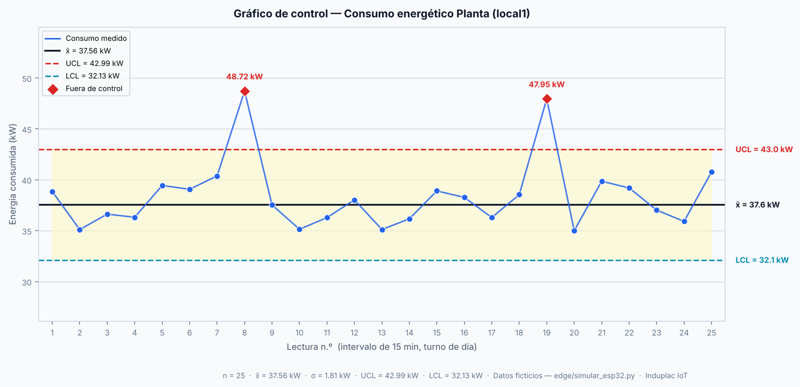

# 📊 Gráfico de control — Consumo energético Planta

> **Autor:** Sebastián Fuentes. Tarea 42 de [`EN-CURSO.md`](../EN-CURSO.md) · criterio 8 de la pauta ([`nota-3.md`](../nota-3.md), herramientas de calidad, IL 4.6, 15 %).
> Basado en la lógica de simulación de `edge/simular_esp32.py` y en las reglas de alerta de `edge/reglas.py`. Estado al **22/11/2026**.

**En resumen:** un gráfico de control es una herramienta SPC (Control Estadístico de Procesos) que distingue la variación normal de un proceso de los eventos que tienen una causa especial y merecen atención. Lo usamos para visualizar el consumo eléctrico de la Planta durante un turno de día, comprobar que el comportamiento habitual es estable y confirmar que los dos picos simulados a propósito —que superan tanto el UCL estadístico como el umbral de alerta del Edge con historia (+20 %)— quedarían detectados como anomalías.

---

## 1. Qué es y por qué lo usamos

Un **gráfico de control** (o carta de control) traza una serie de mediciones en el tiempo junto a tres líneas de referencia:

- **x̄ (línea central):** el promedio del proceso cuando está bajo control.
- **UCL** (*Upper Control Limit*): límite superior = x̄ + 3σ.
- **LCL** (*Lower Control Limit*): límite inferior = x̄ − 3σ.

Un punto dentro de los límites indica **variación común**: el proceso funciona con normalidad. Un punto fuera indica **causa asignable**: algo externo al proceso normal ocurrió y requiere investigación.

Lo elegimos para Induplac porque:

1. El consumo eléctrico de la Planta tiene una variación natural (máquinas encendiéndose en distintos momentos, temperatura ambiente, número de operarios). Sin una referencia estadística, es difícil saber cuándo un consumo alto es normal y cuándo es una anomalía real.
2. La regla de alerta que tiene el Edge (`energía actual > promedio histórico × 1.20`) es, en esencia, un umbral de control operacional. El gráfico de control le pone un respaldo estadístico: **los mismos eventos que superan el UCL también superarían la regla del +20 %**.
3. Es una herramienta de calidad concreta y trazable, diferente del Ishikawa (que ordena causas) y del plan de pruebas (que verifica el software): aquí medimos la **estabilidad del proceso físico** que el sistema monitorea.

## 2. Cómo lo hicimos

### 2.1 Generación de los datos

No tenemos sensores físicos en el Learner Lab, así que usamos la misma lógica que `edge/simular_esp32.py` para generar **25 lecturas ficticias** de energía de la Planta (`local1`) en un turno de día:

- **Base:** 38 kW ± 8 % (rango normal de operación diurna según el simulador).
- **Intervalo:** cada lectura representa un intervalo de 15 minutos (el intervalo de agregación del Edge).
- **Picos simulados:** dos lecturas se fijaron a propósito en **48.72 kW** (lectura 8) y **47.95 kW** (lectura 19) para representar un arranque simultáneo de equipos de alto consumo, el tipo de evento que en Induplac activa la alerta de energía cuando el sistema tiene historia acumulada.

Los datos son completamente ficticios. Ningún dato pertenece a trabajadores ni a la empresa real (Ley 19.628).

### 2.2 Cálculo de los límites (Fase I de SPC)

En un análisis de Fase I se establece el proceso de referencia con los datos "bajo control" y luego se verifican todos los puntos contra esos límites. Seguimos ese procedimiento:

1. Se tomaron las **23 lecturas normales** (sin los dos picos conocidos) para calcular x̄ y σ.
2. Se calcularon UCL y LCL con esas 23 lecturas.
3. Se graficaron las **25 lecturas** (incluidos los picos) para ver qué puntos quedan fuera.

| Parámetro | Valor |
|---|---|
| n (lecturas base) | 23 |
| **x̄** (promedio base) | **37.56 kW** |
| σ (desviación estándar) | 1.81 kW |
| **UCL** = x̄ + 3σ | **42.99 kW** |
| **LCL** = x̄ − 3σ | **32.13 kW** |
| Puntos fuera de control | lecturas **8** y **19** |

### 2.3 Las 25 lecturas (datos ficticios)

| # | kW | Control | # | kW | Control | # | kW | Control |
|--:|---:|:---:|--:|---:|:---:|--:|---:|:---:|
| 1 | 38.85 | ✅ | 10 | 35.14 | ✅ | 19 | **47.95** | ❌ |
| 2 | 35.11 | ✅ | 11 | 36.29 | ✅ | 20 | 35.00 | ✅ |
| 3 | 36.63 | ✅ | 12 | 38.03 | ✅ | 21 | 39.86 | ✅ |
| 4 | 36.32 | ✅ | 13 | 35.12 | ✅ | 22 | 39.20 | ✅ |
| 5 | 39.44 | ✅ | 14 | 36.17 | ✅ | 23 | 37.03 | ✅ |
| 6 | 39.07 | ✅ | 15 | 38.91 | ✅ | 24 | 35.91 | ✅ |
| 7 | 40.38 | ✅ | 16 | 38.27 | ✅ | 25 | 40.78 | ✅ |
| **8** | **48.72** | ❌ | 17 | 36.30 | ✅ | | | |
| 9 | 37.53 | ✅ | 18 | 38.54 | ✅ | | | |

✅ dentro de control (32.13 – 42.99 kW) · ❌ fuera del UCL · Generados con `seed=42` (reproducibles)

### 2.4 El gráfico



El gráfico muestra:

- La **zona amarilla pálida** entre LCL y UCL: variación normal del proceso.
- Los **puntos azules**: lecturas dentro de control.
- Los **rombos rojos** (lecturas 8 y 19): puntos fuera del UCL, con su valor anotado.
- Las tres líneas de referencia con sus valores al margen derecho.

## 3. Qué nos muestra

El consumo de la Planta en turno de día es **estable**: 23 de 25 lecturas se mantienen entre 32 y 43 kW con poca variación (σ = 1.81 kW). Esa estabilidad confirma que el promedio histórico que usa el Edge como base para la alerta es representativo del comportamiento normal.

Las lecturas 8 (48.72 kW) y 19 (47.95 kW) **superan el UCL** y están a **+29.7 %** y **+27.7 %** sobre el promedio base, respectivamente. Ambas son estadísticamente anómalas: no son variación normal, sino que tienen una causa asignable (en la simulación, un arranque simultáneo de equipos).

## 4. Conexión con la alerta de energía del Edge

La lógica de alertas del Edge (`edge/reglas.py`) distingue dos situaciones:

**Con historia acumulada (≥ 4 semanas):** la alerta usa el promedio histórico a la misma hora:

```
nivel "crítico"     → energia_kw > referencia × 1.20   (alerta real)
nivel "advertencia" → energia_kw > referencia × 1.10   (solo indicador amarillo)
```

Con x̄ = 37.56 kW, el umbral de alerta queda en **37.56 × 1.20 = 45.07 kW**. Las lecturas 8 (48.72 kW) y 19 (47.95 kW) **lo superan**: el Edge habría lanzado una alerta en ambos intervalos.

**Sin historia (primeras 4 semanas):** el Edge usa umbrales fijos de respaldo:

```python
ENERGIA_FIJA_CRITICO      = 55  # kW → alerta
ENERGIA_FIJA_ADVERTENCIA  = 45  # kW → solo nivel amarillo, sin alerta
```

Con los picos en 48.72 y 47.95 kW, el Edge **no habría lanzado alerta** (quedan entre 45 y 55 kW: nivel "advertencia"), aunque sí habría mostrado el indicador en amarillo en el dashboard. La alerta sin historia requiere superar los 55 kW.

La relación entre las dos herramientas es complementaria:

| Herramienta | Qué detecta | Umbral de alerta |
|---|---|---|
| Alerta del Edge con historia (+20 %) | Consumo excesivo vs. el comportamiento habitual | 45.07 kW (dinámico) |
| Gráfico de control (UCL, 3σ) | Punto estadísticamente anómalo vs. el turno | 42.99 kW (estadístico) |
| Alerta fija del Edge (sin historia) | Consumo extremo independiente del historial | 55 kW (fijo) |

> **Conclusión:** el gráfico de control y la alerta del Edge *con historia* son consistentes: los mismos eventos que el SPC marca como causas asignables también habrían disparado la alerta. Con el sistema recién instalado (sin historia), esos mismos picos solo activarían el indicador amarillo, pero no la alerta, lo que refuerza la importancia de acumular al menos 4 semanas de datos antes del piloto real (ver [roadmap de transferencia](transferencia-tecnologica.md), etapa 1).

## 5. Para la presentación (1 diapositiva)

- El gráfico de la sección 2.4 y, al lado, una tabla de tres filas: **x̄ = 37.56 kW · UCL = 42.99 kW · 2 puntos fuera de control**.
- **Frase para decir:** *"No lo hicimos de adorno: lo generamos con los mismos datos simulados que usa el Edge, calculamos los límites estadísticamente y vimos que las dos lecturas altas que el sistema habría alertado también salen del UCL. El gráfico de control y la alerta del +20 % son consistentes."*

### Preguntas probables

| Pregunta | Respuesta corta |
|---|---|
| ¿Por qué Fase I y no Fase II? | En Fase I se establece la línea base. Fase II sería monitoreo continuo, que en producción haría el Edge automáticamente con los datos reales. |
| ¿Por qué los límites son distintos al umbral del Edge? | El UCL se calcula con σ de los datos del turno; el umbral del Edge usa el promedio histórico × 1.20. Son complementarios: uno es estadístico, el otro es operacional. |
| ¿Los picos habrían generado alerta en el sistema real? | Con historia acumulada, sí (superan el +20 %). Sin historia (primeras 4 semanas), solo pondrían el indicador en amarillo, porque el umbral fijo de alerta es 55 kW y los picos están en ~48 kW. |
| ¿Qué pasa si el promedio sube por estacionalidad? | El Edge recalcula su promedio con las últimas 4 semanas. En SPC se haría un nuevo análisis de Fase I con los datos del nuevo período. |
| ¿Los datos son reales? | No. Son ficticios, generados con `edge/simular_esp32.py` (seed = 42, reproducibles). Sin datos ni sistemas reales de Induplac (Ley 19.628). |
