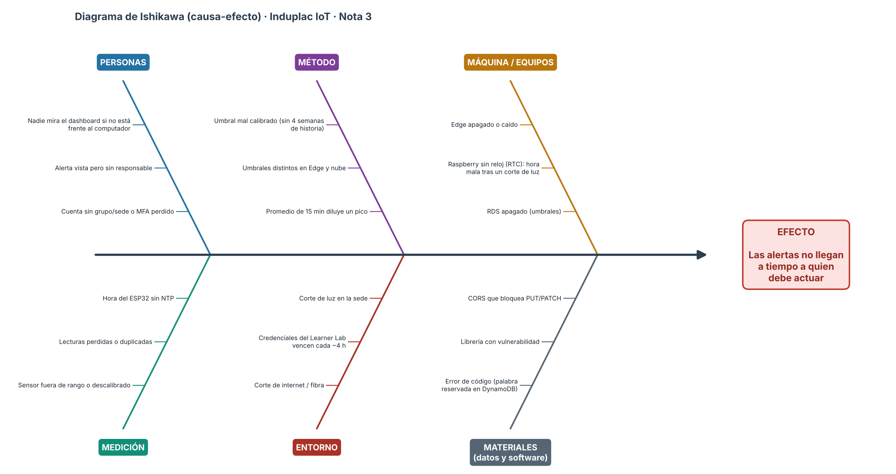

# 🐟 Diagrama de Ishikawa (causa-efecto) — Nota 3

> **Autora:** Lisandra González (`lisagonzalez-jpg`). Tarea 40 de [`EN-CURSO.md`](../EN-CURSO.md) · criterio 8 de la pauta ([`nota-3.md`](../nota-3.md), herramientas de calidad, IL 4.6, 15 %).
> Basado en la bitácora [`notas-de-avance.md`](../notas-de-avance.md), [`decisiones-tecnicas.md`](../decisiones-tecnicas.md), [`plan-de-pruebas.md`](plan-de-pruebas.md) y [`backlog.md`](backlog.md). Estado al **18/11/2026**.

**En resumen:** el corazón de Induplac IoT es que **una alerta llegue a tiempo** a quien debe actuar. Con el diagrama de Ishikawa ordenamos en 6 categorías las 18 causas que pueden impedirlo, casi todas sacadas de **problemas reales que tuvimos** durante el proyecto. Después revisamos cada causa: **14 tienen un control funcionando**, 1 está en curso y 3 quedan abiertas y pasan al [roadmap de transferencia](transferencia-tecnologica.md).

---

## 1. Qué es y por qué lo usamos

El **diagrama de Ishikawa** (o de espina de pescado) pone el **efecto** (el problema) en la cabeza y, en las espinas, las **posibles causas** agrupadas en categorías. Sirve para no quedarse con la primera explicación y para revisar que cada causa tenga una solución.

- **5 Porqués** ([`5-porques.md`](5-porques.md)): sigue **una** cadena hasta la causa raíz del problema de Induplac.
- **Ishikawa** (este archivo): mira **muchas** causas a la vez sobre un efecto concreto de nuestra solución. Por eso lo usamos como herramienta de **calidad**.

## 2. El efecto

> **Las alertas no llegan a tiempo (o no llegan) a la persona que debe actuar.**

Elegimos este efecto porque es la promesa central del sistema (detectar en minutos, no en un mes). Si una alerta falla, la solución no sirve, aunque todo lo demás funcione.

## 3. El diagrama

Usamos las **6M** adaptadas al proyecto. En un sistema de software, la categoría **Materiales** son los **datos y el código** con los que se construye.

## 4. Causas y cómo las controlamos

Leyenda: ✅ control funcionando · 🟡 en curso · 🔴 abierta (pasa al roadmap).

### 👥 Personas

| Causa | De dónde salió | Control en Induplac IoT | Estado |
|---|---|---|---|
| Nadie mira el dashboard si no está frente al computador | Limitación anotada en [`conclusiones.md`](../conclusiones.md) | Notificaciones al celular (HU-20) o por correo/Telegram con SNS | 🔴 Abierta |
| Alerta vista pero sin responsable | Porqué 2 de los [5 Porqués](5-porques.md) | El jefe **reconoce la alerta con comentario**; queda quién y cuándo en la auditoría (tarea 28) | ✅ |
| Cuenta sin grupo o sede, o MFA perdido | Cambio de roles del 02/11 | Una cuenta sin grupo o sede **no entra** y ve un aviso para pedir revisión; el admin puede reenviar la clave temporal (tareas 26, 28 y 31) | ✅ |

### 📋 Método

| Causa | De dónde salió | Control | Estado |
|---|---|---|---|
| Umbral mal calibrado (la regla de +20 % necesita 4 semanas de historia) | Decisión de la regla relativa de energía | **Umbral fijo de respaldo** (45 kW) mientras no hay historia (`edge/reglas.py`) y **simulación** de umbrales antes de guardarlos (tarea 28) | ✅ |
| Umbrales distintos en el Edge y en la nube | Revisión del 14/11 | El Edge descarga los umbrales de la nube y guarda la última copia (tarea 44) | 🟡 En curso |
| El promedio de 15 min diluye un pico corto | Prueba de la demo: 120 lecturas a 40 kW y una a 60 kW dan 40,17 kW | Es **a propósito**: un pico de segundos no es una anomalía de consumo. El UV usa el **máximo** del intervalo, no el promedio | ✅ (decisión) |

### ⚙️ Máquina / equipos

| Causa | De dónde salió | Control | Estado |
|---|---|---|---|
| Edge apagado o caído | Diseño del modo offline | Servicio `induplac-edge` con `systemd` instalado por **Ansible**; la pantalla *Estado de las sedes* distingue sede sin datos, datos antiguos y Edge sin nube (tareas 30 y 33) | ✅ |
| Raspberry sin reloj: hora mala tras un corte de luz sin internet | ADR-10 | Módulo **RTC DS3231** + `chrony`; la Pi es el servidor de hora de la sede | 🔴 Solo diseño (no aplica en Wokwi) |
| RDS apagado (ahí viven los umbrales) | Decisión del 03/11 | Los umbrales se **copian a DynamoDB**, que siempre está encendida; las alertas siguen con la última copia | ✅ |

### 📏 Medición

| Causa | De dónde salió | Control | Estado |
|---|---|---|---|
| Sensor fuera de rango o descalibrado | Diseño de ciberseguridad (capa 2) | El Edge **valida límites físicos** y descarta lo imposible; pruebas unitarias en el CI | ✅ |
| Lecturas perdidas o duplicadas | Sincronización después de un corte | Cola en SQLite con `is_synced` + **idempotencia por intervalo**: al reconectar sube todo sin duplicar (HU-06) | ✅ |
| Hora del ESP32 sin NTP | Revisión del diseño | El ESP32 sincroniza la hora por **NTP** al arrancar; por eso, aunque Wokwi simuló lento, los datos quedaron con su hora real | ✅ |

### 🌎 Entorno

| Causa | De dónde salió | Control | Estado |
|---|---|---|---|
| Corte de internet o de la fibra | Problema 3 de Induplac | **Alertas locales en el Edge** con las mismas reglas que la nube; dashboard de planta en modo OFFLINE (HU-05, probado con el lab apagado) | ✅ |
| Credenciales del Learner Lab vencen cada ~4 h | [`devops.md`](../devops.md) | Despliegue manual documentado; en producción, **rol IAM con OIDC** | 🔴 Limitación del Learner Lab |
| Corte de luz en la sede | Diseño | Lo guardado en SQLite no se pierde y el Edge **retoma la cola** al volver la luz; si solo cae el Edge, el ESP32 guarda hasta 50 lecturas en su *ring buffer* | ✅ |

### 💾 Materiales (datos y software)

| Causa | De dónde salió | Control | Estado |
|---|---|---|---|
| Error de código: `total` es palabra reservada en DynamoDB y la auditoría no se guardaba | Bitácora del 02/11 | Corregido y **prueba nueva** (`test_repo_dynamo.py`) que revisa la petición real antes de enviarla | ✅ |
| Librería con vulnerabilidad conocida | `picomatch` dentro de Vite (17/11) | **Revisión de dependencias en el CI** que bloquea el PR; excepción acotada y documentada (tarea 48) | ✅ |
| CORS que bloqueaba PUT y PATCH (guardar umbrales y reconocer alertas) | Bitácora del 03/11 | CORS de API Gateway corregido; queda en la **lista de inspección** del despliegue | ✅ |

## 5. Cómo lo usamos en el proyecto

1. **Recolectar causas:** revisamos la bitácora y los PR buscando cada vez que algo impidió o pudo impedir una alerta. No inventamos causas genéricas: cada una tiene su origen en la tabla.
2. **Ordenarlas en las 6M:** así vimos que la mayoría de las fallas reales fueron de **Materiales** (código) y **Entorno** (Learner Lab, internet), no de los sensores.
3. **Revisar el control de cada causa:** una causa sin control es un riesgo. Este paso dejó tres conclusiones:
   - Las fallas de código se repetían → refuerza que **cada error corregido suma una prueba** en el CI ([plan de pruebas](plan-de-pruebas.md)).
   - El **Entorno** se cubre con el Edge: por eso el modo offline es parte del núcleo y no un extra.
   - Quedan **3 causas abiertas** (notificaciones al celular, reloj RTC y credenciales del Learner Lab) que solo se resuelven en una implementación real → pasan a las etapas de **piloto** y **mejora continua** de la [transferencia tecnológica](transferencia-tecnologica.md).
4. **Seguirlo usando:** cuando aparezca una falla nueva en el piloto, se agrega a la espina que corresponda con su control. El diagrama queda como checklist antes de cada demo.

## 6. Para la presentación (1 diapositiva)

- El diagrama de la sección 3 y, al lado, tres números: **18 causas · 14 controladas · 3 al roadmap**.
- **Frase para decir:** *"No lo hicimos de adorno: cada espina es un problema que tuvimos de verdad. Lo usamos para revisar que cada causa tuviera un control, y lo que no se puede resolver en el Learner Lab lo pasamos al plan de transferencia."*

### Preguntas probables

| Pregunta | Respuesta corta |
|---|---|
| ¿Por qué ese efecto y no el problema de Induplac? | El problema de Induplac lo analizamos con los 5 Porqués. Aquí medimos la **calidad de nuestra solución**: su promesa es que la alerta llegue a tiempo. |
| ¿Cuál fue la categoría con más fallas reales? | Materiales (código) y Entorno (Learner Lab e internet). Por eso invertimos en el CI con pruebas y en el modo offline. |
| ¿Qué hacen con las causas abiertas? | Están en el roadmap: notificaciones en la mejora continua, RTC y rol IAM en el piloto real. |
