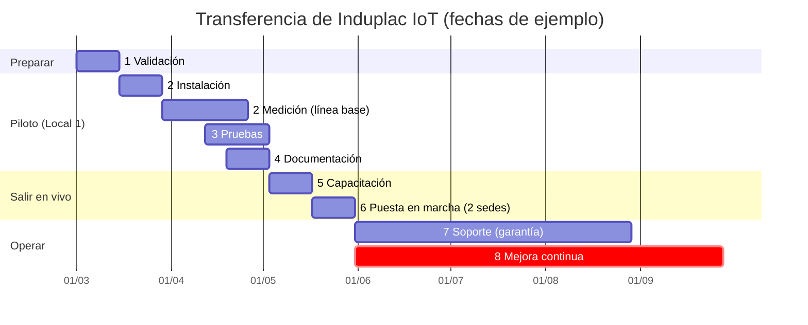

# 🚀 Transferencia tecnológica: del MVP a Induplac — Nota 3

> **Autora:** Lisandra González (`lisagonzalez-jpg`). Tarea 38 de [`EN-CURSO.md`](../EN-CURSO.md) · criterio 6 de la pauta ([`nota-3.md`](../nota-3.md), IL 4.4, 15 %).
> Basado en [`conclusiones.md`](../conclusiones.md) (limitaciones y siguientes pasos), [`devops.md`](../devops.md), [`ansible/README.md`](../../ansible/README.md), [`plan-de-pruebas.md`](plan-de-pruebas.md) e [`ishikawa.md`](ishikawa.md). Estado al **18/11/2026**.

**En resumen:** el MVP funciona con sensores simulados y en el Learner Lab. Para que Induplac lo use de verdad proponemos **8 etapas en unas 13 semanas hasta la puesta en marcha**, más soporte y mejora continua. Se parte con un **piloto en el Local 1 (Planta)**, porque ahí están los tres problemas (energía, agua y UV), y recién cuando el piloto cumple sus metas se replica en el Local 2 (Oficinas) con Ansible.

> ⚠️ Es una **propuesta**: los cargos de Induplac son genéricos (no tenemos datos internos) y las duraciones son estimaciones del equipo.

---

## 1. Qué cambia del MVP a la versión real

| En el MVP (hoy) | En Induplac (real) | Por qué |
|---|---|---|
| Sensores simulados en **Wokwi** | Sensores de corriente **SCT-013**, **caudalímetros** y sensor **UV** con ESP32 | Medir el consumo real |
| Edge en un PC o en EC2 | **Raspberry Pi** por sede con reloj **RTC DS3231** | Hora correcta aunque se corte la luz y no haya internet (causa abierta en Ishikawa) |
| HTTPS con clave de ingesta | **VPN Site-to-Site IPsec** hacia AWS | Diseño de seguridad completo (ADR) |
| AWS **Learner Lab** (USD 100, credenciales de ~4 h) | **Cuenta AWS de Induplac** con despliegue automático por **rol IAM con OIDC** | Sin llaves guardadas y sin credenciales que venzan |
| Alertas solo en el dashboard | Alertas también por **correo o celular** (Amazon SNS) | Causa abierta: nadie mira el dashboard si no está frente al computador |
| Prohibir borrar la auditoría no es posible en el lab | **Regla IAM** que lo prohíbe + copias en S3 con bloqueo | Auditoría que de verdad nadie puede borrar |

## 2. Quiénes participan

| Rol | Quién | Qué aporta |
|---|---|---|
| **Patrocinador** | Gerencia de Induplac | Aprueba el piloto, el presupuesto y el paso entre etapas |
| **Dueño del proceso** | Jefe de planta (Local 1) | Valida reglas y umbrales; decide si el piloto cumplió |
| **Usuarios clave** | Jefe de mantenimiento, operarios de patio | Prueban el sistema y dan retroalimentación |
| **TI de Induplac** | Encargado de redes y sistemas | Red, VLAN, firewall, cuenta AWS; recibe la operación |
| **Electricista autorizado** | Externo o de mantenimiento | Instala los sensores en los tableros (trabajo eléctrico certificado) |
| **Equipo del proyecto** | Nosotros (como proveedor) | Instala, configura, prueba, documenta y capacita |

## 3. Las 8 etapas

| # | Etapa | Qué se hace | Quién (responsable · apoyo) | Duración aprox. | Para pasar a la siguiente |
|---|---|---|---|---|---|
| 1 | **Validación** | Presentar el MVP; confirmar con Induplac el problema, las reglas de alerta y los umbrales; definir indicadores de éxito; revisar la Ley 19.628 modificada por la Ley 21.719 (sin datos personales; hoy rige desde el 01/12/2026, y el Congreso ya aprobó postergarla al 15/10/2027, falta su publicación); levantar los puntos de medición, la red y el espacio para la Pi en el Local 1 | Equipo · gerencia, jefe de planta, TI | **2 semanas** | Acta firmada con alcance del piloto, indicadores y presupuesto aprobado |
| 2 | **Piloto en una sede** | Comprar e instalar sensores, ESP32 y Raspberry Pi con RTC en el **Local 1**; crear la cuenta AWS de Induplac y desplegar con el pipeline; instalar el Edge con **Ansible**; medir **4 semanas** para tener la línea base de la regla de energía (+20 %) | Equipo · electricista, TI | **6 semanas** (2 de instalación + 4 de medición) | Datos llegando sin cortes y alertas funcionando en la planta |
| 3 | **Pruebas** | Correr el [plan de pruebas](plan-de-pruebas.md) en el piloto: comparar los sensores con el medidor de la distribuidora, **cortar internet y la luz de verdad**, medir falsas alarmas, prueba de seguridad (ZAP y revisión de la VPN) | Equipo · jefe de planta, TI | **3 semanas** (las 2 últimas del piloto + 1) | Cumplir las metas de la sección 5 |
| 4 | **Documentación** | Manual por rol (operario, jefe, admin), manual de operación de TI (despliegue, volver a una versión, Ansible), plan de contingencia y registro de equipos instalados | Equipo · TI revisa | **2 semanas** (en paralelo con las pruebas) | TI aprueba que puede operar con los manuales |
| 5 | **Capacitación** | Sesiones por rol: **operarios** (alerta UV y qué hacer), **jefes** (reconocer alertas, umbrales, histórico), **administradores** (usuarios, MFA, auditoría), **TI** (pipeline, Ansible, *rollback*). Se forma a un **referente interno** por sede | Equipo · jefe de planta convoca | **2 semanas** | Cada rol hace su tarea solo, con el manual |
| 6 | **Puesta en marcha** | Ajustar lo aprendido, crear la versión estable (`v1.x`), **replicar en el Local 2 con Ansible** y salir en vivo en las dos sedes, con **marcha blanca** (el equipo acompaña) | Equipo · TI, gerencia aprueba | **2 semanas** | Dos sedes en vivo y marcha blanca sin fallas graves |
| 7 | **Soporte** | Mesa de ayuda por niveles: **N1** referente de la sede, **N2** TI de Induplac, **N3** equipo del proyecto. Monitoreo de `/health` y alarmas de CloudWatch; correcciones por PR con el mismo CI | TI · equipo (N3) | **3 meses** de garantía, luego contrato | Traspaso completo de la operación a TI |
| 8 | **Mejora continua** | Revisión **mensual** de indicadores y del [Ishikawa](ishikawa.md) con fallas nuevas; ciclo PDCA; priorizar el backlog: notificaciones (HU-20), comparación por estaciones (HU-21), predicción de consumo y nuevas sedes | Jefe de planta + TI · equipo | **Continua** | — |

**Total hasta la puesta en marcha: unas 13 semanas (unos 3 meses).** Se cuenta solo lo que va en secuencia: validación (2) + piloto (6) + la semana de pruebas que queda después del piloto (1) + capacitación (2) + puesta en marcha (2). Las otras 2 semanas de pruebas y la documentación van en paralelo, así que no suman.

## 4. Cronograma (fechas de ejemplo)

Suponiendo que el proyecto parte el **1 de marzo de 2027**:

## 5. Cómo sabremos que funciona (metas del piloto)

| Indicador | Hoy (sin sistema) | Meta del piloto |
|---|---|---|
| Tiempo para detectar un consumo anormal | Hasta **30 días** (boleta) | **Menos de 15 min** |
| Alertas que llegan sin internet | 0 (no hay sistema) | **100 %** en el dashboard de planta |
| Datos perdidos o duplicados después de un corte | — | **0** |
| Diferencia entre el sensor y el medidor de la distribuidora | — | **Menos de 5 %** |
| Alertas reconocidas por un jefe en su turno | — | **Más de 90 %** |
| Falsas alarmas | — | Bajar mes a mes ajustando umbrales |
| Aviso de UV alto a los operarios | No existe | Cada día con UV ≥ 8 |

## 6. Riesgos y cómo los cubrimos

| Riesgo | Cómo lo cubrimos |
|---|---|
| Los operarios lo sienten como vigilancia | No se guardan nombres ni RUT; las HH son contadores, como pide la Ley 19.628 modificada por la Ley 21.719 (hoy rige desde el 01/12/2026; el Congreso ya aprobó postergarla al 15/10/2027, falta su publicación). Se explica en la capacitación |
| Muchas falsas alarmas y la gente deja de mirar | Umbral fijo de respaldo, simulación de umbrales y ajuste mensual en la mejora continua |
| La instalación eléctrica de los sensores | La hace un electricista autorizado; el SCT-013 se abraza al cable, sin cortar el circuito |
| Depender del equipo del proyecto | Manuales, referente por sede, Ansible y todo en el repositorio: TI puede reinstalar sin nosotros |
| Que una versión nueva falle en las sedes | Versiones con nombre y vuelta atrás con Ansible (`-e repo_version=v0.x`), ver [`devops.md`](../devops.md) |
| Costo de AWS | Servicios por uso (DynamoDB, Lambda), RDS pequeño; revisar la factura cada mes en la mejora continua |

## 7. Para la presentación (1 a 2 diapositivas)

1. **Diapositiva del roadmap:** las 8 etapas como flechas, con la duración debajo de cada una (sección 3) y "13 semanas hasta salir en vivo".
2. **Diapositiva de metas:** la tabla de la sección 5 (de 30 días a menos de 15 min).
3. **Frase para decir:** *"No proponemos instalar todo de una vez: primero un piloto en la planta, medimos cuatro semanas para tener la línea base y, solo si cumple las metas, lo replicamos en la oficina con Ansible en minutos."*

### Preguntas probables

| Pregunta | Respuesta corta |
|---|---|
| ¿Por qué el piloto en la Planta y no en la Oficina? | Porque en la Planta están los tres problemas (energía, agua y UV) y los cortes de internet afectan más a la operación. |
| ¿Por qué el piloto dura 6 semanas? | La regla de energía compara con el promedio de **4 semanas** a la misma hora: sin esa historia no podemos probarla con datos reales. |
| ¿Quién lo mantiene después? | TI de Induplac, con los manuales, Ansible y el CI. Nosotros quedamos como soporte de tercer nivel durante la garantía. |
| ¿Qué pasa con lo que no se pudo hacer en el Learner Lab? | Se resuelve en el piloto: VPN, rol IAM con OIDC, regla que prohíbe borrar la auditoría y reloj RTC. |
